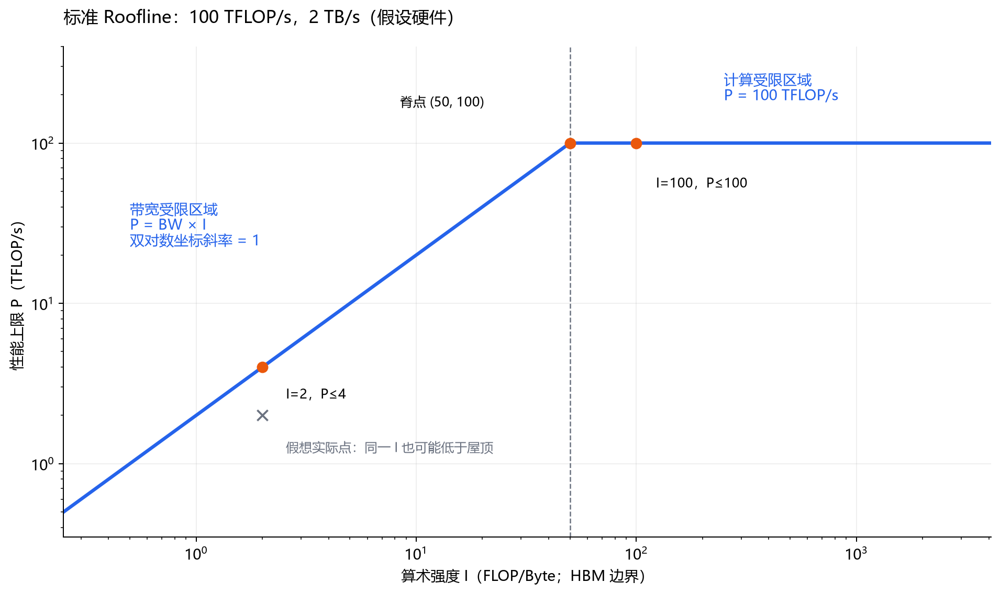
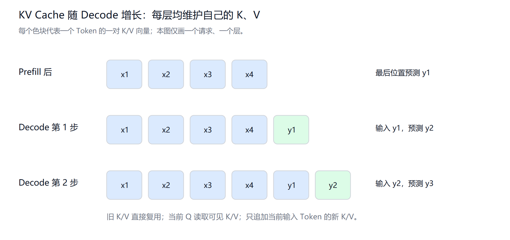

# Roofline 与 LLM 推理：基础教程

这份教程介绍理解讨论所需的核心概念：**算力与带宽如何共同限制性能，以及为什么同一个语言模型在 Prefill 和 Decode 阶段表现不同。**

## 1. Roofline：程序到底是在等计算，还是在等数据？

计算机运行程序，既要计算，也要把数据从内存搬到计算单元。可以把计算单元想成工人、内存带宽想成原料传送带：工人再多，原料送不过来也会闲着。

| 概念 | 含义 | 单位 |
|---|---|---|
| 运算量 F | 一共要做多少次浮点运算 | FLOP |
| 计算性能 P | 每秒完成多少次浮点运算 | FLOP/s，也常称 FLOPS |
| 数据传输量 D | 一次执行需要读写多少数据 | Byte |
| 内存带宽 BW | 每秒能传输多少数据 | Byte/s |

一次乘法和一次加法各计 1 FLOP；一次融合乘加（FMA）计 2 FLOP。**运算量是“多少工作”，性能是“工作做得多快”。**

### 算术强度：每搬一个字节，能算多少次？

**算术强度（Arithmetic Intensity）**把计算和搬运联系起来：

$$
I=\frac{F}{D}\qquad\text{单位：FLOP/Byte}.
$$

例如，完成 100 次浮点运算，需要从主存读写 50 Byte，则 I=2 FLOP/Byte；如果通过复用，让同样的计算只需要搬 10 Byte，I 就提高到 10。

这里的 D 要明确存储边界。本文主要统计高带宽内存（High Bandwidth Memory，HBM）与芯片内部之间的读写，**数据在寄存器里反复使用，不会每次都算作 HBM 读取。**

### 两种能力，共同决定上限

设硬件计算峰值为 $P_{\rm peak}$。计算受到两项约束：

- 计算单元每秒最多完成 $P_{\rm peak}$ 次运算。
- 内存每秒送来 BW 个字节，每字节支持 I 次运算，因此供数最多支持 $BW I$ 次运算/秒。

Roofline 取两者中较小的一个：[1][2]

$$
\boxed{P_{\rm upper}=\min(P_{\rm peak},BW\times I)}.
$$

| 情况 | 直觉 | Roofline 中的瓶颈 |
|---|---|---|
| $BW I<P_{\rm peak}$ | 计算单元吃不饱 | 内存/带宽受限（Memory-bound） |
| $BW I>P_{\rm peak}$ | 数据供给够，计算能力不够 | 计算受限（Compute-bound） |

假设硬件具有 **100 TFLOP/s 算力、2 TB/s 带宽**。两种上限相等的位置称为**脊点（Ridge Point）**：

$$
I^*=\frac{P_{\rm peak}}{BW}=\frac{100}{2}=50\ \mathrm{FLOP/Byte}.
$$

这里 T 均表示 $10^{12}$，所以可以直接相除。算例为：

| I（FLOP/Byte） | 带宽支持的性能 | 最终性能上限 |
|---:|---:|---:|
| 2 | 4 TFLOP/s | 4 TFLOP/s，受带宽限制 |
| 50 | 100 TFLOP/s | 100 TFLOP/s，位于脊点 |
| 100 | 200 TFLOP/s | 100 TFLOP/s，受计算限制 |



图 1：横轴是算术强度，纵轴是性能，均为对数坐标。左段由 $BW I$ 决定，强度越大，上限越高；右段被计算峰值截住，因此水平。图中的实际点也是假想示意。

**Roofline 是性能上限，不是实际速度保证。** 真实程序可能因并行度、指令依赖等原因明显低于屋顶线。

## 2. 和 GEMM、Cache Blocking 有什么关系？

对两个 $n\times n$ 矩阵做乘法 $C=AB$，运算量约为

$$
F\approx2n^3.
$$

但“需要做多少计算”和“实际从主存搬多少数据”是两回事。同一个矩阵元素，如果每次使用都从主存读，流量很大；如果读入 Cache 后反复使用，主存流量就会减少。

**缓存分块（Cache Blocking）**把矩阵拆成适合快存储的小块，尽量在换块前完成更多计算。因此通常有：

$$
\text{计算量基本不变，主存流量减少}
\quad\Rightarrow\quad I\text{ 增大}.
$$

这在 Roofline 图上表现为向右移动；如果原先受带宽限制，上限就可能提高。

| 熟悉的优化 | 主要作用 | Roofline 中的理解 |
|---|---|---|
| 循环换序、连续访问 | 改善局部性与访问方式 | 可能减少流量或提高有效带宽 |
| Cache Blocking | 让数据在快存储中复用 | 减少所选边界流量时，I 向右移动 |
| 寄存器复用 | 保留操作数、部分和 | 减少重复装载，改善局部数据流 |
| SIMD、FMA、循环展开 | 更充分使用计算资源 | 常使性能在相同 I 下向上靠近屋顶 |
| 使用更多已有核心 | 增加执行并行度 | 更充分利用整机算力，也可能先耗尽带宽 |

循环顺序的效果取决于行/列主序、缓存和编译器，不能认定某个顺序在所有平台都最快。SIMD 也不会自动提高芯片的物理峰值，它主要让程序更接近已有能力。

## 3. 理解 LLM，只需先认识这些部件

**大语言模型（Large Language Model，LLM）**可以理解为：根据已有文本，反复预测下一个 Token 的模型。

**Token** 是模型处理文本的离散单元，可能是一个词、词的一部分或若干字符，不一定等于一个汉字。**权重（Weights）**是模型推理时固定的参数；**激活（Activations）**是处理当前输入时产生的中间数据。

| 部件 | 可以怎样理解 |
|---|---|
| 词嵌入（Embedding） | 根据 Token ID 查表，把文字单元变成向量 |
| 自注意力（Self-Attention） | 让当前位置根据相关性，从可见位置获取信息 |
| 多层感知机（MLP） | 用多次线性变换与非线性运算加工每个位置的向量 |
| Transformer 层/块 | 包含 Attention、MLP 等操作，模型由很多层依次堆叠 |
| 输出头（LM Head） | 把最后的向量转成词表中各 Token 的分数 |

其中很多运算都可以写成**线性层**：

$$
Y=XW.
$$

X 是输入向量组成的矩阵，W 是权重矩阵。这正是熟悉的矩阵乘法，也是 Roofline 在 AI 中特别有用的原因：**大量计算具有明确的矩阵形状，而数据复用差异会直接改变算术强度。**

GPU 的 Tensor Core 等矩阵计算单元能高速执行矩阵乘加，但前提是任务规模、数据供给和执行方式适合它们，并非任何 LLM 运算都能用满峰值。

### Attention 中的 Q、K、V 是什么？

每个位置的向量会经过投影，得到三种向量：

- **Q，Query（查询）**：当前位置想找什么信息。
- **K，Key（键）**：各位置用什么特征参与匹配。
- **V，Value（值）**：匹配之后，各位置实际提供什么信息。

Attention 用 Q 与各个 K 计算相关性，再按相关性对 V 加权。它们都是模型计算出的数值向量；这些比喻只是帮助理解其作用。

生成文本时，当前位置只能关注自身及过去，不能看到未来。这由**因果掩码（Causal Mask）**保证：

```text
              可以读取的 Key 位置
                1  2  3  4
Query 位置 1    ✓  ×  ×  ×
           2    ✓  ✓  ×  ×
           3    ✓  ✓  ✓  ×
           4    ✓  ✓  ✓  ✓
```

## 4. Prefill、Decode 和 KV Cache 在做什么？

先用一个例子建立流程：输入「中国的首都是」，模型接着生成「北京。」。

```text
输入提示 → Prefill → 预测“北京”
输入“北京” → Decode → 预测“。”
输入“。” → Decode → 预测结束标记 EOS → 停止
```

上面的文字块是**示意 Token**，不是真实分词器的切分结果，也不保证模型一定生成这句话。

### Prefill：一次处理已经知道的输入

**预填充（Prefill）**对提示中的全部 Token 执行模型前向计算。因为输入已知，同一层中多个位置可以并行处理；因果掩码仍保证每个位置看不到未来。

各层的 K、V 会保存下来。最后一个输入位置的输出经过输出头，通常就能预测出**第一枚输出 Token**。

注意：同层的多个 Token 可以并行，不代表不同 Transformer 层也能完全并行；后一层仍要用前一层的结果。

### Decode：每一步处理刚生成的 Token

**解码（Decode）**每次输入刚选出的 Token，执行各层计算，再预测下一枚 Token。下一步需要本步的结果，因此标准自回归生成存在跨步骤依赖。

**键值缓存（Key-Value Cache，KV Cache）**保存每层历史位置的 K、V，使 Decode 不必每一步重新计算整个前缀：

1. 为当前输入位置计算新的 Q、K、V。
2. 当前 Q 查询旧 K/V 和当前位置的新 K/V。
3. 保存新的 K/V，供后续步骤使用。



图 2：一个请求、一个层的示意；实际每层都有自己的缓存。首次输出 $y_1$ 由 Prefill 预测；第一次 Decode 输入 $y_1$，将其 K/V 加入缓存，并预测 $y_2$。

过去位置不依赖未来的新 Token，因此其 K/V 可以复用。通常无需保存历史 Q，因为下一步要用的是**当前 Q 与历史 K/V**。

**KV Cache 减少重复计算，但没有消除历史数据读取。** 上下文越长，需要保存、读取的 K/V 通常越多。

### 为什么两个阶段性能不同？关键是矩阵形状

令 L 为输入长度，d 为隐藏维度，B 为一起执行的请求数（Batch Size）。在线性层 $Y=XW$ 中：

| 项目 | Prefill：单个长度 L 的提示 | Decode：B 个请求的一步 |
|---|---|---|
| 输入形状 | $L\times d$ | $B\times d$ |
| 权重复用 | 同一权重可服务 L 行输入 | 同一权重可服务 B 行输入 |
| 典型矩阵计算 | 多行矩阵乘法（GEMM） | B=1 时接近矩阵向量乘法（GEMV） |
| KV 行为 | 建立提示各位置的缓存 | 读取历史缓存，追加新位置 |
| 性能倾向 | 长输入线性层较容易受计算限制 | 低 Batch 较容易受带宽限制 |

区别不是 Decode 使用了更大的权重，而是**同样一遍权重读取，在 Prefill 中支持了更多计算。**

两者都执行完整模型的前向计算。“所有 Prefill 都计算受限、所有 Decode 都带宽受限”并不成立，仍要看长度、Batch、KV 和实现。

## 5. 用 Qwen-7B 级模型做一次简化估算

原始 **Qwen-7B** 具有 32 层、4096 隐藏维度、32 个注意力头，使用 MHA；不能混用 Qwen2 或 Qwen2.5 的配置。[3]

为了看清主线，采用以下**教学假设，非实测配置**：

| 项目 | 假设 |
|---|---|
| 参数规模 N | 约 $7\times10^9$，不是精确参数总数 |
| 权重精度 | FP16，每参数 s=2 Byte |
| 硬件 | 100 TFLOP/s 的稠密 FP16 矩阵算力，2 TB/s 的 HBM 带宽 |
| Prefill | 一个 1024 Token 的提示 |
| Decode | B=1，每步处理一个新位置 |
| 初始流量口径 | 权重理想复用，仅计算权重读取流量 |

### 两个近似式就能完成基本估算

一个含有 N 个权重的稠密线性计算，每个权重参与一次乘法和一次加法，因此每 Token 的运算量可粗估为

$$
F_{\rm token}\approx2N=14\ \mathrm{GFLOP}.
$$

权重大小约为

$$
M_w\approx Ns=14\ \mathrm{GB}.
$$

此处 G 表示 $10^9$。$2N$ 主要近似稠密线性层，未覆盖全部 Attention 等操作；14 GB 是教学权重规模，不等于真实每次执行的全部 HBM 流量。

### Prefill：一遍权重服务 L 个输入位置

运算量乘以 L，但理想权重读取仍是一遍：

$$
F_{\rm prefill}\approx2NL,\qquad
I_{\rm prefill}\approx\frac{2NL}{Ns}=\frac{2L}{s}.
$$

FP16 下 $I\approx L$。L=1024 时，I≈1024 FLOP/Byte，远大于脊点 50，所以**仅权重模型下受计算限制**。

### Decode：B=1 时，一遍权重只服务一个位置

$$
I_{\rm decode}\approx\frac{2N}{Ns}=\frac2s
=1\ \mathrm{FLOP/Byte}.
$$

这远低于脊点 50。2 TB/s 的带宽只能支持约 2 TFLOP/s，所以**仅权重模型下受带宽限制**。

| 指标 | Prefill：L=1024 | Decode：B=1，一步 |
|---|---:|---:|
| 近似运算量 | 14.336 TFLOP | 14 GFLOP |
| 理想权重读取 | 14 GB | 14 GB |
| 权重级算术强度 | 1024 FLOP/Byte | 1 FLOP/Byte |
| Roofline 性能上限 | 100 TFLOP/s | 2 TFLOP/s |
| 简化模型时间下界 | 143.36 ms | 7 ms |

时间下界可用下式理解：计算要花时间，搬运也要花时间，即使完全重叠，也不能比两者中较长的那个更短。

$$
t\ge\max\left(\frac{F}{P_{\rm peak}},\frac{D}{BW}\right).
$$

例如 Decode 读取 14 GB 权重至少需要 $14\ \mathrm{GB}/(2\ \mathrm{TB/s})=7$ ms。**这些数字都是简化模型的理论估计，不是 Qwen 实际运行结果。**

### Batch 和长上下文会怎样改变判断？

B 个请求一起 Decode，可以共享一次权重读取，运算量约为 $2NB$。因此，权重主导且复用有效时：

$$
I_{\rm decode}\approx\frac{2B}{s}.
$$

FP16 下约为 B，Batch 增大能够提高权重复用。但各请求的 KV 也随之增加，不能只用这个式子预测全部流量。

原始 Qwen-7B 的 MHA 在 FP16 KV 假设下，单请求缓存 1024 个位置约需 **512 MiB**；缓存 8192 个位置约需 **4 GiB**。这是按每层、每位置分别存 K 和 V 推算的容量。若每步读取一遍旧 KV，还会产生相应量级的额外流量。

所以，长上下文 Decode 可能从“主要读权重”转为“KV 读取也很重要”。**Batch 提高总吞吐，不保证单个请求的每 Token 延迟同比降低。**

## 6. 这些概念能指导哪些优化与硬件选择？

Roofline 的作用是先判断约束在哪里，再选择对症的方法：

| 方法 | 为什么可能有用？ |
|---|---|
| 批处理（Batching） | 多个请求复用权重，把多次小计算组织成更大的矩阵计算 |
| 权重量化（Quantization） | 用更少字节保存权重，减少容量与读取需求；也有精度和反量化代价 |
| FlashAttention | 对 Attention 分块和融合，减少中间结果在 HBM 的读写；与 Cache Blocking 思路相通 [4] |
| GQA / MQA | 多个 Query 头共享 K/V，减少 KV 数据；属于模型结构选择，不能随意替换已训练模型的注意力配置 |

如果设计加速器，$P_{\rm peak}/BW$ 表示计算与带宽的配比：

- **低 Batch、低延迟 Decode：** 优先关注带宽、容量和执行开销；单纯堆计算单元可能收效有限。
- **高 Batch Decode：** 权重摊薄后，计算与 KV 都可能成为约束，需要重新估算。
- **长输入 Prefill：** 通常更需要高效矩阵算力、片上复用与 Attention 优化。

**容量与带宽不同：容量决定“装不装得下”，带宽决定“每秒搬得了多少”。** 模型能装进显存，不代表能快速推理；更高带宽也不能代替不足的容量。

没有对所有 LLM 推理都最好的固定算力/带宽比例，选择取决于目标 Batch、上下文长度、延迟需求和成本。

## 7. Roofline 能解释什么，不能解释什么？

它擅长回答：给定计算量和数据流量，**算力与带宽谁构成更紧的上限？** 但真实时间还会受其他因素影响：

| 被简化掉的因素 | 为什么会影响推理？ |
|---|---|
| 访问延迟 | 带宽再高，也可能等某次数据返回 |
| Cache 与存储层次 | HBM 不忙，不代表片上数据通路不忙 |
| Kernel 启动、同步 | 很多小操作的固定开销可能不可忽略 |
| 并行度与指令依赖 | 数据足够，也可能没有足够独立工作喂满计算单元 |
| 算子与精度差异 | GEMM、softmax、归一化不一定使用同一类执行单元 |
| 多卡通信与服务调度 | 单卡算得快，也可能在等通信、请求或下一步调度 |

因此，实际点低于屋顶线时，需要进一步分析，不能全部归因于“内存不够快”。同样，也不能用标称峰值直接当作模型实际 FLOP/s。

还有两个常见体验指标：**TTFT（Time To First Token）**是用户等到首 Token 的时间，主要受 Prefill 及排队等影响；**TPOT（Time Per Output Token）**反映后续每 Token 的平均生成时间，主要受 Decode 影响。它们帮助区分“开始回答有多快”和“之后输出有多快”。

记住一条主线即可：**数据复用决定算术强度；算术强度与硬件配比共同决定 Roofline 上限；真实速度还取决于实现与系统开销。**

### 参考资料

- **[1]** Williams, S., Waterman, A., & Patterson, D. (2009). *Roofline: An Insightful Visual Performance Model for Multicore Architectures*. Communications of the ACM, 52(4), 65–76. [论文 DOI](https://doi.org/10.1145/1498765.1498785)。
- **[2]** NERSC. *Roofline Performance Model*. [官方指南](https://docs.nersc.gov/tools/performance/roofline/)。
- **[3]** Qwen Team. 原始 Qwen-7B 的[官方配置](https://huggingface.co/Qwen/Qwen-7B/blob/main/config.json)、[实现](https://huggingface.co/Qwen/Qwen-7B/blob/main/modeling_qwen.py)及 [Qwen Technical Report（2023）](https://arxiv.org/abs/2309.16609)。
- **[4]** Dao, T., et al. (2022). *FlashAttention: Fast and Memory-Efficient Exact Attention with IO-Awareness*. NeurIPS 2022. [论文](https://arxiv.org/abs/2205.14135)。

本版复用已核实的资料与图表，保留基础概念和教学估算。需要进一步查看公式细节与实验方法时，可读[完整教程](roofline_llm_tutorial.md)。
