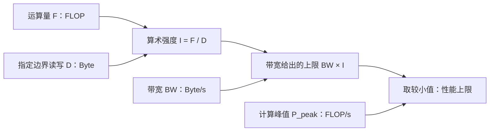
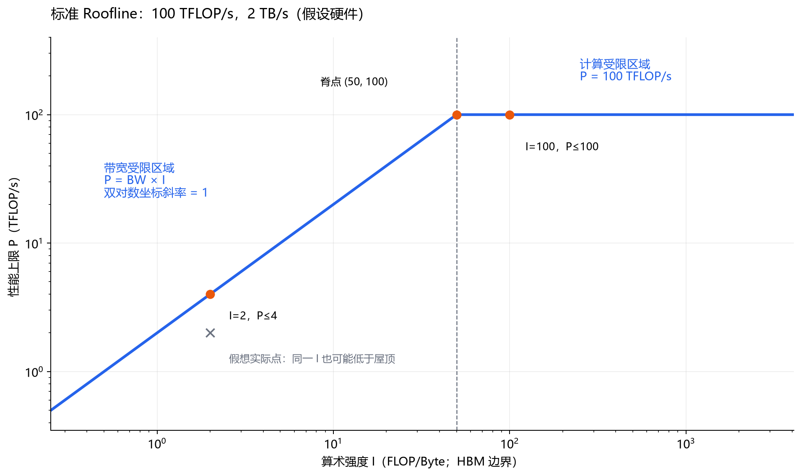
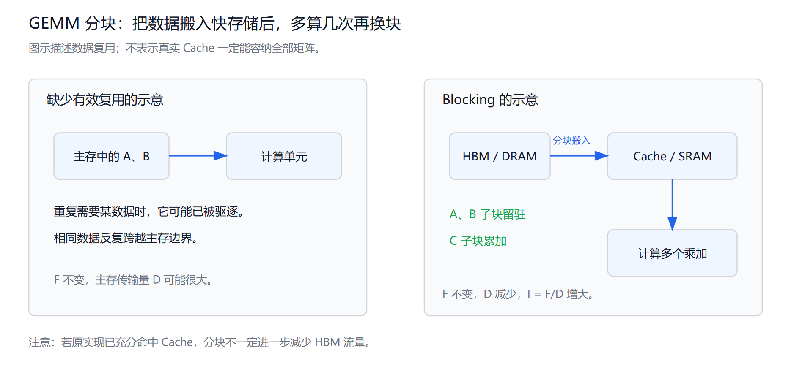
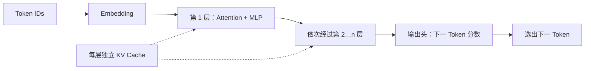
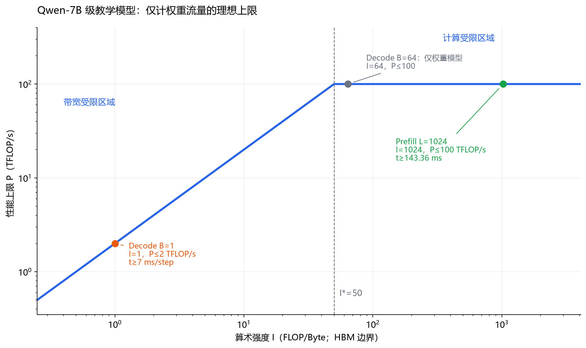
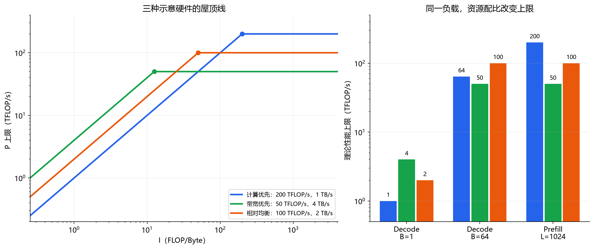
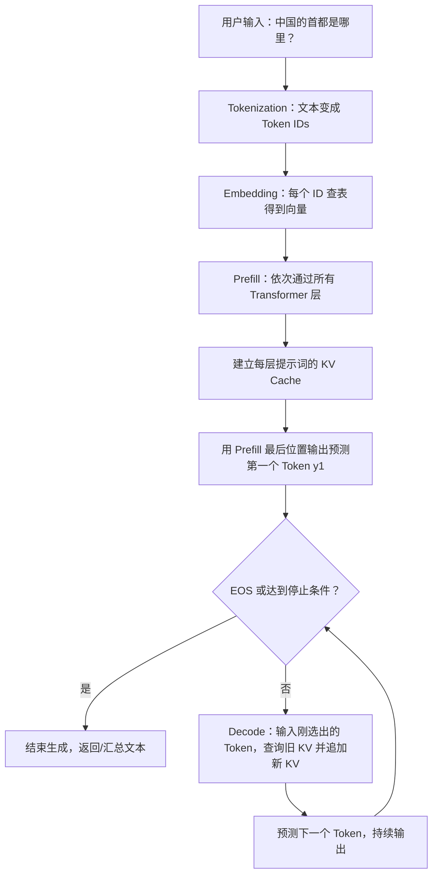
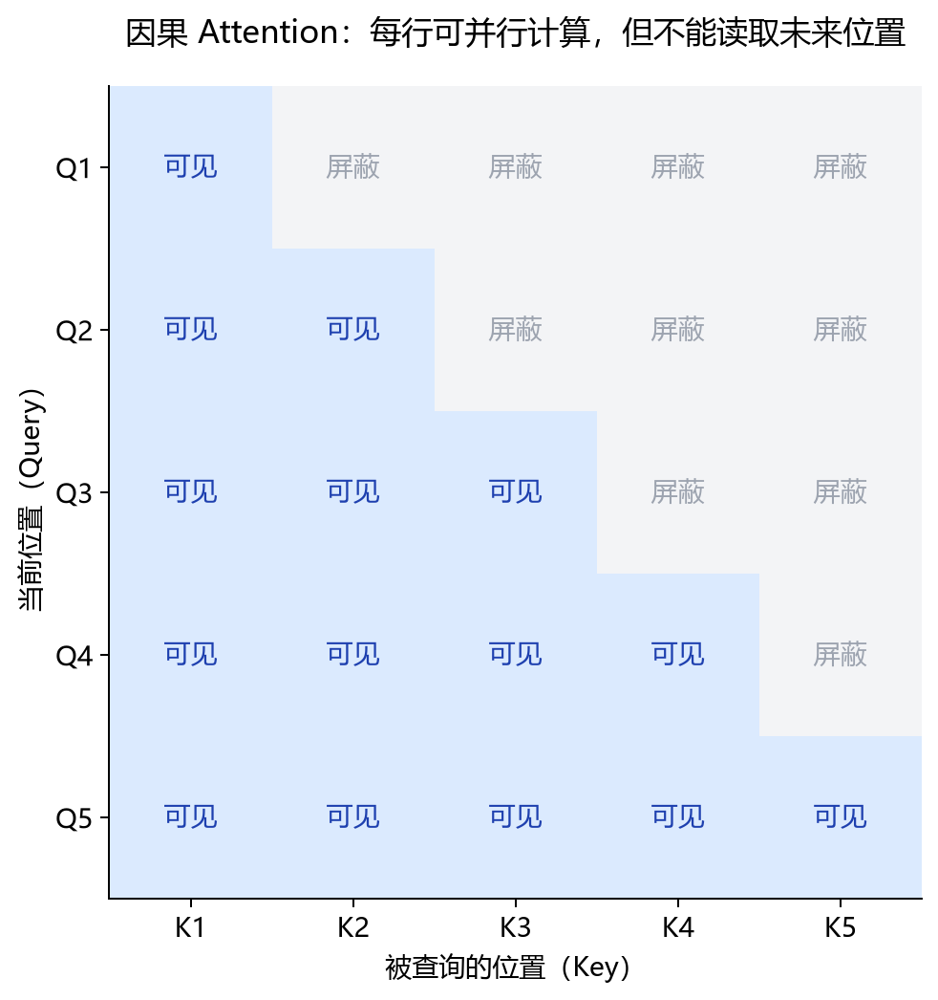
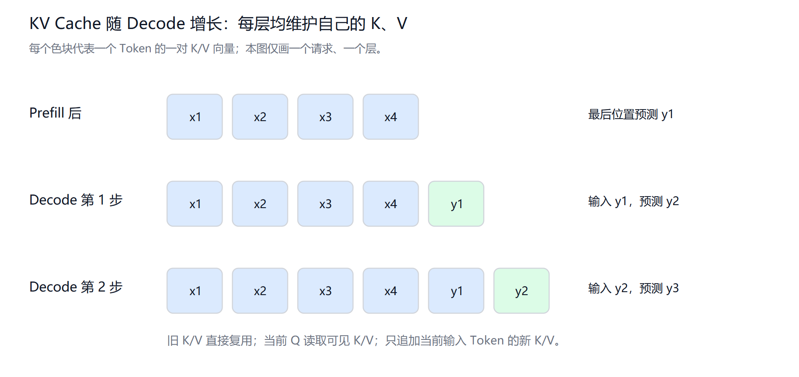

# Roofline 模型及其在 LLM 推理中的应用

> 面向计算机系统结构课程的小组学习教程。资料核实日期：2026-11-15。全文采用“直觉 → 公式 → 应用”的顺序；不了解语言模型的同学，可先读第七章，再回到第三、四章。
>
> **数据身份说明：** 官方模型配置会注明来源；100 TFLOP/s、2 TB/s 等硬件指标均为教学假设，未对应某款真实芯片。所有性能图与算例均为理论估计；10 ms/Token 为模拟情形。本文没有下载模型、运行 GPU 推理或采集真实性能数据。

本教程的学习主线是：**数据搬进来以后能算多少次 → 硬件能否及时供数 → Prefill 与 Decode 为什么不同 → 应该优化软件还是调整硬件配比。**

| 阅读位置 | 要能回答的问题 |
|---|---|
| 第一章 | 两段屋顶线从哪里来？一个点怎样判断瓶颈？ |
| 第二章 | GEMM 分块、SIMD 分别改变 Roofline 的什么？ |
| 第三章 | 同一个线性层，为什么处理一行和很多行会不同？ |
| 第四章 | 如何亲手完成 Qwen-7B 级模型的估算与测量设计？ |
| 第五章 | 为什么落在屋顶线下方不一定是带宽问题？ |
| 第六章 | 面向不同推理负载，应怎样配置计算与存储？ |
| 第七章 | Prefill、Decode、KV Cache 到底在做什么？ |

全文约定：乘法与加法各计 1 次浮点运算；一次融合乘加（Fused Multiply-Add，FMA）计 **2 FLOP**，不是 1 FLOP。GB、TB、TFLOP/s 使用十进制：$10^9$ Byte、$10^{12}$ Byte、$10^{12}$ FLOP/s；GiB 使用二进制：$2^{30}$ Byte。Byte 是字节，8 bit = 1 Byte。

## 第一章：Roofline 模型是什么？

**本章要解决：一台机器算力很高，程序为什么仍然跑不快？**

### 1.1 先把计算单元想成一间加工车间

车间有两项能力：每秒最多加工多少件，以及原料传送带每秒能送来多少原料。如果每送来一份原料，只做很少的加工，工人容易等料；如果一份原料可以反复加工，车间就容易把工人用满。

对应到计算机：工人是计算单元，传送带是内存系统，“一份数据能支持多少计算”就是**算术强度（Arithmetic Intensity，AI）**。这里的 AI 是强度缩写；第三章讨论的人工智能（Artificial Intelligence）是另一个意思。

**计算受限（Compute-bound）**表示计算吞吐能力构成主要上限；**内存受限（Memory-bound）**表示内存系统构成主要限制。在基本 Roofline 中，后者特指**带宽上限**；真实内存问题还可能来自访问延迟。

Roofline 由 Williams、Waterman、Patterson 提出，经典论文发表于 2009 年。它把运算吞吐、数据搬运和程序特征画在一张图上，为多核时代的性能优化提供直观依据。[1](https://doi.org/10.1145/1498765.1498785)

| 对比维度 | Compute-bound | 带宽型 Memory-bound |
|---|---|---|
| 直觉 | 原料供应够，工人加工不过来 | 每份原料加工少，工人等待供料 |
| Roofline 条件 | $BW I>P_{\rm peak}$ | $BW I<P_{\rm peak}$ |
| 常见任务形态 | 充分复用的大规模矩阵乘法 | 流式扫描、低复用矩阵向量乘法 |
| 优先检查 | 向量化、矩阵单元利用、并行度 | 流量、复用、访问连续性、可用带宽 |
| 单独增加计算单元 | 可能提高上限 | 此模型下通常不提高上限 |
| 单独增加主存带宽 | 此模型下通常不提高上限 | 可能提高上限 |

这些是**模型内的判别**，不是不看实现就能下的实测结论。

### 1.2 四个量，各自回答什么问题？

| 名称 | 符号与单位 | 回答的问题 |
|---|---|---|
| 浮点运算次数（Floating-Point Operations） | $F$，FLOP | 一共算了多少？ |
| 浮点性能/吞吐率 | $P$，FLOP/s，常简称 FLOPS | 每秒算了多少？ |
| 内存带宽（Memory Bandwidth） | $BW$，Byte/s | 每秒搬了多少字节？ |
| 算术强度 | $I$，FLOP/Byte | 每跨越指定存储边界的 1 Byte，支持多少计算？ |

“任务需要 14 GFLOP”是工作量；“硬件有 100 TFLOP/s”是处理速率，不能直接比较两个数字。带宽统计包括指定边界上的**读取与写入**，不是只看输入文件大小。

设 $D$ 是一次执行在指定存储边界上的总传输量，则

$$
I=\frac{F}{D}.
$$

例如，执行 $8\times10^9$ FLOP，读写主存共 $4\times10^9$ Byte，主存级算术强度就是 $2$ FLOP/Byte。它不表示“每个变量只计算两次”，而是整个代码区间的运算量与主存流量之比。改变缓存命中情况，$D$ 就可能改变。

### 1.3 从执行时间推导两段屋顶线

设硬件峰值计算性能为 $P_{\rm peak}$，所选存储边界带宽为 $BW$。

1. 完成 $F$ 次运算，即使计算单元全速运行，也至少需要 $F/P_{\rm peak}$ 秒。
2. 搬运 $D$ Byte，即使带宽用满，也至少需要 $D/BW$ 秒。
3. 即使计算与搬运能够理想重叠，总时间仍不能小于两者的较大值：

$$
t\ge\max\left(\frac{F}{P_{\rm peak}},\frac{D}{BW}\right).
$$

因此，$P=F/t$ 满足

$$
P\le\min\left(P_{\rm peak},BW\frac{F}{D}\right).
$$

我们把右侧记为 Roofline 的可达性能上限：

$$
\boxed{P_{\rm attainable}=\min(P_{\rm peak},BW\times I)}.
$$

单位也能验证：$(\mathrm{Byte/s})\times(\mathrm{FLOP/Byte})=\mathrm{FLOP/s}$。它是一个**乐观上限**；计算与访存重叠不充分、调度和同步等都会让时间更长。



图 1-1：程序的运算与流量决定 $I$；硬件的计算与带宽共同限制性能。即使阅读器不支持 Mermaid，上方推导也给出了相同关系。

### 1.4 标准示例：100 TFLOP/s 与 2 TB/s

交点处两种上限相等：$BW I^*=P_{\rm peak}$，所以**脊点（Ridge Point）**为

$$
\boxed{I^*=\frac{P_{\rm peak}}{BW}
=\frac{100\times10^{12}}{2\times10^{12}}
=50\ \mathrm{FLOP/Byte}}.
$$

| $I$（FLOP/Byte） | $BW I$（TFLOP/s） | Roofline 上限（TFLOP/s） | 理论判断 |
|---:|---:|---:|---|
| 2 | 4 | 4 | 带宽受限 |
| 50 | 100 | 100 | 正好位于脊点；两种约束同样紧 |
| 100 | 200 | 100 | 计算受限 |



图 1-2：横轴为算术强度，纵轴为性能，均为对数坐标。左段满足 $P=BW I$，在双对数图上斜率为 1；右段满足 $P=P_{\rm peak}$，因此水平。在线性坐标中左段斜率是 $BW$，不应把两种“斜率”混淆。所有点均为教学示意。

在此硬件上，$I<50$ 时，提高复用往往可以把任务沿带宽斜线向右上方推进；$I>50$ 后，即使进一步减少流量，也不能突破 100 TFLOP/s 的计算屋顶。

### 1.5 上限点与实际点必须分开

实际运行还需时间 $t$。其纵坐标是 $F/t$，横坐标是同一执行区间的 $F/D$。比如 $I=2$ 的任务实际只达到 2 TFLOP/s，它在 4 TFLOP/s 屋顶线下方；可能是带宽未用满，也可能是并行度、依赖或启动开销限制。

**Roofline 告诉你“在这些假设下最多能多快”，不承诺“运行就会这么快”。** 若实测点超过所画屋顶，先核查峰值、精度、稀疏模式、FMA 计数、缓存边界与计时口径是否一致。

小练习：把带宽从 2 提高到 4 TB/s、算力保持不变，$I=2$ 的上限变成 8 TFLOP/s，脊点降至 25 FLOP/Byte；$I=100$ 的上限仍是 100 TFLOP/s。

## 第二章：结合计算机系统结构理解 Roofline

**本章要解决：已经做过的 Cache 与 GEMM 优化，怎样映射到这张图？**

### 2.1 先选清楚“数据从哪里搬到哪里”

CPU 的典型路径是：主存 → L3 → L2 → L1 → 寄存器（Register）→ 计算单元。GPU 常见 HBM → L2 → L1/共享内存（Shared Memory）→ 寄存器；具体结构依芯片而异，不应假设每块 GPU 都有 CPU 式 L3。

| 层级 | 对本主题最重要的性质 | 复用带来的效果 |
|---|---|---|
| 寄存器 | 靠近运算单元，容量小 | 避免反复装载操作数与部分和 |
| L1/L2/L3 Cache | 缓存主存数据，容量逐级变化 | 命中可减少更低层的数据读取 |
| 片上 SRAM/共享内存 | 可由 Kernel 显式安排分块 | 留住子块，支持协作复用 |
| DRAM / 高带宽内存（High Bandwidth Memory，HBM） | 容量较大，但供数速率有限 | 提供权重、激活和 KV 数据 |

计算单元发出请求后，如果数据还没到，它就可能等待。大量独立请求可以隐藏部分延迟，但不能让每秒传输量无限增长。

本文主要使用 **HBM ↔ 片上缓存/计算系统** 的读写流量。数据在寄存器里反复使用，不会每次都算作 HBM 读取。若改画 L1 级 Roofline，必须改用对应边界的 $D_{L1}$ 和带宽；不能把 HBM 的 $I$ 直接配上 L1 带宽。[2](https://docs.nersc.gov/tools/performance/roofline/)

### 2.2 从矩阵乘法看“数学工作量相同，数据搬运不同”

令 $C=AB$，三个矩阵均为 $N\times N$。每个 $C_{ij}$ 是长度为 $N$ 的点积：$N$ 次乘法、$N-1$ 次加法。因此

$$
F=N^2(2N-1)\approx2N^3\ \mathrm{FLOP}.
$$

假设每元素 $s$ Byte，计算 $C=AB$、无需读取旧 $C$。如果 A、B 各从主存读一次、C 写一次，理想数据量为 $3sN^2$，于是

$$
I_{\rm ideal}\approx\frac{2N^3}{3sN^2}=\frac{2N}{3s}.
$$

这是假想的充分复用流量，**不是所有大小的 GEMM 都能达到的主存流量**。有限 Cache 容量可能迫使子块重复装入；$C\leftarrow AB+C$ 还需读旧 C，写分配等也可能增加流量。

#### 循环顺序为什么有影响？

以**行主序（Row-major）**存储为例：

| 顺序 | 最内层操作的典型模式 | 可能影响 |
|---|---|---|
| ijk | A 沿行前进，B 沿列前进 | B 跨行步长大，空间局部性可能较差；C 点积可在寄存器累加 |
| ikj | 固定 $A_{ik}$，沿 B、C 的一行更新 | B、C 连续，有利于向量化及 A 标量复用 |
| kij | 固定 k，对多个 i 扫描 B 的一行 | 可复用 B 行，但 C 多行反复更新，效果依缓存容量而变 |

如果矩阵足够小、已全部留在 Cache，顺序变化可能主要影响向量化或指令依赖，而不是 HBM 流量。列主序、预取、编译器变换、矩阵尺寸也会改变结论。因此不能断言 ikj 在所有平台都最快。

#### Cache Blocking 为什么能提高强度？

缓存分块（Cache Blocking/Tiling）把大矩阵拆成小块。例如把 A、B 的 $b\times b$ 子块放入快存储，用它们更新 C 子块。一次块更新约执行 $2b^3$ FLOP；若 A、B 各读一块、C 读写一块，则块边界数据量约为 $4sb^2$，块级强度约为 $b/(2s)$。若 C 块在多个 k 块期间一直保留，还能摊薄 C 的读写。

这个局部估算说明：计算随 $b^3$ 增长，搬运随 $b^2$ 增长。但 b 太大放不进 Cache/共享内存，就会失去预期收益。多级分块还要配合寄存器微内核。



图 2-1：分块通常不改变数学运算量，却可能减少穿越主存边界的字节数。图中“缺少复用”是一种执行情况，不代表所有未手工分块代码都如此。

在 Roofline 图上，**$F$ 基本不变、HBM 流量下降 → $I$ 增大 → 点向右移动**；如果受带宽限制，上限也可能提高。已有实现充分复用时，分块收益可能来自更高层存储或指令安排，不能机械地认为 HBM 强度必然增加。

### 2.3 计算资源优化与数据流优化要区分

单指令多数据（Single Instruction Multiple Data，SIMD）能在一条指令中处理多个元素。例如 AVX2 的 256 bit 向量可容纳 8 个 FP32；**支持相应 FMA 指令时**，一次向量 FMA 计 16 FLOP。每周期能发射几条、频率是否下降等还取决于微架构。

寄存器微内核保存若干 C 部分和，让 A、B 的装载服务多个乘加。循环展开与多个独立累加器可减少控制开销、缓解依赖；多核增加并行工作，也可能更快耗尽共享内存带宽。它们并不保证同样比例的加速。

| 优化技术 | 直接改变什么 | Roofline 中的典型效果 | 不应误解为 |
|---|---|---|---|
| 循环换序、连续访问 | Cache 行利用、访问模式 | 可能降低 D；也可能提高实际带宽 | 数学 FLOP 数变少 |
| Cache Blocking | 数据复用与低层传输 | D 降低时 I 右移 | 自动增加物理 HBM 带宽 |
| 寄存器复用/微内核 | 寄存器与缓存之间流量、依赖 | 更接近局部存储或计算天花板；也可能减少低层流量 | 所有层级的 I 都同时增大 |
| SIMD / AVX2 / FMA | 已有执行单元的利用率 | 相同 I 下性能可能向上，跨过较低的软件天花板 | 执行这段代码就改变芯片物理峰值 |
| 循环展开、独立累加器 | 指令级并行与依赖 | 靠近计算天花板；过度展开可能溢出寄存器 | 必然减少 HBM 流量 |
| 多核/多线程 | 使用更多既有资源 | 若原图按整芯片峰值，通常是向屋顶靠近 | 原有整芯片屋顶自动升高 |
| 更换为更多计算单元的硬件 | 物理计算峰值 | 水平屋顶升高、脊点可能右移 | 低 I 负载一定加速 |
| 增加物理内存带宽 | 物理传输能力 | 带宽斜线抬高、脊点左移 | 容量同时必然增大 |

表 2-1：体系结构优化 → Roofline 效果。读图时依次问：**D 变了吗？利用率变了吗？硬件本身变了吗？**

## 第三章：Roofline 在 AI 领域中的应用与优势

**本章要解决：为什么许多 AI 程序都在做矩阵计算，瓶颈却并不相同？**

### 3.1 矩阵计算很多，不等于峰值算力一定用满

神经网络通过许多带参数的运算把输入向量映射为输出。推理时固定的参数称为**权重（Weights）**；中间产生的数据称为**激活（Activations）**。线性层和注意力包含大量矩阵乘法，所以适合用“计算量 + 数据搬运”的方法分析。

GPU 的 **Tensor Core（张量计算核心）**等专用矩阵单元可以高吞吐执行小块矩阵乘加。但权重和激活仍需从 HBM 搬入片上存储。矩阵太小、形状不适合分块、数据供给不足，都会让矩阵单元闲置。比较硬件时还必须匹配精度、累加方式以及稠密/稀疏模式；本文假设的 100 TFLOP/s 指支持 FP16 输入的**稠密矩阵计算峰值**，不借用稀疏或其他精度的数字。

### 3.2 用一个线性层理解 GEMM 与 GEMV

考虑 $Y=XW$，其中 $X\in\mathbb R^{M\times K}$、$W\in\mathbb R^{K\times H}$、$Y\in\mathbb R^{M\times H}$。M 是同时处理的 Token 行数，K 是输入维度，H 是输出维度。

$$
F\approx2MKH.
$$

若三个矩阵都采用每元素 s Byte、X/W 各读一次、Y 写一次，则

$$
D_{\rm ideal}\approx s(MK+KH+MH),\qquad
I_{\rm ideal}\approx\frac{2MKH}{s(MK+KH+MH)}.
$$

在**权重项 $KH$ 主导流量**时，再进一步简化：

$$
I_{\rm weights}\approx\frac{2MKH}{sKH}=\frac{2M}{s}.
$$

取 $K=H=4096$、FP16（s=2），得到下表。MB 为十进制，流量均为理想估计。

| 同时处理的行数 M | 矩阵形状 | 计算量 | 权重大小 | X/W/Y 总流量 | 完整理想 I | 仅权重 I |
|---:|---|---:|---:|---:|---:|---:|
| 1 | $1\times4096$ 乘 $4096\times4096$ | 33.55 MFLOP | 33.55 MB | 33.57 MB | 约 1.00 | 1 |
| 1024 | $1024\times4096$ 乘 $4096\times4096$ | 34.36 GFLOP | 33.55 MB | 50.33 MB | 约 682.67 | 1024 |

M=1 时数学上是**矩阵向量乘法（Matrix-Vector Multiplication，GEMV）**的等价形态，每个权重主要服务一行。M 很大时是**通用矩阵乘法（General Matrix-Matrix Multiplication，GEMM）**，同一权重可以服务很多行。实际库可能用统一 GEMM 接口或专用 Kernel 实现，名称不决定性能。

特别留意第二行：1024 是**只算权重字节的强度**；加入输入输出后已降至 682.67。第四章也必须保留这个区别。

### 3.3 只学理解推理所需的 Transformer

**大语言模型（Large Language Model，LLM）**接收一串 Token，预测下一个 Token。Token 是词表中的离散单元，可能对应词、词的一部分或若干字符，不一定等于一个汉字。

| 部件 | 在推理中做什么 | 和计算/存储的联系 |
|---|---|---|
| 词嵌入（Embedding） | 把 Token ID 查表变成向量 | 查表不是扫描全部嵌入参数做 GEMM |
| 自注意力（Self-Attention） | 按相关性混合当前和历史位置的信息 | 既有投影矩阵乘法，也有跨 Token 的计算与 KV 读取 |
| 多层感知机（Multi-Layer Perceptron，MLP） | 在每个位置上变换特征 | 大量稠密线性层，权重复用很重要 |
| Transformer 块（Transformer Block） | 依次执行注意力、MLP，以及归一化和残差连接 | 模型由很多层堆叠，层间存在数据依赖 |
| 键值缓存（Key-Value Cache，KV Cache） | 保存每层历史位置的 K、V 向量 | 减少重复计算，但占用容量与读取带宽 |
| 输出头（LM Head） | 从最后位置的向量得到词表分数 | 通常是投影到词表的大矩阵运算 |



图 3-1：这是功能简图，归一化、残差与位置编码未展开。Prefill 和 Decode 都经过完整的 Transformer 前向计算（Forward Pass）。

### 3.4 Prefill 与 Decode：同一模型，两种计算形状

**预填充（Prefill）**处理已经知道的输入提示词（Prompt）。同一层内可以并行处理很多输入位置，通常形成较大的 GEMM；但第 2 层仍需等待第 1 层结果。

**逐步解码（Decode）**在标准自回归生成中，每次为每个活跃请求处理一个新位置，预测下一个 Token。跨生成步骤存在依赖：还不知道下一个 Token 是什么，就不能把它当作确定输入继续计算。B 个独立请求可以一起前向，形成 B 行矩阵。

| 项目 | Prefill（一个长度 L 的输入） | Decode（B 个活跃请求的一步） |
|---|---|---|
| 线性层输入 | $L\times d$ | $B\times d$ |
| 并行来源 | 已知提示中的多个位置 | 不同请求；单请求跨步有依赖 |
| 权重复用 | 同一权重服务 L 个位置 | 同一权重服务 B 个位置 |
| KV 行为 | 建立各层提示词 K/V | 读取旧 K/V，并追加当前位置 K/V |
| Roofline 倾向 | 长输入的线性层更容易靠近计算区 | 低 B 更容易受权重/KV 带宽约束 |
| 例外 | 短输入、长缓存前缀、低效小 Kernel | 高 B、量化、投机解码、通信主导等 |

### 3.5 Roofline 的价值：先定位，再选策略

它把两类资源放在同一尺度上：由 F、D、t 统一计算强度和吞吐；由任务落在哪个区域识别主要上限；再选择减少流量、提高并行度或增加算力。把同一任务放到多块硬件的屋顶线下，还能比较哪种硬件配比更合适。由此也能讨论“改变模型结构能否更适配硬件”，形成硬件与算法协同设计的依据。[6](https://arxiv.org/abs/2402.16363)

| 策略 | 改变的核心因素 | 与熟悉知识的联系 | 需要付出的代价 |
|---|---|---|---|
| FlashAttention | 分块与融合，避免把完整注意力分数矩阵写回 HBM | 把 Cache Blocking 用于注意力的数据流 | 片上资源约束，具体收益依形状与实现 |
| 量化（Quantization） | 减少权重或 KV 的每元素字节数 | 同样计算可少搬数据 | 误差、缩放元数据、反量化与新精度 Kernel |
| 批处理（Batching） | 多请求共享一次权重加载 | 把多次 GEMV 合并成更像 GEMM 的工作 | 等待时间、KV 容量与总流量增加 |

FlashAttention 是精确注意力的 IO 优化，并不是简单“删掉注意力计算”；它通过片上分块和在线归一化减少 HBM 访问，不保证数学 FLOP 数下降。[5](https://arxiv.org/abs/2205.14135) 三种策略改变的东西不同，不能笼统画成“算力提升”。

## 第四章：以 Qwen-7B 为例的 Roofline 分析框架

**本章要解决：面对一个具体模型，怎样依次确定对象、估算工作量、画上限、设计测量？**

### 4.1 确定分析对象和实验假设

#### 第一步：确认是原始 Qwen-7B

本文分析对象为 **`Qwen/Qwen-7B` 原始基础模型**，不是 Qwen-7B-Chat，也不是 Qwen2-7B 或 Qwen2.5-7B。下表来自官方配置、实现与技术报告；源码核查尤其重要，因为原始配置没有单独列出 `num_key_value_heads` 字段。

| 项目 | 原始 Qwen-7B 的核实结果 | 依据 |
|---|---|---|
| 官方规模名称 | 7B 级；报告表 1 标作 7B | [4] |
| 层数 $n_\ell$ | 32 | [3b] |
| 隐藏维度 d | 4096 | [3b] |
| Query 头数 $h_q$ | 32 | [3b] |
| 每头维度 $d_h$ | 128；$32\times128=4096$ | [3b] |
| KV 头数 $h_{kv}$ | 32，标准多头注意力（Multi-Head Attention，MHA） | [3c] 中 Q/K/V 等宽投影与拆分 |
| 词表大小 V | 151936；嵌入与输出权重不共享 | [3b] |
| MLP 维度解释 | config 的 `intermediate_size=22016`；源码中两条门控分支各为 11008 | [3b][3c] |
| 官方权重/训练精度信息 | 模型页张量类型为 BF16；报告描述 BF16 混合精度训练 | [3a][4] |
| 本文选择的推理精度 | **FP16，2 Byte/参数**，属于教学设定 | 不声称官方权重原本就是 FP16 |

来源：[官方模型页 3a](https://huggingface.co/Qwen/Qwen-7B)、[配置 3b](https://huggingface.co/Qwen/Qwen-7B/blob/main/config.json)、[实现 3c](https://huggingface.co/Qwen/Qwen-7B/blob/main/modeling_qwen.py)、[技术报告 4](https://arxiv.org/html/2309.16609v1)。这些网页的 `main` 可更新；正式复现实验应另外记录使用的提交 SHA。

**“7B”不是精确参数清单。** 根据上述配置与官方实现，自行按张量维度推算：每层注意力权重 $4d^2$，MLP 权重 $3d\times11008$，QKV 偏置 $3d$，两组归一化权重 $2d$；另有最终归一化 d 和不共享的嵌入/输出矩阵 $2Vd$。因此

$$
N_{\rm config}=32(4d^2+3d\cdot11008+3d+2d)+d+2Vd
=7{,}721{,}324{,}544\approx7.72\times10^9.
$$

这是**依据官方实现进行的维度计数推导**，不是官方报告直接给出的精确数字，也不是本机加载后的 `numel()` 结果。若所有参数均用 2 Byte 保存，对应约 15.44 GB（14.38 GiB）。嵌入查表不对全部参数逐一乘加，输出头也可能仅处理最后位置，因此仍不能拿精确总参数数机械替代所有计算量。

#### 第二步：冻结一套便于手算的教学配置

| 量 | 本章统一使用的值 | 数据身份 |
|---|---:|---|
| 参与粗估的参数规模 N | $7\times10^9$ | 7B 级教学近似，不是精确 `numel()` |
| 每参数字节数 s | 2 Byte | FP16 推理假设 |
| 稠密 FP16 矩阵计算峰值 | 100 TFLOP/s | 假设硬件 |
| HBM 峰值带宽 | 2 TB/s | 假设硬件 |
| Prefill 批大小、输入长度 | 1、L=1024 Token | 假设负载 |
| Decode 批大小 | B=1；扩展讨论 B=64 | 假设负载 |
| KV 精度 | FP16，$s_{kv}=2$ Byte | 单独声明的假设 |
| 数据边界 | HBM 与片上存储之间，读 + 写 | 全章统一口径 |
| 初始流量模型 | 每次前向理想读取一遍有效权重，忽略其他流量 | 简化模型 |

以下 **14 GB、14 GFLOP/Token、143.36 ms、7 ms** 全部由这张教学配置表推导，不能与上面的 7.72B 精细计数交叉拼接。

### 4.2 建立简化模型：先分清“放着多少”和“搬了多少”

#### 为什么每 Token 约 $2N$ FLOP？

先看一个权重矩阵 $W\in\mathbb R^{a\times b}$，有 $ab$ 个参数。一行输入乘 W，需要约 $ab$ 次乘法、$ab$ 次加法，合计约 $2ab$ FLOP。如果模型以稠密线性层为主，对每个 Token 使用这些矩阵，累加后可写成

$$
\boxed{F_{\rm token}\approx2N}.
$$

严格地说，N 最适合表示每 Token 实际经过的稠密投影权重规模。本教程用全模型的 7B 规模代理它，以建立数量级直觉。Embedding 查表、输出头的位置选择、归一化、非线性函数，以及 Attention 的 $QK^\top$ 与加权 V 都使这个近似存在偏差。不能把 $2N$ 当作所有上下文长度下的完整 FLOP 数。

权重存储大小为

$$
\boxed{M_{\rm weights}\approx Ns=7\times10^9\times2
=14\times10^9\ \mathrm{Byte}=14\ \mathrm{GB}\approx13.04\ \mathrm{GiB}}.
$$

| 容易混淆的量 | 单位 | 本例怎么理解 |
|---|---|---|
| 权重占用容量 $M_{\rm weights}$ | Byte | 约 14 GB 的参数常驻设备内存 |
| 一次执行的权重传输 $D_w$ | Byte/次执行 | 理想有效复用时可近似读一遍权重；实现不好可能多读 |
| 一次执行的总传输 D | Byte/次执行 | $D_w+D_{kv}+D_{act}+D_{other}$ |
| 内存带宽 BW | Byte/s | 决定上述数据最快多久搬完 |

权重常驻 HBM 只是避免每 Token 从 CPU/磁盘重载，**并不意味着计算单元无需从 HBM 读权重**。如果有更大容量的片上缓存并确实命中，HBM 流量也可能小于“每次一遍全部权重”；反之，分块重复读取会使它更大。

### 4.3 Prefill：把一遍权重服务于 1024 行输入

单请求长度为 L，近似有 L 份 Token 线性层计算：

$$
F_{\rm prefill}\approx L(2N)=2NL.
$$

理想情况下，同一遍权重服务整个输入序列；仅计权重流量：

$$
D_{w,\rm prefill}\approx Ns,\qquad
I_{\rm prefill,w}\approx\frac{2NL}{Ns}=\frac{2L}{s}.
$$

FP16 时 s=2，所以 $I_{\rm prefill,w}\approx L$。代入 L=1024：

$$
F_{\rm prefill}=2\times7\times10^9\times1024
=14.336\times10^{12}\ \mathrm{FLOP}=14.336\ \mathrm{TFLOP},
$$

$$
I_{\rm prefill,w}=\frac{14.336\times10^{12}}{14\times10^9}
=1024\ \mathrm{FLOP/Byte}.
$$

注意这里是 **TFLOP（运算量）**，尚不是 TFLOP/s（速率）。和脊点 50 相比，1024 远在右边；权重级模型下

$$
P_{\rm upper}=\min(100,2\times1024)=100\ \mathrm{TFLOP/s}.
$$

再换成时间：

$$
t_{\rm compute}=\frac{14.336\times10^{12}}{100\times10^{12}}
=143.36\ \mathrm{ms},\quad
t_{\rm weights}=\frac{14\times10^9}{2\times10^{12}}=7\ \mathrm{ms}.
$$

因此简化 Roofline 给出 **$t_{\rm prefill}\ge143.36$ ms 的乐观下界**。这不是“Qwen-7B 实际 Prefill 用时 143.36 ms”，也不能据此宣称某真实设备能达到该延迟。

#### 加入 Attention 后，哪里需要修正？

考虑标准全注意力的两次矩阵乘法；投影计算已算入 $2NL$，这里仅补跨位置计算。每层 $QK^\top$ 约 $2L^2d$ FLOP，再乘 V 约 $2L^2d$ FLOP，故使用完整方阵计数时

$$
F_{\rm attn,prefill}\approx4n_\ell L^2d.
$$

若因果 Kernel 真正跳过上三角，按有效元素对计数约为

$$
F_{\rm attn,causal}\approx2n_\ell dL(L+1).
$$

32 层、d=4096、L=1024 时，两种口径分别约 **0.550 TFLOP** 和 **0.275 TFLOP**，还未计 softmax 等。是否执行被屏蔽区域取决于 Kernel，不能把“数学上不可见”直接等同于“硬件一定没算”。

此外，还需保存提示的 K/V、读写激活，某些实现会把注意力分数写入 HBM。实际强度应为

$$
I_{\rm actual}=\frac{F_{\rm linear}+F_{\rm attn}+F_{\rm other}}
{D_w+D_{kv}+D_{act}+D_{other}}.
$$

分子和分母都变了，不能只给 14 GB 加一点流量、仍称其为精确模型。长输入的线性层通常利于计算利用；短序列、短新增输入配长缓存前缀、低效实现或单个小算子，可能仍在别的瓶颈区。

### 4.4 Decode：每一步需要哪些权重与 KV？

#### Batch=1：先只考虑权重

每一步只为一个请求处理一个新位置，约为

$$
F_{\rm decode}\approx2N=14\times10^9\ \mathrm{FLOP}=14\ \mathrm{GFLOP}.
$$

若每步从 HBM 理想读取一遍权重，则

$$
I_{\rm decode,w}\approx\frac{2N}{Ns}=\frac2s
=1\ \mathrm{FLOP/Byte}.
$$

因此

$$
P_{\rm upper}=\min(100,2\times1)=2\ \mathrm{TFLOP/s},
$$

$$
t_{\rm compute}=\frac{14\times10^9}{100\times10^{12}}=0.14\ \mathrm{ms},\qquad
t_{\rm weights}=7\ \mathrm{ms}.
$$

时间下界为 7 ms/步，对应吞吐上限约 $1/0.007=142.86$ Token/s。该单请求 Decode 上限仅相当于计算峰值的 2%；在简化模型里，增加计算单元很难解决供数不足。

这里“一步”指**输入上一枚已选出的 Token，预测下一枚 Token**的一次前向。首次输出 Token 已由 Prefill 的最后位置预测，见第七章。

#### 推广到 B 个请求：权重在 Batch 内复用

一步执行 B 份 Token 计算，而理想权重读一次：

$$
F_{\rm step}\approx2NB,\qquad
I_{\rm decode,w}\approx\frac{2NB}{Ns}=\frac{2B}{s}.
$$

FP16 下 $I\approx B$。在同一教学硬件上，B=64 时，强度约 64，线性权重模型上限为 100 TFLOP/s，计算时间下界为 $0.14\times64=8.96$ ms/步，整批理论吞吐上限为 $64/0.00896\approx7142.86$ Token/s。

**整批每步产生 64 个 Token，不代表每个请求每 0.14 ms 就看到一个 Token。** 各请求通常仍要等该步约 8.96 ms，还可能有排队与调度延迟。这里还没有计入随 B 增加的 KV 流量。

仅权重模型的跨脊点条件是 $B\ge sI^*/2$，本例约 B≥50；它只是必要的教学平衡线索，不是“真实服务 B=50 就必然计算受限”的阈值。

#### 加入长上下文：KV 会成为另一条数据流

令 T 为这一步读取的历史位置数；忽略当前新位置带来的一个元素差异。每个位置、每层都保存 K 与 V，各有 $h_{kv}d_h$ 个元素。因此 B 个长度约 T 的请求，KV 容量为

$$
\boxed{M_{kv}\approx2n_\ell BT h_{kv}d_hs_{kv}}.
$$

最前面的 2 是 K、V 两份，**不是 FMA 的计数 2**。原始 Qwen-7B 用 MHA，代入 $n_\ell=32,h_{kv}=32,d_h=128,s_{kv}=2$：

$$
M_{kv}\approx524{,}288\,BT\ \mathrm{Byte}.
$$

| B、T（假设） | FP16 KV 容量 | 对 Decode 读取的含义 |
|---|---:|---|
| B=1，T=1024 | 536870912 Byte = 512 MiB ≈ 0.537 GB | 理想每步读旧 K/V 一遍约为该量 |
| B=1，T=8192 | 4294967296 Byte = 4 GiB ≈ 4.295 GB | 上下文扩大 8 倍，KV 读取也约增 8 倍 |
| B=64，T=1024 | 32 GiB ≈ 34.36 GB | 已超过教学权重容量；还需权重和工作空间 |

“容量”只表示驻留数据有多少；当每步要读一遍完整旧 K/V，数值上才近似等于一次读取流量。Cache 命中、重复读取、分页和具体 Attention 算法会改变实际 HBM 流量。每步还追加约 $2n_\ell B h_{kv}d_hs_{kv}$ Byte 的新 K/V。

对 B=1、T=8192，仅补充一次旧 KV 理想读取，流量就从 14 GB 增至约 18.295 GB。只看搬运，下界从 7 ms 增至约 **9.15 ms**；同时完整 Decode Attention 两次矩阵乘法约为

$$
F_{\rm attn,decode}\approx4n_\ell BTd\approx4.295\ \mathrm{GFLOP}.
$$

相应合计约 18.295 GFLOP；在这组 MHA、FP16、B=1 的假设里，补充 Attention 后 F 与 D 恰好都以近似比例增长，强度仍约为 1 FLOP/Byte，但每步工作与传输更多，延迟下界明显增长。**相同强度不等于相同延迟。**

对 B=64、T=1024，补充 KV 后，粗估 $D\approx14+34.36=48.36$ GB；$F\approx896+34.36=930.36$ GFLOP，$I\approx19.24$ FLOP/Byte，已低于 50 的脊点，搬运下界约 24.18 ms。这个有条件的算例展示了为什么仅权重模型的 $I=B$ 会过于乐观；它仍非实测，也未计全部流量与开销。

#### GQA / MQA 改变什么？

**分组查询注意力（Grouped-Query Attention，GQA）**让若干 Q 头共享一组 K/V；**多查询注意力（Multi-Query Attention，MQA）**让全部 Q 头共享一个 K/V 头。因此保持其他项不变，$h_{kv}$ 减小会按比例减少 KV 容量和理想读取量，但 Q 头数不一定减少。

这属于模型结构变化，不能把原始 Qwen-7B 的 KV 头数在推理时随手从 32 改成 4，还认为是同一个已训练模型。NVIDIA 的官方分析也指出，短新增输入配长缓存前缀时，Prefill 会表现得更像 Decode；其 FP8 Attention 专项结论不能直接替代本文 FP16 整模型估算。[8](https://developer.nvidia.com/blog/co-designing-ai-model-attention-for-fast-interactive-long-context-inference)

真实 Decode 因此可能受**权重带宽、KV 带宽、计算、并行度、调度或多卡通信**中的一个或多个因素限制，不能一概称为“读权重慢”。

### 4.5 把两个阶段画在同一套硬件上



图 4-1：同一 100 TFLOP/s、2 TB/s 假设硬件。图中点是**仅权重流量模型的理想上限位置**，不是实测点；B=64 标记尤其不含 KV 流量，不能覆盖上一节的长上下文修正情形。

| 指标 | Prefill：B=1、L=1024 | Decode：B=1，一步 | Decode：B=64，一步 |
|---|---:|---:|---:|
| 简化 FLOP 数 | 14.336 TFLOP | 14 GFLOP | 896 GFLOP |
| 理想权重读取 | 14 GB | 14 GB | 14 GB，整批复用 |
| 权重级 I | 1024 FLOP/Byte | 1 FLOP/Byte | 64 FLOP/Byte |
| 与脊点 50 比较 | 大于 | 小于 | 大于 |
| Roofline 性能上限 | 100 TFLOP/s | 2 TFLOP/s | 100 TFLOP/s |
| 时间下界 | 143.36 ms/提示 | 7 ms/步 | 8.96 ms/批步 |
| 在上述时间下界下的权重等效带宽 | 约 0.0977 TB/s | 2 TB/s | 1.5625 TB/s |
| 权重等效带宽 / 峰值带宽 | 约 4.88% | 100% | 约 78.13% |
| 理论瓶颈 | 计算 | 权重带宽 | 仅权重模型下是计算 |
| 未包含 | Attention 补充计算、激活、KV 与其他开销 | 同左 | 同左，KV 随 B 增长尤其重要 |

表中 Prefill 的 1024 个是**已处理的输入 Token**，不能当成一次生成了 1024 个输出 Token。Prefill 输入吞吐和 Decode 输出吞吐必须分别标注。

“权重等效带宽”按 $D_w/t_{\rm lower}$ 计算，是这个理想模型在其时间下界处的供数需求，**不是实测 HBM 利用率**；加入 KV/激活或实际时间变化后应重新计算。Prefill 即使权重等效带宽只有峰值的约 4.88%，也可以已受计算屋顶限制，低带宽占比本身并不说明性能差。

### 4.6 从理论估算到真实性能测量

**本节要解决：以后有 GPU 时，怎样把真实点放上图，并避免把估算冒充实测？**

#### 四种“性能”不要混用

| 名称 | 怎么得到 | 可以说明什么 |
|---|---|---|
| 理论峰值 $P_{\rm peak}$ | 匹配精度和运算模式的硬件规格 | 理想计算能力 |
| Roofline 上限 | $\min(P_{\rm peak},BW I)$ | 在给定流量和模型假设下的上界 |
| 实现性能（Achieved Performance） | $F/t$ | 所选执行区间每秒完成的工作量 |
| 实测带宽与利用率 | 总线/设备内存计数器和对应时间 | 该边界实际传输了多少、是否接近峰值 |

形式上：

$$
P_{\rm actual}=\frac{F_{\rm actual}}t,\qquad
BW_{\rm actual}=\frac{\mathrm{Bytes}_{\rm measured}}t,\qquad
\eta_{\rm BW}=\frac{BW_{\rm actual}}{BW_{\rm peak}}.
$$

其中 $F_{\rm actual}$ 是与时间区间一致的实际执行计数。如果分子仍用 $2N$，应写作 **“基于近似 FLOP 数的 achieved performance 估计”**，不能称为硬件计数器实测 FLOP/s。Tensor Core 指令还需按矩阵形状换算 FLOP；不能只统计普通 CUDA 核心的浮点指令。

#### 模拟例子：假设 Decode 为 10 ms/Token

明确假设 B=1、$t=0.010$ s、用近似工作量 14 GFLOP；另外**假设计数器读写合计为 14 GB**。计算得到：

$$
\widehat P=\frac{14\times10^9}{0.010}=1.4\ \mathrm{TFLOP/s},
\quad BW=\frac{14\times10^9}{0.010}=1.4\ \mathrm{TB/s},
\quad\eta_{\rm BW}=70\%.
$$

对应点是 $(I,P)=(1,1.4)$，在 2 TFLOP/s 屋顶下方；相对 100 TFLOP/s 峰值的近似计算利用比例为 1.4%。**70% 是模拟结果，不是 Qwen 实测带宽利用率。** 如果只有 10 ms 时间、没有 HBM 计数器，那么 $14\ \mathrm{GB}/t$ 只能称“按权重流量假设估计的有效带宽”。若 KV/激活还产生流量，真实带宽会不同。

#### 可执行的分阶段测量方案

本项目提供 [测量脚本](../scripts/measure_qwen.py)，它使用 Transformers 的原始 Qwen 实现，执行独立 Prefill 和显式 KV Decode 循环；**脚本未在本任务中进行模型/GPU 运行验证**。它负责延迟与 NVTX 标记，不会伪造 FLOP 或 HBM 计数。

1. **准备并记录环境。** 建议在有 NVIDIA GPU 的 Linux/WSL 环境中使用单独 Python 3.10/3.11 虚拟环境；记录 GPU 型号、显存、驱动、PyTorch/CUDA、Transformers、Attention 后端和模型 revision。原始 Qwen 使用自定义模型代码，需 `trust_remote_code=True`，应检查并固定可信提交。此处使用历史接口兼容基线 Transformers 4.32.1，不能假设任意新版都兼容。
2. **安装实验依赖。** 先按目标 GPU 安装匹配的 CUDA PyTorch，再运行 `python -m pip install "transformers==4.32.1" accelerate tiktoken einops transformers_stream_generator`。本教程未实际执行这一模型实验环境安装；如需 FlashAttention，另按其兼容性选择版本，并把后端变化记入实验表。脚本默认禁用外部 FlashAttention 以减少依赖差异，官方实现仍可能调用 PyTorch SDPA，须实际记录。
3. **固定工作负载。** 合成 Token IDs 的长度精确为 1024，B=1，FP16，Decode 固定 32 步；合成输入只用于性能形状，不能评价回答质量。额外测试 B=1/8/32/64 与多个 T，先核查容量，避免 CPU offload、多卡切分或 OOM 污染比较。
4. **预热与重复。** 脚本先预热，再重复执行；各次从相同初始提示建立新的 KV，Decode 内 T 逐步增长。使用 CUDA Events 与结束同步，排除模型加载和 Tokenization；输出 Prefill 中位数、平均 TPOT，以及按步延迟。报告上下文范围，不把逐渐增长的 T 当成不变。
5. **另测服务体验。** 首 Token 延迟（Time To First Token，TTFT）在服务侧通常包含排队、预处理、Prefill 与采样/传输；每输出 Token 时间（Time Per Output Token，TPOT）常取 $(t_{last}-t_{first})/(G-1)$，G 是输出数量。脚本的设备阶段时间不等于端到端 TTFT。服务实验应另记录并发、到达率、P50/P95 TTFT/TPOT 与完成输出 Token/s；不能把单请求数值当总吞吐。
6. **对代表性 Kernel 做性能剖析（Profiling）。** 用 NVIDIA Nsight Compute（`ncu`）选择脚本的 `prefill` 或 `decode_step` NVTX 范围；先查本机 section/metric，再收集 Kernel 时间、DRAM/HBM 读写与矩阵计算计数。分开做普通计时和 Profiling，避免重放开销污染延迟。[7](https://docs.nvidia.com/nsight-compute/ProfilingGuide/)

示例命令（**需要有 GPU 并下载模型后由组员执行；本任务未执行**）：

```bash
# 将 <固定提交SHA> 换为实际核实的 Qwen/Qwen-7B revision。
python scripts/measure_qwen.py --revision <固定提交SHA> --batch 1 --length 1024 --steps 32 --repeats 5

# 先查询当前 GPU/工具版本支持的名字，不照搬其他架构计数器。
ncu --list-sections
ncu --list-sets
ncu --query-metrics

# 只分析一个被选中的 Decode Kernel，避免剖析加载与全部预热。
# push/pop 范围过滤的末尾 / 是 Nsight Compute 的 NVTX 语法。
ncu --nvtx --nvtx-include "decode_step/" --launch-count 1 \
    --section SpeedOfLight_RooflineChart --section MemoryWorkloadAnalysis -o qwen_decode \
    python scripts/measure_qwen.py --revision <固定提交SHA> --warmup 0 --repeats 1
```

实际 section 名称以本机 `--list-sections` 为准，并按 [Nsight Compute CLI 文档 7b](https://docs.nvidia.com/nsight-compute/NsightComputeCli/)调整。Tensor Core Kernel 还应选择本机支持的 Tensor Roofline section（例如 `SpeedOfLight_HierarchicalTensorRooflineChart`），或单独收集对应矩阵指令计数；不要把只覆盖普通浮点路径的图当成完整 FP16 矩阵性能。`--launch-count 1` 的报告仅对应一个 Kernel，不能直接称整步或整个模型的 Roofline。

需要原始字节数时，可在 `ncu --query-metrics` 中确认诸如 `dram__bytes_read.sum`、`dram__bytes_write.sum` 是否可用；若只存在事务计数，应按对应架构文档换算，不能统一假设所有事务都是某个固定长度。按相同边界统计读写总和，排除模型初始化传输。

#### 采集之后怎样画实测点？

对同一 Kernel 区间收集 $F_k,D_k,t_k$，计算 $I_k=F_k/D_k$、$P_k=F_k/t_k$，用与其精度/稠密模式一致的屋顶线绘图。最好分别标注 GEMM、Attention、归一化等 Kernel，避免整模型平均值掩盖差异。

整阶段还可做汇总，但必须保证统计覆盖相同区间：包括每次 Kernel 的重数；并发 Kernel 的时间不可简单累加当阶段墙钟时间；HBM 重放或 Cache 清理策略也可能改变流量。阶段平均点是一种粗摘要，不是每个算子都同时达到该强度。

| 必填记录 | Prefill 记录示例 | Decode 记录示例 |
|---|---|---|
| 模型/软件/精度 | revision、版本、FP16、后端 | 同左 |
| 工作形状 | B、输入长度 L、是否有 prefix cache | B、历史长度 T、步数 |
| 普通运行延迟 | CUDA 阶段时间、端到端 TTFT 分开 | 逐步时间、TPOT 分布 |
| FLOP 口径 | 硬件执行计数或公式估计，二选一注明 | 同左 |
| 字节口径 | 实测 HBM 读+写；注明重放设置 | 同左 |
| 结果点 | $F/D,F/t$，明确 Kernel 或阶段 | 同左 |

**无 GPU 或无计数器时的结论边界：** 可以完成第四章的数量级估算、下界推导和实验设计；不能报告 Qwen 的真实 TFLOP/s、HBM 利用率或 TTFT。本教程正处于这个边界内。

## 第五章：Roofline 模型的局限性

**本章要解决：已经算出 $\min(P_{\rm peak},BW I)$，为什么仍然不能准确预测推理用时？**

### 5.1 带宽上限只描述“最多搬多快”，没有描述“数据何时到”

访问延迟（Latency）是一次请求等到数据所需时间；带宽是大量数据持续传输的速率。高速公路车道很多，不代表第一辆车能瞬间到达。若有很多独立内存请求在途，就可能用并发隐藏延迟；如果下次地址依赖上次结果，即使传输的总字节数很少，计算也可能停顿。

LLM 中的离散 KV 页访问、小 Batch 的小 Kernel、串行采样或同步，都可能无法形成足够的并行请求。所以低 HBM 利用率并不自动说明“HBM 还不够快”；可能是请求根本来不及发出。

### 5.2 同样的平均强度，可以有不同的算子组合

整个 Transformer 包含大 GEMM、小矩阵投影、Attention、归一化、位置编码、激活与采样。一个平均 I 会把它们压缩成一个数，而这些 Kernel 往往顺序执行、使用不同资源。

例如，一个阶段先执行大 GEMM，再执行低复用 Attention。全阶段相加得到的 $\min(P,BW I)$ 相当乐观，因为空闲带宽不能跨时间“存起来”补给后面的 Attention，空闲算力也不能自动替它消除访存等待。更有针对性的下界是分别计算再相加：

$$
t_{\rm stage}\gtrsim\sum_k\max\left(\frac{F_k}{P_k},\frac{D_k}{BW_k}\right)
$$

这里假定这些 k 区间按顺序执行，且 $P_k$ 匹配该算子的运算类型；有真实重叠时还需按时间线分析。它通常比用一个平均 I 更贴近结构，但仍未覆盖所有开销。

### 5.3 按具体 LLM 现象理解遗漏项

| Roofline 基础式没显式描述的因素 | 为什么会使真实推理更慢？ | LLM 中的具体例子/检查方向 |
|---|---|---|
| 多级存储与缓存容量 | HBM 不是唯一数据通路；某一级可能先饱和 | Kernel 的数据从 L2 命中，HBM 很空，但共享内存/寄存器通路受限 |
| Kernel 启动（Kernel Launch） | 每次调度有固定成本，小工作难以摊薄 | B=1 的许多归一化、逐元素 Kernel；可研究融合或 CUDA Graph |
| 并行度与占用率（Occupancy） | 同时活跃线程块不足，或寄存器/共享内存占用限制驻留 | 小 Batch 的 GEMV，或者过大的 tile 使活跃块减少 |
| 指令依赖与流水线 | 部分和依赖、特殊函数吞吐等不等同于矩阵峰值 | softmax 的指数/归约、归一化的归约链 |
| 同步与资源冲突 | 线程要等其他线程，或同一资源被争用 | 共享内存 bank 冲突、跨块归约、Kernel 间同步 |
| 算子精度与实现 | Tensor Core、普通算术单元、整数/反量化走不同路径 | 不能用 FP16 矩阵峰值评估全部 FP32 归一化或 INT4 解码开销 |
| 自回归与 CPU/服务端开销 | 生成步之间、CPU 与 GPU 之间可能出现空隙 | 等采样、调度下一批、请求到达不足；GPU 阶段下界不是 TPOT 保证 |
| 多 GPU 互连 | HBM 模型没有网络传输项 | 张量并行中的 all-reduce，流水线气泡，跨卡 KV 迁移 |
| 功耗、频率与持续负载 | 标称峰值并非实际时钟下持续性能 | 功率限制或热约束；需要持续微基准建立经验屋顶 |
| 容量、分页与卸载 | 数据放不下时，数据路径改变 | CPU offload、KV 碎片、PCIe 搬运；原先只画 HBM 的模型失效 |

Occupancy 高也不等于性能一定高：寄存器多但复用好的 Kernel 可能反而更快。表格提供的是核查方向，不是新的单一判断指标。

### 5.4 怎样让 Roofline 更有解释力？

**分层 Roofline（Hierarchical Roofline）**对 HBM、L2、L1/共享内存等边界分别收集流量，画各自强度与带宽上限。同一 Kernel 在不同层级有不同 I，不能共用一个分母。

**性能天花板（Performance Ceilings）**在理想屋顶下再标注“没有向量化”“仅部分核心”“特定指令吞吐”“可持续带宽”等较低上限，帮助解释距离峰值的差距。这些扩展来自 Roofline 方法的优化思路与后续实践。[1](https://escholarship.org/content/qt78h8v7mr/qt78h8v7mr.pdf) [2](https://docs.nersc.gov/tools/performance/roofline/)

实际工作应把 Roofline 与 Kernel 统计、时间线、缓存命中和同步分析结合起来：先看主要时间花在哪里，再对那一段选正确精度和存储边界建模。不要把屋顶下的所有空白都解释为“内存带宽不足”。

## 第六章：用 Roofline 指导 LLM 推理加速器设计

**本章要解决：如果设计推理加速器，该增加计算单元，还是增加存储带宽？**

### 6.1 脊点就是硬件的计算/带宽配比

$$
I^*=\frac{P_{\rm peak}}{BW}.
$$

它可解释为：**想把计算单元喂满，每搬来 1 Byte，平均至少需要支持多少 FLOP。** 对固定工作负载，$I_{\rm workload}\ll I^*$ 时，芯片的计算能力相对供数能力偏多；$I_{\rm workload}\gg I^*$ 时，供数能力相对计算需求可能富余。

在带宽受限区间，模型给出的计算利用比例上界为

$$
\frac{P_{\rm upper}}{P_{\rm peak}}
=\frac{BW I}{P_{\rm peak}}=\frac{I}{I^*}.
$$

例如 I=1、脊点=50，理想计算利用比例也只有 2%。如果把算力翻倍而带宽不变，屋顶升高但 I=1 的可达性能不变，只会让比例进一步降低。这就是不能只追求最高 TFLOPS 的原因。

反过来，对于完全由计算限制的任务，在当前计算峰值下继续加带宽也未必有收益；但剩余带宽可能服务其他并发任务，不能把所有未使用资源直接等同于设计失败。

### 6.2 先选目标负载，再谈比例

| 目标负载 | 仅权重模型的 I（FP16） | 必须补充考虑的因素 | 最需要保护的指标 |
|---|---:|---|---|
| 低 Batch、低延迟 Decode | 约 B，B=1 时约 1 | KV 读取、小 Kernel、逐步依赖 | TPOT 和尾延迟 |
| 高 Batch、高吞吐 Decode | 权重复用可使 I 随 B 增长 | 各请求 KV 流量与容量也随 B 增长 | 输出 Token/s，同时满足延迟约束 |
| 长输入 Prefill | 约 L，L=1024 时约 1024 | Attention 随 L 增长、激活和片上复用 | TTFT、输入处理吞吐 |

应当收集**负载强度的分布**，而不是只选一个平均 I：例如请求输入长度、输出长度、活跃 B、上下文 T、精度、Prefix Cache 命中率，以及每类 Kernel 占时。服务策略会改变这些分布，因此芯片与软件不能完全分开考虑。

### 6.3 三套示意方案：没有同成本保证

为了只观察配比效应，设三种硬件都支持相同的 FP16 稠密矩阵运算，容量暂时足够，性能计数口径相同。以下是**假设方案，不是商业产品，也没有假定它们面积/功耗/价格相同**。

| 方案 | 计算峰值（TFLOP/s） | HBM 带宽（TB/s） | 脊点（FLOP/Byte） |
|---|---:|---:|---:|
| 计算优先型 | 200 | 1 | 200 |
| 带宽优先型 | 50 | 4 | 12.5 |
| 相对均衡型 | 100 | 2 | 50 |

同样使用第四章 **N=7B、s=2、仅权重流量** 的教学负载，逐格代入 $P_{\rm upper}=\min(P_{\rm peak},BW I)$：

| 方案 | B=1 Decode：I=1 | B=64 Decode：I=64 | L=1024 Prefill：I=1024 |
|---|---|---|---|
| 计算优先 | 上限 1 TFLOP/s；下界 14 ms/步 | 上限 64 TFLOP/s；下界 14 ms/批步 | 上限 200 TFLOP/s；下界 71.68 ms |
| 带宽优先 | 上限 4 TFLOP/s；下界 3.5 ms/步 | 上限 50 TFLOP/s；下界 17.92 ms/批步 | 上限 50 TFLOP/s；下界 286.72 ms |
| 相对均衡 | 上限 2 TFLOP/s；下界 7 ms/步 | 上限 100 TFLOP/s；下界 8.96 ms/批步 | 上限 100 TFLOP/s；下界 143.36 ms |



图 6-1：左图比较配比，圆点为各自脊点；右图比较三个负载的性能上限，纵轴为对数轴。所有数字均为仅权重简化模型的理论估计，不包含 KV 与其他开销。

为什么带宽优先型在 B=64 时反而落后？其 I=64 已足够让 50 TFLOP/s 的较低计算屋顶成为限制，富余带宽不能替代缺少的算力。计算优先型的 B=1 性能只达到自身峰值的 0.5%，但它的 Prefill 上限最高。这些差异说明“资源浪费”要对照负载而谈。

| 设计投入 | 定性代价 | 可能换来的收益 |
|---|---|---|
| 更多矩阵计算单元 | 逻辑面积、供电、散热、片上互连压力 | 高 I GEMM 与长输入处理能力 |
| 更多/更快 HBM 通道 | 内存与控制器、PHY、封装复杂度、功耗和成本 | 低 I 或 KV 读取密集负载能力 |
| 更多片上 SRAM/Cache | 芯片面积与静态功耗，容量仍然有限 | 减少重复 HBM 流量、支持更大 tile |
| 更高 HBM 容量 | 内存器件/堆叠与系统成本 | 容纳模型、更多请求的 KV 与工作空间 |

这些只构成定性讨论，不能据表声称三种方案性能/价格比相等，也不能从带宽倍数推导价格倍数。

### 6.4 把容量、流量和服务策略一起纳入设计

**容量与带宽是两项独立约束。** 容量够装下模型和 KV，并不说明每秒能把它们读足够多次；带宽很高但模型放不下，也会引入卸载或多卡通信。粗略容量规划为

$$
M_{\rm required}\gtrsim M_{\rm weights}+M_{kv}+M_{\rm activations/workspace}
+M_{\rm runtime\ overhead}.
$$

第四章 B=64、T=1024 的原始 MHA 算例中，教学权重 14 GB 加 KV 约 34.36 GB，合计已约 48.36 GB（45.04 GiB），还没有工作空间与预留。设备是否能承载该批次，不能只看“7B 权重约 14 GB”。

片上 SRAM/Cache 通常更适合留住活跃子块、部分和和高复用数据；不能不做容量核算就假设十几 GB 权重全部驻留片上。量化减小 s 或 $s_{kv}$，可以同时缓解容量和带宽，但要支持有效的反量化/矩阵 Kernel，并验证精度。

服务端的连续批处理（Continuous Batching）让请求动态加入退出，减少固定批次的等待；实际 B 与 T 持续变化。低延迟服务不能为了达到脊点无限等请求凑批，还需保证 TPOT 与尾延迟。

**Prefill / Decode 分离部署**允许一组设备偏向大 GEMM，另一组偏向低延迟供数，也可能减少阶段相互干扰；代价是跨设备传输 KV、调度和额外容量。在原始 Qwen 的 L=1024、B=1 算例里，仅迁移提示 KV 就有 512 MiB；理想迁移时间至少为 $M_{kv}/BW_{link}$，还未包括延迟与协议开销。分离是否划算，必须把互连带宽与请求规模加入模型。

### 6.5 形成有条件的设计结论

若目标吞吐为 R Token/s、每 Token 需要 f FLOP、平均实际传输 d Byte，可先用 $P\gtrsim Rf$、$BW\gtrsim Rd$ 作乐观容量规划。再加入可持续利用率余量、逐请求延迟目标与成本约束；这只是必要条件，不能保证自回归服务达到该吞吐。

一个实用步骤是：先确定目标 B/L/T 分布与延迟约束 → 估计各类 Kernel 的 F、D → 比较候选硬件上限 → 核查 KV 容量与互连 → 用 Profiling 修正持续利用率 → 在成本/功耗预算下选择。**不存在适合所有 LLM 推理的普适最佳 $P/BW$ 比例。**

| 推理负载 | 主要潜在瓶颈 | 硬件资源优先级 | 推荐设计思路 |
|---|---|---|---|
| 低 Batch、短/中上下文 Decode | 权重供数、小 Kernel 开销 | 带宽、足够容量、快速调度 | 避免过高脊点；结合权重量化、融合和低开销执行 |
| 低 Batch、长上下文 Decode | KV 读取与容量，仍可能有权重压力 | HBM 带宽/容量、KV 数据路径 | 支持有效 KV 管理与可选 KV 量化；模型设计可考虑 GQA |
| 高 Batch、高吞吐 Decode | 权重摊薄后可能转向计算或 KV | 计算与带宽都核算，特别检查 KV 容量 | 用实际 I 分布选配比；不要仅按 B 推断进入计算区 |
| 长输入 Prefill | 大 GEMM、Attention 计算和 IO | 矩阵算力、片上复用、持续供数 | 强计算配适量带宽，支持 IO 高效 Attention |
| 混合在线服务 | 调度干扰、尾延迟、阶段资源失配 | 均衡资源与互连，按负载分池 | 比较共置与阶段分离的整体收益，计入 KV 迁移 |

## 第七章（附录）：LLM 的 Prefill 和 Decode 具体在做什么？

**本章要解决：不用先学完整深度学习，能否理解两个阶段每一步在算什么？**

### A. 完整推理流程：先读输入，再逐步生成

设用户输入「中国的首都是哪里？」，期望看到「中国的首都是北京。」。这只是用来解释流程的理想化问答，**不声称原始 Qwen-7B 基础模型一定按此作答**。

分词（Tokenization）把文字变成词表编号。下面为了便于阅读，示意写成：

```text
提示词示意：[中国] [的] [首都] [是] [哪里] [？]
输出示意：  [中国] [的] [首都] [是] [北京] [。] [EOS]
```

**这不是真实 Tokenizer 的切分或 ID。** 一个词可能分成多个 Token，多个字符也可能合成一个 Token。序列结束标记（End Of Sequence，EOS）通常是专用 Token，界面一般不显示它；还可能因长度上限或服务停止规则而结束。



图 A-1：建 KV 与算隐藏状态在各层中一起发生；图中分开画是为了说明结果，不是额外扫描一次模型。“预测”包括先输出词表分数，再选择 Token。Decode 每次也要对当前 Token 做 Embedding；它画在 Decode 节点内部。

### B. Prefill 做了什么？

#### B.1 从 ID 到向量

Embedding 是大小约为“词表大小 × d”的表。某 Token 的 ID 用来取出一行长度 d 的向量。L 个输入位置拼成 $X\in\mathbb R^{L\times d}$。这不是让模型把 ID 当作具有大小关系的数字直接计算。

模型还需要区分位置。Qwen 使用旋转位置编码（Rotary Position Embedding，RoPE），可理解为给注意力的 Q/K 带上位置信息；这里不展开旋转公式。[4](https://arxiv.org/html/2309.16609v1)

#### B.2 同一层的很多位置怎样并行？

输入 Token 已经全部给定，所以这一层的投影可写作

$$
Q=XW_Q,\quad K=XW_K,\quad V=XW_V.
$$

先只看一个注意力头：$Q,K,V\in\mathbb R^{L\times d_h}$。Query（查询）Q 表示“当前位置要找什么”，Key（键）K 表示“各位置可被如何匹配”，Value（值）V 表示“被匹配后传递什么内容”。它们都是由当前层向量计算出来的数值特征，不是人工设定的关键词。

Attention 的简化表达是

$$
S=\frac{QK^\top}{\sqrt{d_h}}+M,\qquad
A=\operatorname{softmax}(S),\qquad O=AV.
$$

其中 $S,A$ 为 $L\times L$；$QK^\top$ 比较每个查询和每个键，$\sqrt{d_h}$ 是缩放因子；掩码 M 在可见处为 0、未来处为 $-\infty$；softmax 沿每一行把分数变成权重，未来处权重为 0；O 是加权混合后的向量。多头分别执行这样的操作，再拼接并投影。

#### B.3 为什么可以并行，又不偷看未来？

**因果掩码（Causal Mask）**限制第 i 行只能使用第 1 到第 i 个位置。所有行的输入向量和本层 K/V 已知，所以可以并行算各行；每行允许访问的列不同。



图 B-1：行是 Query 位置，列是 Key 位置；对角线可见。未来输入即使在 Prefill 时物理上已知，也被屏蔽，避免改变自回归模型的定义。“并行计算多个位置”与“允许看到未来位置”是两回事。

Attention 输出再通过残差、归一化和 MLP 等，得到该层结果，传给下一层。**同层多位置并行，不等于 32 层可以一起算。** 每一层都需要上一层的输出。

#### B.4 KV Cache 与首 Token 如何产生？

每层把提示各位置的 K、V 保存下来。通过最后一层后，Prefill 最后一个输入位置的隐藏向量经输出头得到词表分数（Logits），再用贪心选择或采样等策略选出第一枚输出 Token $y_1$。

这时 KV Cache 包含的是**提示位置**。刚被预测出来的 $y_1$ 还没有经过模型前向，因此它的 K/V 尚未加入；下一次 Decode 才处理它。

### C. Decode 做了什么？

#### C.1 为什么一般要逐步生成？

标准自回归关系可写成

$$
y_{t+1}\sim p(\cdot\mid x_1,\ldots,x_L,y_1,\ldots,y_t).
$$

下一步输入需要用到本步选出的 $y_t$。不同请求之间可并行，但单个请求不能先假定后续所有 Token 已知。投机解码等方法会改变执行组织，这里讨论的是标准循环。

#### C.2 每一步输入一枚 Token，读取许多历史向量

以第一步 Decode 为例，输入刚由 Prefill 选出的 $y_1$：

1. 对 $y_1$ 查 Embedding，带着正确位置依次经过所有层。
2. 在每层，只为当前输入位置计算新的 Q、K、V。
3. 将新 K/V 追加到该层旧 KV；当前 Q 可访问提示位置、已处理的输出位置以及当前自身的位置。
4. 用当前 Q 与可见 K 做相关性计算，再用权重混合 V；经过本层后续运算，传给下一层。
5. 最后层当前隐藏向量经输出头得到分数，选出 $y_2$。下一步输入 $y_2$，预测 $y_3$，直到 EOS 或其他停止条件。



图 C-1：仅画一个请求、一个层。蓝块是已有位置，绿块是本步追加的位置。每层都维护自己的一份缓存；K/V 不是一份所有层共享的表。

图中长度为 4 的提示 $x_1…x_4$ 是通用示意，不对应前面问句的示意切分数量。因果 Attention 中，过去位置不依赖将来的新 Token，所以在同一组固定模型/位置设置下，它们的旧 K/V 可以复用；不需要每一步重算整个前缀。

**为什么通常不缓存所有历史 Q？** 标准下一步只计算当前 Q 对历史 K 的匹配；过去 Q 对当前输出没有直接用途。缓存 K/V 能避免历史投影与层前向重算，却不能免除当前 Q 对可见历史 KV 的读取和 Attention 计算。因此“缓存让 Decode 只看当前 Token”是错误的。

### D. 为什么两个阶段性能不同？回到矩阵形状

Prefill 中，线性层输入是

$$
X\in\mathbb R^{L\times d},\qquad W\in\mathbb R^{d\times h}.
$$

同一个 W 支持 L 行输出，天然有机会把权重分块留在片上反复使用。Decode 的 B=1 情形则为

$$
X\in\mathbb R^{1\times d},\qquad W\in\mathbb R^{d\times h},
$$

这次 W 主要只服务一行。不是模型权重突然变大了，而是**同样一遍权重搬运所支持的计算变少了**。提高 B 才能在不同请求之间增加行数；单请求的 L 个历史位置已经在 KV 中，不能把它们等价当作 L 个新 Token 再与 W 做相同的批计算。

| 项目 | Prefill | Decode |
|---|---|---|
| Token 并行度 | 同层可并行处理已知的 L 个提示位置 | 每请求每步一个位置，跨请求可并行 |
| 权重复用 | 理想上同一权重服务 L 行 | 理想上同一权重服务 B 行 |
| KV Cache 行为 | 建立提示各位置的每层 K/V | 读取旧 KV，追加当前输入位置的 K/V |
| 权重级强度 | $2L/s$；FP16 约 L | $2B/s$；FP16 约 B |
| 典型潜在瓶颈 | 长输入线性层偏计算，Attention 仍需单独看 | 低 B 常偏带宽，也可能受启动/并行/通信限制 |
| 面向用户的指标 | 主要影响 TTFT，但 TTFT 还含其他开销 | 主要影响 TPOT 与输出吞吐 |
| 首 Token 的归属 | 最后输入位置通常预测 $y_1$ | 首次 Decode 输入 $y_1$、预测 $y_2$ |

### E. 自测与汇报提问准备

| 提问 | 建议回答的关键推理 |
|---|---|
| 100 TFLOP/s 为什么只能估出 2 TFLOP/s 的 Decode 上限？ | FP16、B=1、权重主导时 I≈1；2 TB/s 只能支持约 2 TFLOP/s 的供数需求 |
| 把权重从 FP16 改成 INT8，一定快两倍吗？ | 理想权重字节数减半，但 KV、元数据、反量化与计算模式会限制收益；需换用对应 Kernel 的峰值和实测流量 |
| SIMD 和 Blocking 都是让点右移吗？ | Blocking 在减少所选边界 D 时右移；SIMD 主要提高已有计算资源利用，常表现为相同 I 下向上 |
| 所有 Prefill 都是计算受限吗？ | 不是；短输入、长缓存前缀、单算子形状与实现都可能改变判断 |
| Batch 增大 64 倍，单个请求是否快 64 倍？ | 权重摊薄改善总吞吐，但整批一步计算更多、KV 更多，单请求还需等该步和排队 |
| KV Cache 为什么既加速又会成为瓶颈？ | 避免历史前向重算，但每步读取可见 K/V；T、B 增大时容量与流量增长 |
| 为什么没有缓存 Q？ | 标准下一步需要的是当前 Q，历史 K/V；历史 Q 不直接用于当前匹配 |
| 屋顶下差了一半，是否证明带宽不够？ | 不能；应检查真实带宽、并行度、启动、依赖、精度、通信和计时区间 |
| 参数量是不是直接决定全部 FLOP 数？ | $2N$ 仅是稠密线性层近似；Embedding、输出头和随上下文增长的 Attention 都需单独核算 |
| 怎么证实某块设备达到 70% 带宽？ | 同一区间用硬件计数器读取 HBM 总字节数、配运行时间与匹配峰值；只有权重大小/时间不算实测证明 |

练习：请一位组员不看第四章，重算 14 GB、14 GFLOP、I=1/1024、脊点=50 和 7/143.36 ms；另一位组员指出其中至少三条忽略项。再讨论 B=64、T=1024 加入 MHA KV 后，为什么 I 会从 64 降到约 19.24。

### F. 怎样整理成 15–20 分钟的汇报

建议按 18 分钟组织：Roofline 直觉与标准图 3 分钟；GEMM/Blocking 联系 2 分钟；推理流程和矩阵形状 3 分钟；Qwen 两阶段估算与测量区别 5 分钟；加速器方案比较 3 分钟；局限与讨论 2 分钟。详细 Transformer 附录用于组员预习和回答提问，台上重点保留“首 Token、KV、GEMM/GEMV”三条主线。

用图 1-2、图 2-1、图 4-1、图 6-1 串联即可形成主线；不要把所有公式挤到幻灯片。参考文献至少明确展示 Roofline 原论文和 FlashAttention 或 Qwen 技术报告，并在相关图表页标注来源。

### G. 图表复现与数值口径

所有曲线和两张 KV/GEMM 说明图可由 [绘图脚本](../scripts/generate_figures.py)重复生成，数值摘要保存为 [calculation_results.json](../assets/calculation_results.json)。曲线采用 Python/Matplotlib，技术说明图由同脚本写出 SVG 并导出 PNG；正文默认引用 PNG，以便常见 Markdown 阅读器查看，SVG 便于后续排版。

以下命令均从仓库根目录执行：

```bash
python -m pip install numpy matplotlib cairosvg markdown-it-py
python scripts/generate_figures.py
python scripts/check_tutorial.py
```

CairoSVG 导出还需要系统可用的 Cairo 动态库；本次已在当前环境成功生成 PNG。中文字体优先使用 Microsoft YaHei/SimHei/Noto Sans CJK SC；换环境时需保证至少一种可用。Mermaid 与数学公式需支持它们的 Markdown 阅读器；静态 PNG 不依赖这些扩展。

检查脚本复算核心数值、七章结构、图片路径、引用编号、公式与代码围栏配对，并用 Markdown 解析器核对表格列数。它不替代人工检查科学含义与图中标注。本次没有模型实测值；后续实测数据应另表记录，不能覆盖教学假设后仍沿用“同一配置”的标题。

### 参考文献与一手资料

以下链接于 2026-11-15 核实。编号用于定位事实来源；图中的教学硬件与性能数字为本文公式推导，非引用资料中的 Qwen 实验结果。

- **[1]** Williams, S., Waterman, A., & Patterson, D. (2009). *Roofline: An Insightful Visual Performance Model for Multicore Architectures*. Communications of the ACM, 52(4), 65–76. [DOI](https://doi.org/10.1145/1498765.1498785)；[Berkeley/LBNL 开放存档稿](https://escholarship.org/content/qt78h8v7mr/qt78h8v7mr.pdf)。用于模型背景、上限与优化思路；开放稿标题含 “Floating-Point Programs”，与期刊标题略有差异。
- **[2]** NERSC. *Roofline Performance Model*. [官方指南](https://docs.nersc.gov/tools/performance/roofline/)。用于存储边界、算术强度、分层分析与数据采集口径。
- **[3a]** Qwen Team. *Qwen/Qwen-7B Model Card*. [官方模型页](https://huggingface.co/Qwen/Qwen-7B)。用于确认模型身份与公开张量类型。
- **[3b]** Qwen Team. *Qwen-7B config.json*. [官方配置](https://huggingface.co/Qwen/Qwen-7B/blob/main/config.json)。用于层数、隐藏维度、头数、词表及嵌入共享设置。
- **[3c]** Qwen Team. *Qwen-7B modeling_qwen.py*. [官方实现](https://huggingface.co/Qwen/Qwen-7B/blob/main/modeling_qwen.py)。用于核实原始 MHA、MLP 分支维度和参数计数。
- **[4]** Bai, J., Bai, S., Chu, Y., et al. (2023). *Qwen Technical Report*. arXiv:2309.16609. [论文主页](https://arxiv.org/abs/2309.16609)；[正文及表 1](https://arxiv.org/html/2309.16609v1)。用于原始 Qwen 模型架构和训练精度信息；[官方早期技术说明](https://github.com/QwenLM/Qwen/blob/main/tech_memo.md)可辅助阅读。
- **[5]** Dao, T., Fu, D. Y., Ermon, S., Rudra, A., & Ré, C. (2022). *FlashAttention: Fast and Memory-Efficient Exact Attention with IO-Awareness*. NeurIPS 2022. [arXiv:2205.14135](https://arxiv.org/abs/2205.14135)。用于 IO 感知分块及精确注意力，本文未引用其训练加速数值作为推理结果。
- **[6]** Yuan, Z., Shang, Y., Zhou, Y., et al. (2024). *LLM Inference Unveiled: Survey and Roofline Model Insights*. [arXiv:2402.16363](https://arxiv.org/abs/2402.16363)。用于 LLM 推理的 Roofline 分析框架与优化分类。
- **[7]** NVIDIA. *Nsight Compute Profiling Guide*. [官方指南](https://docs.nvidia.com/nsight-compute/ProfilingGuide/)。用于 Kernel 指标采集、Profiling 重放与开销解释。
- **[7b]** NVIDIA. *Nsight Compute CLI*. [官方命令行文档](https://docs.nvidia.com/nsight-compute/NsightComputeCli/)。用于 NVTX 范围筛选、section/set 查询和 Kernel 选择；具体可用项依 GPU 与工具版本而定。
- **[8]** Bhatia, N., Jain, S., Pampana, S. K., Borkar, R., & Darvish Rouhani, B. (2026-07-31). *Co-Designing AI Model Attention for Fast, Interactive Long-Context Inference*. [NVIDIA Technical Blog](https://developer.nvidia.com/blog/co-designing-ai-model-attention-for-fast-interactive-long-context-inference)。用于 GQA/MQA 的 KV 复用及短输入长缓存的边界情形；其正文的 FP8 Attention 分析与本文 FP16 整模型教学算例口径不同。
