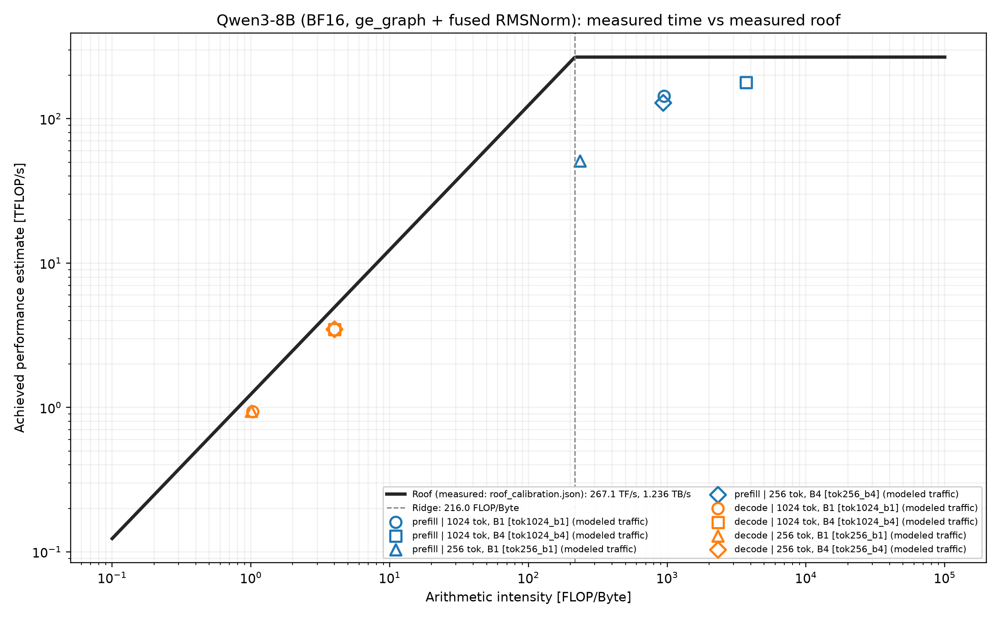

# Qwen3-8B 推理实测屋顶线与硬件设计分析报告

[实验资料导航](../README.md) · [最终报告](../../final_report/report.md) · [时间线导读](timeline_guide.md) · [Profiling 分析](profiling_report.md)

- 设备：Ascend 910B3（容器内仅暴露 1 个 device，逻辑编号 `npu:0`，对应主机 NPU 7）
- 模型：Qwen3-8B，BF16（`torch_dtype: bfloat16`，无量化配置）
- 软件配置：`ge_graph` 图模式 + 04 章 RMSNorm/AddRMSNorm 融合（`qwen3_8b_1tp_ge_graph_fused.yaml`），未启用 08 章 o_proj 预取
- 测量日期：2026-11-19
- 结论一句话：**当前瓶颈是带宽，不是算力。** 实测 ridge = 216 FLOP/Byte，而生成型负载的算术强度只有 1~5，硬件设计应把 ridge 压到 16~32，并把预算从“更多 Cube”转向“更多带宽 + 低比特 + 近存 + KV 复用”。



---

## 1. 测量方法

### 1.1 屋顶标定（实测，不使用数据手册值）

`roof_calibrate.py`：

- 算力：`8192³` BF16 `torch.matmul`，20 次稳态迭代，取最好值
- 带宽：2 GiB device-to-device `copy_`，流量按“读 + 写”计（每迭代 4 GiB），10 次迭代，取最好值

### 1.2 端到端时延

`roofline_measure.py --mode bench`，每个配置一个独立 recipe 进程，读取 scheduler 打印的 `Inference time (prefill/decode)`，不使用进程 wall time，也不使用 `kernel_details.csv` 求和。

- prefill 丢弃首步：recipe 内部已执行一次 warm-up（形状与正式测量一致），日志中第一条 prefill 已是预热后的调用；只有 1 个样本时保留并记录 `prefill_warmup_discarded=0`
- decode 丢弃前 2 步：时延与 `[ROOFLINE_METRIC]` 记录成对丢弃
- Profiler 全程关闭

### 1.3 输入长度控制

默认 prompt 只有 50 token，`--prefill-cap` 只是截断上限。本次用 `--mode prepare-dataset` 生成 33000 字符的 `default_prompt.json`，实测每条请求输入 256 / 1024 token，来自 scheduler 的 `[ROOFLINE_METRIC]`，不是截断上限。

### 1.4 配置矩阵

| 配置 | 输入 token | decode batch | max_new_tokens | 重复 |
|---|---|---|---|---|
| tok256_b1 | 256 | 1 | 64 | 1 |
| tok256_b4 | 256 | 4 | 64 | 1 |
| tok1024_b1 | 1024 | 1 | 64 | 1 |
| tok1024_b4 | 1024 | 4 | 64 | 1 |

---

## 2. 原始数据

### 2.1 屋顶标定原始结果

| 项 | 值 |
|---|---|
| GEMM 形状 | 8192 × 8192 × 8192，20 iters |
| GEMM 单次耗时（ms） | 4.222, 4.151, 4.128, 4.123, 4.128, 4.116, 4.128, 4.118, 4.116, 4.121, 4.140, 4.133, 4.140, 4.118, 4.124, 4.121, 4.138, 4.125, 4.166, 4.155 |
| 算力 best / median / worst | **267.12** / 266.36 / 260.43 TF/s |
| copy 缓冲区 | 2.00 GiB/块（流量 4.00 GiB/迭代），10 iters |
| copy 单次耗时（ms） | 3.505, 3.490, 3.474, 3.476, 3.490, 3.479, 3.478, 3.476, 3.507, 3.480 |
| 带宽 best / median / worst | **1.2364** / 1.2344 / 1.2245 TB/s |
| 参考值（仅对照） | 294.912 TF/s，1.6 TB/s |
| 实测/参考 | 算力 90.6%，带宽 77.3% |
| **ridge** | **216.05 FLOP/Byte** |

### 2.2 逐配置时延原始数据

| 配置 | 输入 token | B | prefill（ms，样本） | decode 均值 | decode 中位 | decode p90 | decode 样本数 | 总 prefill token |
|---|---|---|---|---|---|---|---|---|
| tok256_b1 | 256 | 1 | 70.29（1 个） | 16.282 | 16.230 | 16.500 | 62 | 256 |
| tok256_b4 | 256 | 4 | 111.19（1 个） | 17.609 | 17.555 | 17.980 | 62 | 1024 |
| tok1024_b1 | 1024 | 1 | 101.66（1 个） | 16.874 | 16.830 | 17.000 | 62 | 1024 |
| tok1024_b4 | 1024 | 4 | 325.91（1 个） | 18.218 | 18.150 | 18.540 | 62 | 4096 |

decode 样本为 64 步丢弃前 2 步后的 62 步；decode 最小/最大：16.13/16.92、17.23/18.67、16.76/17.16、18.01/18.78 ms。

### 2.3 模型侧派生量（解析模型，非硬件计数器）

- 权重字节：15.136 GB（BF16）
- KV：147456 B/token（36 层，GQA 8 KV head，head_dim 128）

| 配置 | prefill FLOPs | prefill 字节 | prefill AI | decode FLOPs/step | decode 字节/step | decode AI |
|---|---|---|---|---|---|---|
| tok256_b1 | 3.577 TFLOP | 15.174 GB | 235.7 | 15.31 GFLOP | 15.179 GB | 1.01 |
| tok256_b4 | 14.308 TFLOP | 15.287 GB | 935.9 | 61.23 GFLOP | 15.306 GB | 4.00 |
| tok1024_b1 | 14.536 TFLOP | 15.287 GB | 950.8 | 15.76 GFLOP | 15.292 GB | 1.03 |
| tok1024_b4 | 58.143 TFLOP | 15.740 GB | 3693.9 | 63.04 GFLOP | 15.759 GB | 4.00 |

---

## 3. 数据分析过程

### 3.1 下限模型

对任一阶段，理论最短时间取“算力下限”和“带宽下限”的较大者：

```
T_floor = max( FLOPs / 267.12e12 , Bytes / 1.2364e12 )
```

注意这里的分母是**实测可达值**，因此得到的是“在这台机器上、这套软件栈下”的下限，而不是数据手册下限。

### 3.2 下限与实测对比

| 场景 | 计算下限 | 带宽下限 | T_floor | 实测 | 实测/T_floor |
|---|---|---|---|---|---|
| prefill 256 tok B1 | 13.39 ms | 12.27 ms | 13.39 ms | 70.29 ms | **5.25x** |
| prefill 256 tok B4 | 53.56 ms | 12.36 ms | 53.56 ms | 111.19 ms | 2.08x |
| prefill 1024 tok B1 | 54.42 ms | 12.36 ms | 54.42 ms | 101.66 ms | 1.87x |
| prefill 1024 tok B4 | 217.66 ms | 12.73 ms | 217.66 ms | 325.91 ms | 1.50x |
| decode B1 | 0.057 ms | 12.28 ms | 12.28 ms | 16.28 ms | **1.33x** |
| decode B4 | 0.229 ms | 12.38 ms | 12.38 ms | 17.61 ms | 1.42x |

### 3.3 decode：已贴近带宽天花板

- decode 的算力用量只有 0.057~0.236 ms，占峰值的 0.02%~0.09%，可以完全忽略
- 带宽下限约 12.3 ms（权重 15.1 GB 每步流一遍），实测 16.3~18.2 ms
- 达成率为实测带宽屋顶的 **70.0%~75.4%**，即 `0.93~3.48 TF/s` 对应 `1.25~4.95 TF/s`
- 这里的“总字节 / 总步时”包含了 attention 与其它 kernel；3.7.2 的 profiling 显示**线性层本身已达 1.25~1.47 TB/s（只读屋顶）**，剩余空间集中在 attention
- 结论：decode 已经没有数量级级别的软件空间；除非减少字节，否则上限约 1.3~1.4x

### 3.4 prefill：短 prompt 是“下发开销”，长 prompt 是“效率”

- 256 token：计算下限 13.4 ms，带宽下限 12.2 ms，两者几乎相等；实测 70.3 ms，是下限的 5.25x
- 1024 token B4：计算下限 217.7 ms，实测 325.9 ms，仅 1.50x
- 达成率随规模单调上升：19.1% → 48.2% → 53.5% → 66.8%
- 结论：短 prompt 的差距来自 kernel 数量、host 下发和小 M 效率，**不是峰值算力不足**；给短 prompt 堆 TFLOPS 没有收益

### 3.5 聚合算术强度随输出长度变化

以 1024 token 输入（prefill 14.536 TFLOP / 15.287 GB）、decode 15.76 GFLOP 与 15.292 GB/step 计算：

| 输出 token 数 | 聚合 FLOPs | 聚合字节 | 聚合 AI |
|---|---|---|---|
| 64 | 15.55 TFLOP | 994 GB | 15.64 |
| 128 | 16.55 TFLOP | 1.97 TB | 8.39 |
| 256 | 18.57 TFLOP | 3.93 TB | 4.73 |
| 512 | 22.61 TFLOP | 7.84 TB | 2.88 |
| 1024 | 30.67 TFLOP | 15.7 TB | 1.96 |
| 2048 | 46.81 TFLOP | 31.3 TB | 1.49 |
| 8192 | 143.6 TFLOP | 125.3 TB | 1.15 |
| →∞ | — | — | 1.03 |

对照 ridge = 216：即使是“1K prompt + 64 输出”这种偏 prefill 的场景，聚合 AI 也只有 15.8，仍比 ridge 低一个数量级；生成越长越接近 1。

### 3.6 权重流量与 KV 流量的交叉点

KV = 147456 B/token，权重 = 15.136 GB：

```
交叉点 = 15.136e9 / 147456 ≈ 102,648 token-slot
```

| 场景 | KV 字节 | 权重 : KV |
|---|---|---|
| 1K ctx, B1 | 0.15 GB | 99 : 1 |
| 8K ctx, B8 | 9.7 GB | 61 : 39 |
| 32K ctx, B8 | 38.7 GB | 28 : 72 |
| 32K ctx, B16 | 77.3 GB | 16 : 84 |
| 128K ctx, B8 | 154.6 GB | 9 : 91 |

即：短上下文是“权重流”问题，长上下文变成“KV 流”问题，两者需要不同的硬件资源配比。

### 3.7 Profiling 归因（ge_graph + 04 融合，1024 token / B1）

#### 3.7.1 采集口径

- 用例：`--mode profile`，`qwen3_8b_1tp_ge_graph_fused.yaml`，输入 1024 token，decode batch 1，`max_new_tokens=64`
- Profiler：Level1 + PipeUtilization；prefill `active=1`，decode `active=3`、`skip_first=3`
- 原始目录：`.../models/qwen/res/20261119/qwen3_8b_roof_profile_s1024_b1_t64_r1_20261119_191240_638736/prof/`
- 本文所有时间均来自 `kernel_details.csv` 的 `Duration(us)`，按 `Step Id` 分组；墙钟时间来自同一次运行的 bench 值（prefill 106.32 ms，decode 17.04 ms/step）
- 注意：prefill 只采到 1 个 step，且其 kernel 形态是逐算子下发（714 个 kernel）；decode 采到 step 3/4/5 三个稳态 step，kernel 命名（`MatMul_2`、`MatMul_42`、`MatMul_82`…）符合图回放特征

#### 3.7.2 decode：每步 16.9 ms 的真实构成

| 部分 | 每步耗时 | 占比 | kernel 数 | 流量 | 达成率 |
|---|---|---|---|---|---|
| MatMul（权重） | 12.08 ms | 71.5% | 145 | 15.07 GB | **1.25 TB/s** |
| Attention（36 层 × 2） | 3.16 ms | 18.7% | 72 | 151 MB（KV） | **47.8 GB/s** |
| 其它（norm/rope/copy/argmax…） | 1.65 ms | 9.8% | 386 | — | — |
| 合计（kernel） | 16.89 ms | 100% | 603 | — | — |
| 墙钟 | 17.04 ms | — | — | — | gap 0.15 ms（0.9%） |

三个 step 高度稳定：16.98 / 16.89 / 16.89 ms；MatMul 12.10 / 12.08 / 12.07 ms，Attention 3.24 / 3.16 / 3.16 ms。

按算子形状拆开看（每步各 36 次，`lm_head` 1 次）：

| 算子 | 形状（M×K→N） | 单次耗时 | 单次权重 | 单次带宽 | 每步合计 |
|---|---|---|---|---|---|
| `lm_head` | 1×4096→151936 | 848.1 us | 1.244 GB | **1.47 TB/s** | 0.848 ms |
| gate_up | 1×4096→24576 | 144–166 us | 0.201 GB | 1.21–1.40 TB/s | 5.359 ms |
| down | 1×12288→4096 | 81–87 us | 0.101 GB | 1.16–1.24 TB/s | 3.070 ms |
| qkv | 1×4096→6144 | 46–51 us | 0.050 GB | 0.99–1.09 TB/s | 1.711 ms |
| o_proj | 1×4096→4096 | 26–36 us | 0.034 GB | 0.93–1.29 TB/s | 1.095 ms |

三个直接结论：

1. **线性层已经打满只读带宽**。15.07 GB / 12.08 ms = 1.25 TB/s，单算子最高 1.47 TB/s，而 `copy_` 标定只有 1.236 TB/s。说明 `copy_`（读+写）作为“带宽屋顶”对只读流是偏保守的，真实只读屋顶约 1.5 TB/s。第 3.3 节“70%~75% 达成率”是拿总字节除以总步时得到的，包含了 attention 与其它 kernel；只看 MatMul，decode 已到读带宽屋顶的 84%~98%。
2. **attention 是 decode 唯一的大块空间**。它只搬 151 MB（2×36×1024×8×128×2 B），按 1.236 TB/s 只需 0.12 ms，实际用了 3.16 ms，**高出带宽下限约 26 倍**；FLOPs 仅 0.60 GFLOP，合 191 GF/s（峰值的 0.07%）。即 attention 既不是算力瓶颈也不是带宽瓶颈，而是 **kernel 级延迟与并行度瓶颈**：72 个 kernel/step、平均 43.9 us/个，`kernel_details` 里 Block Num 为 17（未占满 20 个 AIC），B=1 时每核工作量极小。
3. 若把 attention 压到带宽下限（0.12 ms），decode 每步可到 **13.8 ms（1.22x）**；这也是第 3.3 节“1.3~1.4x 上限”中，软件侧唯一还能吃到的那部分。

#### 3.7.3 prefill：算力已用满，瓶颈是 kernel 数与下发

| 部分 | 耗时 | 占比 | kernel 数 | 有效算力 |
|---|---|---|---|---|
| MatMul | 63.59 ms | 76.4% | 145 | **223.6 TF/s（峰值 83.7%）** |
| Attention | 6.40 ms | 7.7% | 36 | **96.9 TF/s（峰值 36.3%）** |
| 其它 | 13.19 ms | 15.9% | 533 | — |
| 合计（kernel） | 83.19 ms | 100% | 714 | — |
| 墙钟 | 106.32 ms | — | — | **gap 23.13 ms（21.8%）** |

MatMul 逐形状效率（每形状 36 次）：

| 算子 | 形状（M×K→N） | 单次耗时 | 单次 FLOPs | 单次算力 |
|---|---|---|---|---|
| gate_up | 1024×4096→24576 | 846.4 us | 206.2 GFLOP | **243.6 TF/s（91%）** |
| o_proj | 1024×4096→4096 | 151.9 us | 34.4 GFLOP | 226.4 TF/s（85%） |
| down | 1024×12288→4096 | 489.2 us | 103.1 GFLOP | 210.8 TF/s（79%） |
| qkv | 1024×4096→6144 | 250.6 us | 51.5 GFLOP | 205.5 TF/s（77%） |

- MatMul 合计 14.22 TFLOP / 63.59 ms = **223.6 TF/s**，说明大 M 的 GEMM 已经基本打满，`8192³` 标定出的 267 TF/s 是可信的（最高单算子已达 243.6 TF/s，91%）。
- Attention 只有 96.9 TF/s（峰值 36.3%），36 次调用、平均 177.8 us；它只写 151 MB KV（约 24 GB/s），同样不是带宽问题，而是 1024 token 下 attention 的 tile/并行度没跑满。
- “其它” 13.19 ms 里有 10.55 ms 是 6 类逐元素/归一化算子（见 3.7.5），剩余 2.64 ms 是 argmax、cumsum、memcpy 等。

**关于 23.13 ms 的 gap**：714 个 kernel 摊下来平均每个 kernel 对应 32.4 us 的空隙；`api_statistic` 里 prefill 的 `node` 级 `launch` 记录为 1260 次、平均 25.3 us、合计 31.9 ms，与这个量级一致。因此 gap 的主因是 **kernel 级下发/调度开销**，不是某个算子算得慢。需要说明的是，这个结论目前是“数量级吻合 + 形态一致”的强相关，还没有做“同一 prefill 第二次调用（非首次 capture）”的对照采集，建议后续补一次确认；但从 3.7.5 的 kernel 数看，减少 kernel 数对 prefill 是同时降低“计算时间”和“下发时间”的双重收益。

#### 3.7.4 并行度与流水分布

按 kernel 耗时加权的 Block Num 分布：

| Block Num | prefill 时间占比 | decode 时间占比 | 说明 |
|---|---|---|---|
| 20 | **84.1%** | **61.3%** | 占满 20 个 AIC，MatMul 主路径 |
| 40 | 15.6% | 0.4% | 占满 40 个 AIV，向量算子 |
| 17 | 0% | 8.6% | decode attention，未占满 |
| 12 | 0% | 10.9% | decode 部分向量算子 |
| 1 | 0.1% | 4.4% | 串行小算子 |
| 0 | 0.2% | 10.8% | 混合核/未上报 |

pipe 占用（按耗时加权）：

| pipe | prefill | decode |
|---|---|---|
| AIC mac | 66.3% | 11.7% |
| AIC mte1 | 60.2% | 32.4% |
| AIC mte2 | 68.6% | **80.5%** |
| AIC scalar | 34.9% | 7.8% |
| AIC fixpipe | 5.5% | 5.5% |
| AIV vec | 9.1% | 2.0% |

- prefill 的 mac / mte1 / mte2 同时处在 60%~69%，是典型的“计算与两级搬运交织、都没打满”，与 83.7% 的 GEMM 达成率互相印证；scalar 34.9% 偏高，提示 tiling 参数计算/地址计算占了不少时间。
- decode 的 mte2 80.5% 而 mac 只有 11.7%，是**教科书级的带宽受限**指纹，与 1.25 TB/s 的实测带宽完全一致。
- `aic_icache_miss_rate` / `aiv_icache_miss_rate` 在 prefill 最大 0.006、decode 最大 0.084，可以排除 icache 抖动。

#### 3.7.5 可融合清单（prefill）

| 算子 | 调用次数 | 总耗时 | 单次 | 说明 |
|---|---|---|---|---|
| `AddRmsNorm` | 72 | 2.93 ms | 40.7 us | 2/层，04 已融合 Add+RMSNorm |
| `RmsNorm` | 73 | 1.92 ms | 26.3 us | 1/层 + 末尾 norm |
| `ScatterNdUpdate` | 72 | 1.56 ms | 21.7 us | **KV cache 写入，2/层** |
| `Silu` | 72 | 1.47 ms | 20.4 us | gate/up 激活 |
| `Mul` | 72 | 1.41 ms | 19.6 us | SiLU 的乘 |
| `ApplyRotaryPosEmb` | 72 | 1.26 ms | 17.5 us | RoPE |
| 合计 | **433** | **10.55 ms** | — | 占 kernel 时间 12.7% |

- 这 433 个 kernel 占 prefill kernel 数的 60.6%，但只占 12.7% 的时间；按 32.4 us/kernel 的下发成本，它们对应约 **14 ms** 的潜在下发开销——**即使只融合掉一半，也能同时省下约 5 ms 计算和约 7 ms 下发**。
- `ScatterNdUpdate` 72 次（2/层）是 KV cache 写入，最值得和 attention 的 KV 写路径合并；`Silu`+`Mul` 可以合成一个 SwiGLU；`RmsNorm` 与相邻的量化/拷贝可以继续合并。
- 这也解释了 3.4 节“短 prompt 差距来自 kernel 数量与下发”：256 token 时 GEMM 变小，但 kernel 数几乎不变，gap 占比进一步升高。

#### 3.7.6 图模式与 bubble

| 指标 | prefill | decode（step 3/4/5） |
|---|---|---|
| kernel 求和 | 83.19 ms | 16.98 / 16.89 / 16.89 ms |
| 墙钟 | 106.32 ms | 17.04 ms |
| gap | 23.13 ms（21.8%） | 0.15 ms（0.9%） |
| `step_trace_time` Computing | 83.19 ms | 15.23 / 15.23 / 15.22 ms |
| `step_trace_time` Free | 31.48 ms | 6.83 / 6.13 / 4.24 ms |
| `step_trace_time` Bubble | 0 | 0 |
| `step_trace_time` Preparing | 1.66 ms | 1.65 / 1.45 / 1.38 ms |
| `step_trace_time` Stage | 114.67 ms | 22.08 / 21.36 / 19.47 ms |

- decode 的 kernel 求和与墙钟只差 0.15 ms，**说明 ge_graph 下 decode 已经没有 host 侧气泡**，这与前面“eager decode 76.8 ms → ge_graph 16.9 ms”的结论一致。
- `step_trace_time` 的 `Free`/`Stage` 比 kernel 求和与墙钟都大（decode Stage 19.5~22.1 ms > 墙钟 17.04 ms），是因为该表包含 profiler 自身的 `Preparing` 与打点开销，**不能**把 `Free` 直接当成 bubble 读；判断气泡应以“kernel 求和 vs 墙钟”为准。
- prefill 的 `Free` 31.48 ms 同样含打点开销，但 23.13 ms 的 gap 是真实存在的（bench 与 trace 两次独立运行分别是 101.66 / 106.32 ms，量级一致）。

#### 3.7.7 对第 4 章硬件设计的修正

1. 4.6 节“B1 只到 75% 带宽，差的是访存并行度”应改为：**线性层已到 1.25~1.47 TB/s（只读屋顶），decode 剩余空间几乎全在 attention 的 3.16 ms**。硬件上继续堆 HBM 带宽对 B1 decode 的边际收益很低，收益更大的是降低 attention 的 kernel 延迟与提升其并行度（更多 in-flight 请求、GQA 专用通路、单层 2 个 attention kernel 合一）。
2. 4.1/4.2 的“ridge 压到 16~32”结论不变，但依据更明确：decode 的 mte2 已 80.5%、mac 仅 11.7%，是纯带宽受限；prefill 的 GEMM 已 83.7%，只有 attention（36.3%）和非 GEMM（15.9%）两块低效。
3. 短 prompt / prefill 的硬件诉求应从“更多 Cube”改为“**更高的 kernel 下发吞吐与更低的单 kernel 启动开销**”：714 个 kernel、23 ms gap，减少 kernel 数或提高 issue rate 都能直接兑现。
4. 带宽标定方法建议改为**只读流式 kernel**（而不是 `copy_`）：本次 `lm_head` 实测 1.47 TB/s 已超过 `copy_` 标定的 1.236 TB/s，用 `copy_` 会把 decode 的达成率系统性低估约 20%。

---

## 4. 硬件设计分析

### 4.1 核心矛盾：ridge 与负载 AI 不匹配

要让 B=1 的 decode 打到算力峰值，需要 `267.12 / 1.03 ≈ 259 TB/s` 带宽，物理上不可行。因此：

> 推理芯片的 ridge 应设计在 **8~32 FLOP/Byte**，而不是 200 以上。

### 4.2 算力 : 带宽 配比

平衡条件 `15.29 GB / BW = B × 15.76 GFLOP / 267.12 TF/s`，即 `BW_needed = 259 / B`（TB/s）：

| 目标 batch | 平衡所需带宽 |
|---|---|
| 1 | 259 TB/s（不可行） |
| 8 | 32.4 TB/s |
| 32 | 8.1 TB/s |
| 64 | 4.05 TB/s |
| 128 | 2.02 TB/s |

现实路径不是死磕带宽，而是“中等带宽 + 低比特”：

- 4 TB/s HBM3e + 267 TF/s → 平衡点 B≈65，B1 decode 下限从 12.4 ms 降到 3.8 ms（3.2x）
- 叠加 W8/W4 存储路径解压 → 等效带宽 ×2 / ×4，B1 下限到 1.9 / 0.95 ms

**每 bit 的节省比每 TB/s 的堆叠更便宜**：权重 15.1 GB → INT8 7.6 GB → INT4 3.8 GB，容量与带宽同时受益。

### 4.3 容量 : 带宽 配比

decode 步时 ≈ 权重字节 / 带宽；容量决定能同时装多少 KV。

- 推荐 96~128 GB：INT8 权重 7.6 GB + FP8 KV（32K × B16 ≈ 38.7 GB）+ 工作区
- 对应 `容量/带宽 ≈ 24~32 s`（整块 HBM 流一遍的时间），该比值决定长上下文吞吐天花板
- 若目标 128K × B8，KV 单独就要 154.6 GB（BF16），必须上 KV 量化或 MLA 类压缩

### 4.4 片上 SRAM 分配比例

关键规律：**权重缓存的收益 = (B − 1) × 缓存字节**。B=1 时收益为零，所以：

- B=1~2：SRAM 几乎全部给 KV 与激活，权重只做双缓冲
- B≥4：才值得给权重划 25~35% 做 tile 缓存

| 用途 | decode 模式 | prefill 模式 |
|---|---|---|
| KV 分块与暂存 | 50~60% | 20% |
| 权重双缓冲 | 25~35% | 30% |
| A/B tile 与归约工作区 | 10~15% | 50% |

容量上 SRAM : HBM ≈ 1 : 1000（64 MB L2 + 512 KB/core L1 对 96 GB HBM）；带宽上 SRAM 需 6~8× HBM（4 TB/s HBM → 24~32 TB/s SRAM）。

GQA 复用是 KV 流量的关键杠杆：32 Q head / 8 KV head，若 4 个 Q head 共享一次 KV 读取，KV 流量直接 /4。要让这件事成立，L2 需放下一个 KV 分块：

```
4 head × 128 dim × 2048 token × B8 × 2 B ≈ 16.8 MB
```

因此 32~64 MB L2 有明确依据。

### 4.5 权重流与 KV 流的带宽配比

| 场景 | 权重 : KV | 访问特征 |
|---|---|---|
| 1K ctx, B1 | 99 : 1 | 权重：完全可预取的顺序流 |
| 8K ctx, B8 | 61 : 39 | KV：分页、随机、延迟敏感 |
| 32K ctx, B16 | 16 : 84 | KV 占主导 |

建议物理统一 HBM、逻辑分两条虚拟通道/QoS 队列：权重走大块 DMA，KV 走低延迟高优先级路径，配比随 `ctx × B` 动态调整。

### 4.6 计算单元组织

- Cube 保留给 prefill：1024 token 的计算下限 54.4 ms，砍算力会直接拖慢 prefill
- decode 需要的是**访存并行度**，不是 MAC 数量：更多 MSHR、更深预取、更大的 in-flight 字节、每核更多内存通道；但 profiling（3.7.7）显示线性层已到 1.25~1.47 TB/s，剩余空间主要在 attention，这部分资源应优先投向 attention 的延迟与并行度
- 增加 M ≤ 8 的 GEMV 专用通路，目标 B1 也跑到 ≥90% 带宽

### 4.7 近存计算

B=1 时每个权重在一次 decode 中只被用 1 次，SRAM tiling 无法制造复用。要彻底绕开“把 15 GB 搬到计算单元”，只有把 MAC 放到 HBM bank 逻辑里：

- 权重不出 bank，省掉 15 GB/step 的搬运
- 代价是 bank 内 MAC 精度/频率受限，适合 B ≤ 8 的 GEMV
- 与 Cube 分工：prefill 与 B ≥ 32 走 Cube，B ≤ 8 走近存

### 4.8 一个可落地的设计点

| 项 | 取值 | 依据 |
|---|---|---|
| BF16/INT8 算力 | 267 TF/s（INT8 翻倍） | prefill 1024 token 需 54.4 ms 下限 |
| HBM | 96~128 GB，4 TB/s | B1 decode 3.8 ms；32K×B16 容量 |
| 低比特 | W8/W4 存储路径解压 | 等效带宽 ×2 / ×4 |
| L2 | 64 MB | GQA 4 路复用 KV，16.8 MB/分块 |
| L1 | 512 KB/core | 权重双缓冲 + KV tile |
| 带宽 QoS | 权重:KV 动态 9:1 → 1:4 | 随 ctx×B 迁移 |
| 功耗/面积 | 存储子系统 60~65%，计算 35~40% | decode 占约 90% 时间 |

预期效果（相对本次实测）：

- decode B1：16.3 ms → 3.8 ms（4 TB/s）→ 1.9 ms（W8）→ 1.0 ms（W4/近存）
- decode B16 吞吐：约 4.4 ms/step（BF16）→ 2.5 ms（W8）
- prefill 1024 token：101.7 ms → 受算力下限约束约 54 ms；INT8 后约 27~35 ms
- 短 prompt prefill：硬件只能帮到约 13 ms 下限，剩余 5x 必须靠软件（ge_graph 已把 decode 从 82 ms 降到 16 ms，同类收益在 prefill 上仍存在）

### 4.9 不该做的两件事

1. **不要为短 prompt 堆 TFLOPS**：256 token 的 prefill 带宽下限 12.3 ms、计算下限 13.4 ms 基本持平，瓶颈是 kernel 数量与下发。
2. **不要用大 SRAM 缓存权重**：B=1 时复用次数为 1，缓存收益为零；同样面积给 KV 或给低比特解压更划算。

---

## 5. 结论与局限

### 5.1 结论

1. 本机实测屋顶：267.12 TF/s、1.2364 TB/s、ridge 216.05 FLOP/Byte。
2. decode 的线性层已到只读带宽屋顶（1.25~1.47 TB/s），每步 16.9 ms 里 12.08 ms 是权重流、3.16 ms 是 attention（仅 151 MB 流量，高出其带宽下限约 26 倍）；软件侧剩余空间就是 attention，约 1.22x；要再快必须减少字节（W8/W4、KV 量化）。
3. prefill 的 GEMM 已到 223.6 TF/s（峰值 83.7%），差距来自 714 个 kernel 的 23.1 ms 下发 gap（21.8%）与 433 个逐元素/归一化 kernel（10.55 ms），属于下发与融合问题，不是算力不足。
4. 硬件设计应把 ridge 压到 16~32：提高带宽、原生低比特、近存 GEMV、KV 复用与压缩，同时保留算力守住 prefill 下限。

### 5.2 局限

- 每个配置只跑了 1 次（repeats=1），时延中位数来自 62 个 decode 步，配置间比较建议补 3 次重复
- 横轴使用解析模型流量，本仓拿不到实测 HBM 字节；`achieved TF/s` 的分母是解析 FLOPs
- “实测峰值”是当前软件栈（`torch.matmul` / `copy_`）的可达值，不是硅片峰值
- prefill 只有 1 个日志样本，无法真正丢弃首步；recipe 内部 warm-up 已排除首次调用
- 未包含 05/06 的 INT8/A8W8：量化会同时改变权重字节与算力口径，必须重新标定屋顶并单独成图
- 3.7 的 kernel 时间来自带 profiler 的运行（prefill 106.32 ms / decode 17.04 ms），与无 profiler 的 bench（101.66 ms / 16.87 ms）有 1%~5% 偏差；结论均为量级判断，不受影响
- 3.7 只采到 1 个 prefill step，且其 kernel 形态是逐算子下发；23 ms gap 的“下发开销”归因尚未用“同一 prefill 第二次调用”做对照 A/B，属于强相关而非已证因果
- 带宽屋顶由 `copy_`（读+写）标定，对只读流偏保守；建议后续用只读流式 kernel 重标（本次 `lm_head` 实测 1.47 TB/s 已超过 1.236 TB/s）

---

## 6. 附件与复现

仓库附件如下，路径相对于本报告所在的 `docs/` 目录。原始数据与运行 ID 保留；汇总结果、运行配置、图表和文档分别存放：

| 文件 | 说明 |
|---|---|
| [hardware_design.md](hardware_design.md) | 本报告（v2，新增 3.7 Profiling 归因） |
| [实测屋顶线图](../figures/roofline_validation_measured.png) | 实测屋顶线图 |
| [roof_calibration.json](../results/roof_calibration.json) | 屋顶标定原始结果 |
| [bench_runs.csv](../results/bench_runs.csv) | 4 配置逐次运行原始数据（64 列） |
| [runs/](../runs/) 下的 `<run_id>/summary.json` | 单次运行完整派生指标 |
| [runs/](../runs/) 下的 `<run_id>/recipe_stdout.log` | recipe 原始输出 |
| [configs/](../configs/) 下的 `<run_id>.yaml` | 每次运行实际使用的 YAML |
| [prefill_trace_view_perfetto.json](../profiling/prefill_trace_view_perfetto.json) | prefill 时间线（已数值化，Perfetto 可直接打开） |
| [decode_trace_view_perfetto.json](../profiling/decode_trace_view_perfetto.json) | decode 时间线（step 3~5，已数值化） |
| [kernel_details_prefill.csv](../profiling/kernel_details_prefill.csv) | prefill 逐 kernel 明细（含 pipe 占比、Block Num、Input Shapes） |
| [kernel_details_decode.csv](../profiling/kernel_details_decode.csv) | decode 逐 kernel 明细 |
| [step_trace_time.csv](../profiling/step_trace_time.csv) | 两个阶段的 Computing/Free/Stage/Preparing/Bubble |
| [api_statistic.csv](../profiling/api_statistic.csv) | 两个阶段的 host API 耗时 |
| [op_statistic.csv](../profiling/op_statistic.csv) | 两个阶段的算子聚合耗时 |

以下命令记录原实验环境中的测量过程。`roof_calibrate.py`、`roofline_measure.py`、`plot_validation.py`、模板 YAML 和数据集来自原实验环境，当前仓库未包含这些脚本与完整依赖；请在原环境中运行，并将产物对应保存到本仓库的 `results/`、`runs/`、`configs/`、`figures/`、`profiling/`。

```bash
# 1) 标定屋顶
python roof_calibrate.py --output roof_calibration.json \
  --matmul-size 8192 --matmul-iters 20 --bandwidth-gib 2 --bandwidth-iters 10

# 2) 生成长 prompt 数据集
python roofline_measure.py --mode prepare-dataset \
  --dataset-path ./dataset_long --dataset-tokens 4096

# 3) 多配置测速（ge_graph + 04 融合）
python roofline_measure.py --mode bench \
  --template-yaml .../qwen3_8b_1tp_ge_graph_fused.yaml \
  --configs-file configs_ge_graph.json \
  --output-dir .../run_outputs/roofline_empirical_ge_graph

# 4) 出图
python plot_validation.py .../bench_runs.csv \
  --roof-calibration .../roof_calibration.json \
  --output .../roofline_validation_measured.png
```

```bash
# 5) 采集 profiling（3.7 节数据来源）
python roofline_measure.py --mode profile \
  --template-yaml .../qwen3_8b_1tp_ge_graph_fused.yaml \
  --dataset-path ./dataset_long --prefill-cap 1024 \
  --batch-size 1 --max-new-tokens 64 \
  --output-dir .../run_outputs/roofline_empirical_ge_graph_profile
```

profiling 原始 case 目录（附件中的 `profiling/` 即从此目录抽取）：

```
.../models/qwen/res/20261119/qwen3_8b_roof_profile_s1024_b1_t64_r1_20261119_191240_638736/prof/
```
