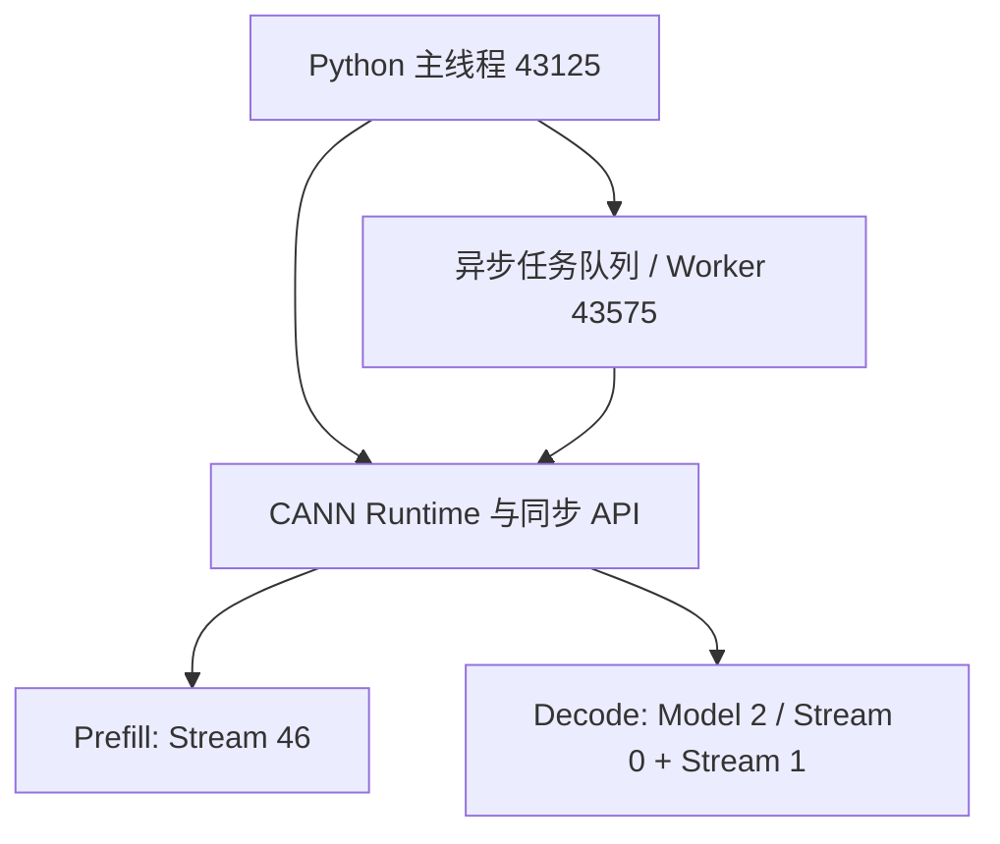
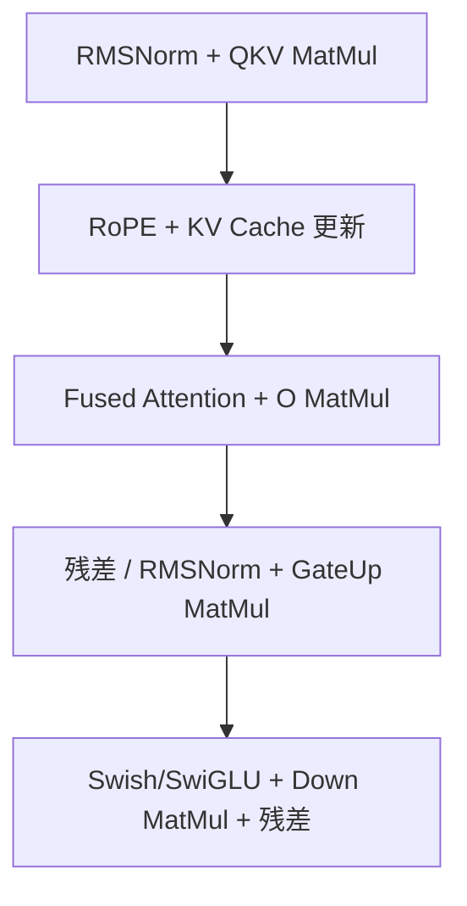

# Qwen3-8B 在 Ascend 910B 上的 Prefill / Decode Profiling 分析报告

[实验资料导航](../README.md) · [实测分析报告](hardware_design.md) · [时间线导读](timeline_guide.md)

> 分析日期：2026-11-19  
> 原始数据：`PREFILL-trace_view.json`（16,022 条 trace 事件）、`DECODE-trace_view.json`（10,354 条 trace 事件）及 Perfetto 截图  
> 目标：解释各 CPU Thread / NPU Stream 的职责，逐类解释算子，定位主要耗时及调度空隙。

仓库提供对应的 [Prefill Perfetto 时间线](../profiling/prefill_trace_view_perfetto.json)、[Decode Perfetto 时间线](../profiling/decode_trace_view_perfetto.json)，以及报告使用的 [Prefill 截图](../../final_report/assets/profiling/prof-PREFILL.png)、[Decode 截图](../../final_report/assets/profiling/prof-DECODE.png)。上面的 `PREFILL-trace_view.json`、`DECODE-trace_view.json` 是分析时使用的原文件名，仓库中的时间线使用已数值化的 `_trace_view_perfetto.json` 文件名。

## 0. 执行摘要

1. **Prefill 的主计算流是 `Ascend Hardware / Stream 46`**（720 个设备任务）；**Decode 的主计算流变为 `Stream 0`**（2,727 个设备任务），辅助 `Stream 1` 处理 Attention 相关 AI CPU 任务和 Event，`Stream 46` 负责静态模型启动、同步及少量图外算子。注意 Perfetto 显示的 Decode `Stream 0/1`，其 `Physic Stream Id` 实际为 **43/42**，不是物理 Stream 0/1。
2. 两份 trace 都有 **36 层 × 4 次主要 MatMul + 1 次最终输出 MatMul = 145 次 MatMul/次前向**。这一规律与 Qwen3-8B 官方配置的 36 层相符。根据执行顺序，可较高置信度推断每层四次 MatMul 分别是 **QKV 投影、Attention 输出投影、MLP Gate/Up 投影、MLP Down 投影**；缺乏输入/输出形状，具体权重归属仍需源码或形状验证。
3. Prefill 设备计算时间约 **83.185 ms**，其中 MatMul 共 **63.590 ms（76.4%）**；Decode 三轮设备计算时间共 **45.695 ms**，其中 MatMul 共 **36.249 ms（79.3%）**。因此，算子级调优应首先研究 MatMul，尤其是 MLP 中间大矩阵乘法。
4. Decode 有 **864 个 `NOP` Task**，其 trace `ph="X"`、每条 `dur` 为 0 或约 0.02 μs，合计记录约 **8.98 μs**，只占 Decode 设备计算时间的约 **0.02%**。它们是 `Task Type=NOP` 的极短时任务，不是 864 次显著的计算资源空闲。Perfetto 将它们画成紫色箭头。
5. Decode 的三次 NPU 迭代分别约 **15.364、15.287、15.285 ms**，每轮内部 Computing 覆盖率约 **97.9%–98.2%**；但两次迭代之间又分别存在约 **6.111 ms、5.694 ms** 的间隙。间隙中存在 Python 端采样/张量操作、`TorchDynamo Cache Lookup`（约 1.3–1.5 ms）及图执行调度，是值得下一步测量的端到端瓶颈候选。

## 1. 口径说明：什么是 Thread、Stream、Task？

| 层级 | Trace 中的名称 | 实际意义 | 不应误解为 |
|---|---|---|---|
| Python | `Python / Thread 43125`、`Thread 43575` | CPU 侧 Python 主执行线程与异步任务队列工作线程 | 两个 NPU 计算核心 |
| CANN | `CANN / Thread 43125`、`Thread 43575` | 同一批 CPU 线程在 AscendCL / Runtime 层的调用轨迹 | 另开了两条独立 Python 线程 |
| NPU | `Ascend Hardware / Stream N` | 设备任务执行队列；Perfetto 为其创建的轨道 | 一个 Stream 对应一个 AI Core |
| Step Trace | `Step Trace(Model ID:2)` | 静态模型迭代边界 | 执行计算的线程 |
| Overlap Analysis | `Computing`、`Free` | NPU 计算活动与无计算/通信覆盖区间的分析轨道 | 可与 MatMul 耗时直接累加的独立工作 |
| AI Core Freq | 频率计数轨道 | AI Core 频率指标 | 执行 Kernel 的 Stream |

这里的 `pid=44160416`（Ascend Hardware）、`pid=44160255`（CANN）、`pid=44160960`（Overlap Analysis）是导出工具组织 Perfetto 轨道时使用的标识，**不应直接当成真实 Linux 进程 PID**。两组 Python/CANN 轨道出现相同的 TID 43125、43575，反映了不同软件层级对同一 CPU 线程的观察。

### 1.1 调度关系



这是逻辑关系示意图，不表示每次 NPU 启动都必然经 Worker，也不表示不同 Stream 只能串行。

## 2. 每个 CPU Thread 和 NPU Stream 具体负责什么？

### 2.1 CPU / Python / CANN

| CPU Thread | Prefill 证据 | Decode 证据 | 主要职责 | 判断等级 |
|---|---|---|---|---|
| **43125：Python 主线程** | `cpu_op` 3,998 条；`Enqueue@...` 606 次；含 `aten::matmul`、`aten::item`、`npu::npu_rms_norm` | `cpu_op` 414 条；`Enqueue@...` 57 次；包含 `TorchDynamo Cache Lookup`、`Torch-Compiled Region`、`TorchNpuGraphBase::Run`、`aten::argmax` 等 | 执行模型的 Python/PyTorch 前向逻辑，准备输入，触发算子或图执行，参与 token 选择与控制 | **直接证据** |
| **43575：Python 异步队列 Worker** | `Dequeue@...` 606 次；包含 145 次 `Dequeue@aclnnMatmulWeightNz`、36 次 Attention | `Dequeue@...` 57 次；主要是小型张量处理、采样相关算子 | 取出主线程下发的异步任务，并在 CANN 层调用执行接口 | **直接证据** |
| **43125：CANN 侧同一主线程** | `Node@launch` 546 次；`aclrtMemcpy`、`aclrtSynchronizeStreamWithTimeout` 75 次 | `Node@launch` 549 次；`Model@ModelExecute` 3 次；`aclrtSynchronizeDeviceWithTimeout` 7 次 | CANN Runtime 交互、部分 Kernel 下发、设备/Stream 同步、静态模型控制 | **直接证据** |
| **43575：CANN 侧同一 Worker** | `Node@launch` 714 次、`aclrtLaunchKernelWithHostArgs` 714 次；大量 `aclnn*` 调用 | `Node@launch` 60 次、`aclrtLaunchKernelWithHostArgs` 60 次；`aclnnCumsum`、`aclnnArgMax` 等 | 把异步任务转换为底层 AscendCL 调用/Kernel 下发 | **直接证据** |

关键区别：`aclnnMatmulWeightNz` 在 CANN 中表示**主机侧算子 API 调用**；同名派生的 `...MatMulV2/V3` 在 Ascend Hardware 中才是**设备执行任务**。CPU 上的 `aten::matmul` 时长不等于 NPU 矩阵乘法时长，不能相加。

### 2.2 Prefill 的 NPU Stream

| Perfetto Stream | 物理 Stream | 任务数 | 主要任务 | 职责 |
|---|---:|---:|---|---|
| **46** | 46 | **720** | MatMul 145、Fused Attention 36、RMSNorm、RoPE、KV Cache 更新及 MLP 算子 | **Prefill 主计算流**，处理输入序列的前向计算 |
| **49** | 49 | **2** | `PROFILING_ENABLE` / `PROFILING_DISABLE` | Profiling 开关控制，不执行模型主体 |

Prefill 设备任务的 `Model Id` 为 `4294967295`（32 位无符号最大值，常用作无效 ID）。结合逐算子的 ACLNN 调用，可以判断这段并非 Decode 的 `Model ID=2` 静态模型执行路径；但不能仅凭这个值断言整个程序没有图编译。

### 2.3 Decode 的 NPU Stream

| Perfetto Stream | `Physic Stream Id` | 任务数 | 主要任务 | 职责 |
|---|---:|---:|---|---|
| **0** | **43** | **2,727** | MatMul 435、Attention 主 Kernel 108、RMSNorm、RoPE、KV Cache 更新、SwishMul；另有 NOP / Event | **Decode 静态模型主计算流** |
| **1** | **42** | **327** | `FusedInferAttentionScore` 108 个 `AI_CPU` Task、`EVENT_RECORD` 111、`MODEL_TASK_UPDATE` 108 | **Attention 辅助与跨流同步**；`AI_CPU` 是设备 AI CPU 任务，不是 Python 主机线程 |
| **46** | **46** | **87** | `MODEL_EXECUTE` 3、`UpdateModelParam_static_bin` 3、`NOTIFY_WAIT` 3、`Cumsum`、`ArgMax`、Memcpy 等 | **静态模型启动、同步和图外辅助算子** |
| **49** | **49** | **2** | `PROFILING_ENABLE` / `PROFILING_DISABLE` | 采集开关控制 |
| **Step Trace(Model ID:2)** | 不适用 | 3 | `Iteration 1/2/3` | 迭代时间边界，不是真实执行 Stream |

**重要细节：**Decode 中 `Stream 1` 的 Attention 名称虽与主 Stream 一致，但其 Task Type 是 `AI_CPU`；`Stream 0` 上的对应 Attention Task Type 是 `MIX_AIC`。它们很可能是同一个融合 Attention 算子的**辅助/控制部分与 AI Core 计算部分**。不能将 Stream 1 的 5.177 ms 全部解释成独立的 Attention 浮点计算，也不能与主 Stream 计算时间直接相加。

## 3. Qwen3-8B 的算子与模型结构如何对应？

官方 Qwen3-8B 配置包括：**36 个 Transformer Decoder Layer、隐藏维度 4096、FFN 中间维度 12288、32 个 Query Head、8 个 KV Head、BF16**。对照 36 次 `FusedInferAttentionScore`、145 次 MatMul 的规律，可以重建典型的一层：



上述执行顺序来自实际 Stream 中逐个 Kernel 的时间排序；其中 QKV、GateUp 等投影名称是根据算子序列及耗时模式推断，并非 trace 直接提供的权重名。

### 3.1 四种主要 MatMul 的耗时（按每层位置推断）

| MatMul 在层内出现位置 | 推测对应模型模块 | Prefill：36 层总时长 | Prefill：平均每层 | Decode：第一轮 36 层总时长 | Decode：平均每层 |
|---|---|---:|---:|---:|---:|
| 第 1 次 | QKV 合并线性投影 | **9.022 ms** | 250.6 μs | **1.714 ms** | 47.6 μs |
| 第 2 次 | Attention 输出投影 O | **5.468 ms** | 151.9 μs | **1.096 ms** | 30.4 μs |
| 第 3 次 | MLP Gate/Up 合并投影 | **30.470 ms** | 846.4 μs | **5.361 ms** | 148.9 μs |
| 第 4 次 | MLP Down 投影 | **17.611 ms** | 489.2 μs | **3.074 ms** | 85.4 μs |
| 36 层之后额外 1 次 | `lm_head` / 输出词表投影 | **1.019 ms** | 单次 | **0.855 ms** | 单次 |

Prefill 前两次投影使用 `aclnnMatmulWeightNz_...MatMulV3`，后两次及最后输出投影使用 `...MatMulV2`；Decode 图内使用 `MatMul`、`MatMul_1`、……、`MatMul_144`。**两个文件出现完全相同的“4×36+1”结构，这是映射模型的主要依据。**

这组数据提示：**MLP 的 Gate/Up 和 Down 两次矩阵乘法是最大的单层计算热点**；比起先优化 NOP 或几微秒的 RoPE，更值得优先做分形状 Roofline 分析。

## 4. Prefill：每类设备算子的作用、次数和耗时

表中耗时是设备轨道上相应事件的 `dur` 之和，不是 CPU API 时长。

| 原始 Kernel 名称 / 算子族 | 数量 | 总时长 | 负责的工作 |
|---|---:|---:|---|
| `aclnnMatmulWeightNz_MatMulCommon_MatMulV2` | 73 | **49.100 ms** | 高耗时矩阵乘法；按执行顺序主要对应各层 MLP Gate/Up、Down 及输出 `lm_head` |
| `aclnnMatmulWeightNz_MatMulV3Common_MatMulV3` | 72 | **14.490 ms** | 各层 QKV 和 Attention 输出线性投影（各 36 次） |
| `FusedInferAttentionScore` | 36 | **6.402 ms** | 融合 Attention：处理 Q/K/V 的注意力打分与加权聚合，结合 KV Cache 使用 |
| `aclnnAddRmsNorm_AddRmsNorm_AddRmsNorm` | 72 | **2.930 ms** | 融合残差相加与 RMSNorm；每层约两次 |
| `RmsNorm` | 73 | **1.916 ms** | 均方根归一化（各层及最终 Norm） |
| `aclnnScatterNdUpdate_ScatterNdUpdateAiCore_ScatterNdUpdate` | 72 | **1.564 ms** | 按位置更新张量，结合上下文推断主要是 K/V Cache 更新 |
| `aclnnScatterNdUpdate_SliceAiCore_Slice` | 36 | 0.301 ms | 为 Scatter 更新准备视图/片段 |
| `ApplyRotaryPosEmb` | 36 | **1.259 ms** | 对 Q/K 应用 RoPE 旋转位置编码 |
| `aclnnSilu_SiluAiCore_Swish` | 36 | **1.466 ms** | MLP 门控分支的 SiLU/Swish 非线性激活 |
| `aclnnMul_MulAiCore_Mul` | 36 | **1.414 ms** | 将门控激活与另一 MLP 分支逐元素相乘（SwiGLU） |
| `aclnnSilu_SliceAiCore_Slice` / `aclnnMul_SliceAiCore_Slice` | 各 36 | 0.806 / 0.546 ms | SiLU、Mul 之前的辅助 Slice / 数据视图处理 |
| `aclnnInplaceCopy_SliceAiCore_Slice` | 72 | 0.608 ms | 将片段拷贝或写回目标位置，可能涉及缓存组织 |
| `aclnnMatmulWeightNz_TransData_TransData` | 2 | 0.020 ms | 数据布局转换（例如 ND/NZ 之间），这里记录的总时长很小 |
| `aclnnEmbedding_GatherV2AiCore_GatherV2` | 1 | 0.035 ms | 根据 token ID 查询 Embedding |
| `aclnnCumsum_CumsumAiCpu_Cumsum` | 1 | 0.144 ms | 前缀累加，通常用于位置/索引相关的准备；此 Task 在 AI CPU 上 |
| `aclnnArgMax_ArgMaxV2AiCore_ArgMaxV2` | 1 | 0.019 ms | 取最大值位置；在生成上下文中可能用于选择 token |
| `MEMCPY_ASYNC` | 6 | 0.004 ms | 设备 DMA 数据拷贝任务（该值为所记录任务时间） |

**其余 Prefill 辅助算子（保留原始名字）：**

| 算子 / 族 | 任务数 | 典型功能 |
|---|---:|---|
| `aclnnInplaceOne_OnesLikeAiCore_OnesLike`、`aclnnInplaceZero_ZerosLikeAiCore_ZerosLike` | 各 1 | 初始化全 1 / 全 0 张量 |
| `aclnnTril_Tril_Tril` | 1 | 生成下三角结构，常见于因果 Attention Mask |
| `aclnnBitwiseNot_LogicalNotAiCore_LogicalNot` | 1 | 对布尔/位掩码取反 |
| `aclnnReduceSum_ReduceSumOpAiCore_ReduceSum` | 1 | 求和归约 |
| `aclnnArange_ArangeAiCore_Range` | 2 | 构造连续索引或位置序列 |
| `aclnnFloorDivides_FloorDivAiCore_FloorDiv` | 1 | 向下取整除法 |
| `aclnnRemainderTensorScalar_BroadcastToAiCore_BroadcastTo` / `...FloorModAiCore_FloorMod` | 各 1 | 标量广播、取模，常用于索引换算 |
| `aclnnMax_ReduceMaxAiCore_ReduceMax` | 1 | 最大值归约 |
| `aclnnIndex_IndexAiCore_Index`、`aclnnIndexSelect_GatherV3AiCore_GatherV3` | 2 / 1 | 索引抽取 |
| `aclnnGather_CastAiCore_Cast`、`aclnnGather_GatherElementsV2_GatherElementsV2` | 各 1 | 类型转换及按索引取值 |
| `aclnnSubs_SubAiCore_Sub` | 2 | 逐元素减法 |
| `aclnnMuls_MulAiCore_Mul`、`aclnnAdd_AddAiCore_Add` | 各 1 | 标量/逐元素乘加 |
| `aclnnAdd_CastAiCore_Cast`、`aclnnInplaceCopy_CastAiCore_Cast`、`aclnnArgMax_CastAiCore_Cast` | 各 1 | 算子所需的辅助数据类型转换 |

注意：这些初始化、Index、Mask 算子出现于 Prefill 初段，但仅凭名字不能确定它们究竟由哪一行应用代码触发。

### 4.1 Prefill 计算与空隙

| Overlap Analysis 指标 | 时长 | 占该 Overlap 轨道观察窗口 |
|---|---:|---:|
| Computing | **83.185 ms** | **72.55%** |
| Free | **31.481 ms** | **27.45%** |
| 合计观察窗口 | **114.666 ms** | 100% |

这个观察窗口与 CPU `ProfilerStep#0` 的 **113.181 ms** 接近但不完全相同，因而不能把两个分母混用。Prefill 中 MatMul 占 Computing 时长的 **76.4%**，Fused Attention 占约 **7.7%**。Free 合计较大，下一步应检查大间隙发生于哪些相邻 Kernel 之间、是否由 Host `.item()` / 设备同步引发。

## 5. Decode：每类设备算子、任务类型和辅助流

以下是 **3 次 Decode 迭代的合计**（括号内为每轮数量）：

| Stream | 算子 / 族 | 记录次数 | 总时长 | 作用 |
|---|---|---:|---:|---|
| 0 | `MatMul`、`MatMul_1`、……`MatMul_144` | **435（145）** | **36.249 ms** | 每层四次线性投影与最后词表输出投影 |
| 0 | `FusedInferAttentionScore`（含编号后缀） | **108（36）** | **4.384 ms** | Attention 的 AI Core 计算部分 |
| 0 | `RmsNorm`（含编号后缀） | **219（73）** | **1.759 ms** | 每层两组 Norm 和末尾 Norm |
| 0 | `ScatterNdUpdate`（含编号后缀） | **216（72）** | **0.814 ms** | K/V Cache 相关的张量更新（按模型结构推断） |
| 0 | `InplaceAddRmsNorm`（含编号后缀） | **216（72）** | **0.574 ms** | 残差相加与归一化融合任务 |
| 0 | `StridedSliceV2`（含编号后缀） | **216（72）** | **0.378 ms** | 切片/视图准备，尤其是 MLP 激活之前 |
| 0 | `ApplyRotaryPosEmb`（含编号后缀） | **108（36）** | **0.323 ms** | RoPE 位置旋转 |
| 0 | `SwishMul` / `Swish_<层编号>Mul_<序号>` | **108（36）** | 约 **0.377 ms** | 融合 SiLU + Mul，实现 SwiGLU 门控 |
| 0 | `GatherV2`、`IndexByTensor/Index`、`IndexByTensor_1/Index` | 各 3（各 1） | 合计约 **0.049 ms** | 输入 token 的 Embedding / Index 准备 |
| 0 | `NOP` | **864（288）** | **0.009 ms** | 不执行有效数值计算的控制/占位任务 |
| 0 | `EVENT_WAIT`、`EVENT_RESET` | 各 **111（37）** | 0.016 / 0.011 ms | 等待及重置跨流 Event，实现任务依赖 |
| 0 | `NOTIFY_RECORD` | 3（1） | 接近 0 | 设置同步通知状态 |
| 1 | `FusedInferAttentionScore`（Task Type `AI_CPU`） | **108（36）** | **5.177 ms** | Attention 相关 AI CPU 辅助任务；可能与 Stream 0 的同名计算配套 |
| 1 | `EVENT_RECORD` | **111（37）** | 0.002 ms | 对应跨流依赖的 Event 记录 |
| 1 | `MODEL_TASK_UPDATE` | **108（36）** | 0.001 ms | 静态模型内部任务的状态/参数更新 |

Stream 0 还出现少量 `Cast`（3 次）等收尾算子，作用是数据类型转换。

### 5.1 Decode Stream 46：并非全部是等待

| 算子 / 任务类型 | 次数 | 记录总时长 | 作用 |
|---|---:|---:|---|
| `NOTIFY_WAIT` | 3 | **45.814 ms** | 等待模型图相关的同步完成，平均每轮约 15.27 ms；**与 Stream 0 的主要计算同时发生** |
| `MODEL_EXECUTE` | 3 | 0.016 ms | 启动 Model ID 2 的静态模型执行 |
| `UpdateModelParam_static_bin` | 3 | 0.025 ms | 执行前更新静态图运行参数 |
| `aclnnCumsum_CumsumAiCpu_Cumsum` | 6 | 0.323 ms | 图外前缀累加 / 位置索引处理（AI CPU） |
| `aclnnArgMax_ArgMaxV2AiCore_ArgMaxV2` | 3 | 0.057 ms | 取最大值的索引，可用于 greedy token 选择 |
| `aclnnTril_Tril_Tril` | 3 | 0.079 ms | 构造因果下三角 Mask |
| `aclnnInplaceOne`、`aclnnInplaceZero`、`aclnnInplaceFillScalar` | 各 3 | 各约 0.005–0.040 ms | Mask、位置或控制张量初始化 |
| `aclnnBitwiseNot`、`aclnnFloorDivides`、`aclnnRemainderTensorScalar` | 各 3（Remainder 拆为广播+模运算，各 3） | 每类约数至几十 μs | 布尔条件及索引换算 |
| `aclnnMax`、`aclnnGather`、`aclnnMuls`、`aclnnAdd`、`aclnnAdds` | 各 3 左右；`aclnnAdds` 为 6 | 各约数至十几 μs | 归约、Gather、Cast 和算术辅助工作 |
| `MEMCPY_ASYNC` | 12 | 0.015 ms | 异步设备数据搬运 |
| `PROFILER_TRACE_EX` | 6 | 接近 0 | Profiling 打点标记 |

`NOTIFY_WAIT` 的长条几乎覆盖每轮 Model 2 执行时间，但这表示 Stream 46 依赖其他任务完成，**不是说 910B 整个设备在空转 45.8 ms**。按事件类型看，Stream 1 是 AI CPU 的 Attention 辅助及 Event 生产侧，而 Stream 0 是对应 Event 的等待/消费侧；具体 Record/Wait 的一一配对可利用事件 ID 和完整依赖链进一步证实。

### 5.2 NOP：用原始 JSON 修正此前的图形理解

你在 Perfetto 选中的 NOP 详情具有以下字段：

```text
Name              NOP
Task Type         NOP
Model Id          2
Physic Stream Id  43
Thread            Stream 0 [44160416]
Duration          0s （Perfetto 显示舍入）
```

在原始 JSON 中，NOP **不是** `ph="I"` 的标准 Instant Event，而是 `ph="X"`、`dur=0` 或 `dur=0.02` μs 的**极短 Complete Event**。Perfetto 因此将它可视化为近乎瞬时的紫色小箭头。864 个 NOP 中，约 415 个记录为 0，另 449 个约为 0.02 μs，合计 **8.98 μs**。

每轮有 **288 个 NOP = 36 层 × 每层 8 个**，显示其出现具有固定的静态图调度模式。可判定它们不是 MatMul/Attention 浮点计算，也不是几毫秒 Free 的原因；但是否由特定 CANN 编译优化或 Event/模型任务编排插入，单凭 trace 不足以精确归因。

## 6. Decode 单轮执行：计算饱满，但迭代之间有 Host 间隙

### 6.1 每轮 NPU Iteration 的拆分

| NPU 迭代 | Iteration 时间 | 其中 Computing | 其中 Free | Computing 占比 | 到下一轮的间隙 |
|---|---:|---:|---:|---:|---:|
| 1 | 15.364 ms | 15.037 ms | 0.327 ms | 97.87% | **6.111 ms** |
| 2 | 15.287 ms | 15.002 ms | 0.285 ms | 98.14% | **5.694 ms** |
| 3 | 15.285 ms | 15.006 ms | 0.279 ms | 98.18% | — |

在 Decode 文件整个 Overlap 观察窗口（62.900 ms）中，Computing 45.695 ms（72.65%）、Free 17.206 ms（27.35%）。这个总体 Free 比例看似很高，但**迭代内部仅有约 0.28–0.33 ms 的 Free**；显著的空隙主要在迭代之间及观察窗口边缘。

### 6.2 为什么两次 Decode 之间会有约 6 ms 的空隙？

可以在两段间隙内找到如下 Host-side Trace：

| 活动 | 迭代 1→2 间隙 | 迭代 2→3 间隙 | 说明 |
|---|---:|---:|---|
| 间隙总长 | **6.111 ms** | **5.694 ms** | 以 NPU `Iteration` 边界计算 |
| `TorchDynamo Cache Lookup` | **1.473 ms** | **1.296 ms** | 每轮都会做缓存查找；不等于每轮都重新编译 |
| `Torch-Compiled Region: 0/0` | 约 0.513 ms 与间隙相交 | 约 0.480 ms 与间隙相交 | 编译区域 wrapper，可能与其他事件嵌套 |
| `npu_fx_compiler inference` | 约 0.337 ms 与间隙相交 | 约 0.318 ms 与间隙相交 | 框架执行路径标记；不能据名称直接断言重新编译 |
| Python `aten::to`、`aten::_to_copy`、`aten::item`、`aten::argmax` 等 | 均出现 | 均出现 | Token 处理、设备/主机数据访问及下一轮准备的候选开销 |

两个间隙里分别能看到约 7 次 `aten::item`、数次 `aten::to`、`argmax`、`copy_`、`empty_tensor` 等。`aten::item` / `_local_scalar_dense` 尤其值得关注：如果依赖 NPU 结果才能返回 Python 标量，就可能构成同步点。但不能仅凭名称把全部时间判定为这些操作造成。

Decode 的 CPU 端 `ProfilerStep#3/#4/#5` 分别约 **22.209、21.349、20.829 ms**，比三次 NPU 迭代的约 15.3 ms 更长。它们反映了较完整的 Host + Device 步骤，**不能把 CPU Step 与 NPU Iteration 两种边界当作相同量测**。

### 6.3 不要把同步 API 耗时当成额外计算时间

Decode 的 CANN 主线程有 7 次 `aclrtSynchronizeDeviceWithTimeout`，累计显示 **44.978 ms**；其中三次各约 14.95 ms，与三轮设备前向计算持续时间大致对应。它们是 Host 等待 Device 完成的**重叠墙钟时间**，不能做 `44.978 + 45.695` 得到 90 ms 推理时间。同理，`NOTIFY_WAIT` 的 45.814 ms 也不能再额外相加。

Prefill 中还有 75 次 `aclrtSynchronizeStreamWithTimeout`，API 耗时记录共 **14.934 ms**；以及 79 次 `aten::item` / `_local_scalar_dense`。这两种模式可能存在关联，建议按时间戳和依赖关系核对。这里存在优化空间的可能性，但**不能把这些嵌套时长直接相加，或断言它们就是 Prefill 的 31.481 ms Free 的全部原因**。

## 7. 应当如何继续优化？

建议按以下顺序进行，避免盯着图里最显眼但并不耗时的 NOP：

1. **先做 MatMul 分组 Roofline（最高优先级）**：分别对 QKV、Attention O、GateUp、Down、lm_head 五类 MatMul 测其 FLOPs、读写字节、持续时间和实际 AI Core 利用率。现在已经能确认 GateUp 与 Down 是最主要的耗时来源，但单凭 Timeline 还不能判定它们是 Compute-bound 还是 Memory-bound。
2. **检查 Prefill 的 31.481 ms Free**：以每个 Free 区间相邻的 `Node@launch`、`aclnn*`、`aten::item`、同步 API 为线索，寻找最长的 10–20 个间隙并追踪 Host 下发链。这里可能比微优化 RoPE 更有收益。
3. **定位 Decode 的 5.7–6.1 ms 迭代间隙**：在不改变输出的前提下，对比减少 Python 同步标量读取、减少逐 token 图查找/包装开销、整合采样与下一轮输入准备前后的端到端时延。尤其要验证 `TorchDynamo Cache Lookup` 的实际自耗时。
4. **查验 Stream 0/1 的事件依赖**：`EVENT_RECORD/WAIT/RESET` 在每轮约 37 对，Attention 的 `AI_CPU` 与 `MIX_AIC` 可能形成固定协作路径；确认它们是否带来非必要的序列化。
5. **最后才考虑 NOP**：它们总耗时近似 0，首要价值是辅助识别静态模型调度结构，而非直接削减计算时间。

## 8. 方法、证据与局限

### 8.1 统计方法

- 两份文件均为 Chrome Trace JSON 数组；以 `ph="X"`、`pid`、`tid`、`name`、`args["Task Type"]` 识别设备任务。
- 设备 Kernel 的耗时直接汇总对应 `dur`（单位 μs）；同一个 Stream 上的顺序执行任务可做任务类型的耗时统计，但不同 Stream 的任务可能重叠。
- `Computing` / `Free` 时长直接按 Overlap Analysis 轨道汇总；每轮 Computing/Free 是与 `Iteration` 区间求交集后的时长，不把迭代外间隙算入单轮。
- Decode 的第 1、2、3 轮均有 145 次 MatMul；按时间排序后，每 4 个 MatMul 作为一层，最后一个视为输出投影，这一步是**结构推断**，并非 trace 自带的层号。
- CANN/Python 轨道存在父子事件嵌套，因此 **CPU 事件的 `dur` 不应简单加总作为墙钟时间**。`Model@ModelLoad` 记录约 1.490 秒，在两份文件中重复出现且发生于推理步骤之前，故不计入本报告的 Prefill / Decode 计算时延。
- 主要数字来自这两份原始 trace；没有提供完整的算子张量形状、FLOPs、访存量、频率采样、HCCL 统计或源代码调用栈，无法据此直接完成性能 Roofline 定位。

### 8.2 证据来源

1. **本地实测**：[Prefill 时间线](../profiling/prefill_trace_view_perfetto.json)、[Decode 时间线](../profiling/decode_trace_view_perfetto.json)；分析时原文件名为 `PREFILL-trace_view.json`、`DECODE-trace_view.json`，以它们作为任务数、时间、名称、Task Type 的直接来源。
2. **Qwen 官方模型结构**：[Qwen/Qwen3-8B config.json](https://huggingface.co/Qwen/Qwen3-8B/blob/main/config.json)，确认 `num_hidden_layers=36`、`hidden_size=4096`、`intermediate_size=12288`、`num_attention_heads=32`、`num_key_value_heads=8` 等。
3. **Perfetto 事件格式**：[Visualizing external trace formats with Perfetto](https://perfetto.dev/docs/getting-started/other-formats)，定义 `X` Complete Event、`I` Instant Event 和跨轨道 Flow Event；本报告依据原始 `ph` 而非仅凭屏幕形状分类。
4. **昇腾 Profiling 结构**：[MindStudio Insight Quick Start](https://www.hiascend.com/document/detail/en/mindstudio/2610/visualization_tool/MindStudioInsight/docs/en/quick_start/system_tuning_quick_start.md)，解释 Computing、Communication、Free 轨道。
5. **昇腾 Task 与 Stream**：[task_time 任务调度信息](https://www.hiascend.com/document/detail/zh/CANNCommunityEdition/83RC1alpha001/devaids/Profiling/atlasprofiling_16_0062.html)，描述设备任务及任务执行时长含义。
6. **Notify 同步**：[CANN Profiling 通信任务行为](https://www.hiascend.com/document/detail/zh/CANNCommunityEdition/910beta3/API/hcclug/docs/zh/user_guide/perf_analysis/profiling_op_behavior.md)，解释 Notify Wait 与 Record 的同步语义。

**最终判断：**这次最有价值的发现不是“紫色 NOP 很多”，而是**Prefill 的大头在 MatMul、Decode 的静态图内计算已经相对紧凑，但两次 Decode 迭代之间仍有值得研究的 Host 调度/采样空隙**。更细的优化归因需要结合 Kernel 形状、AI Core PMU 和对应 Python 源码。
