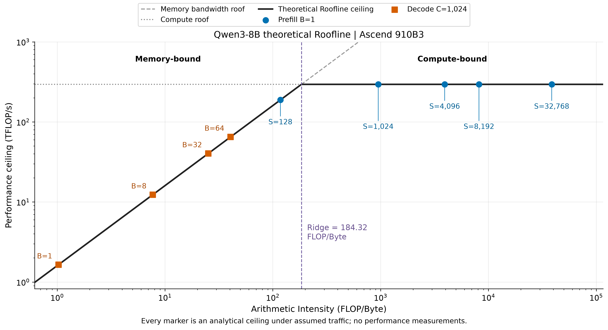
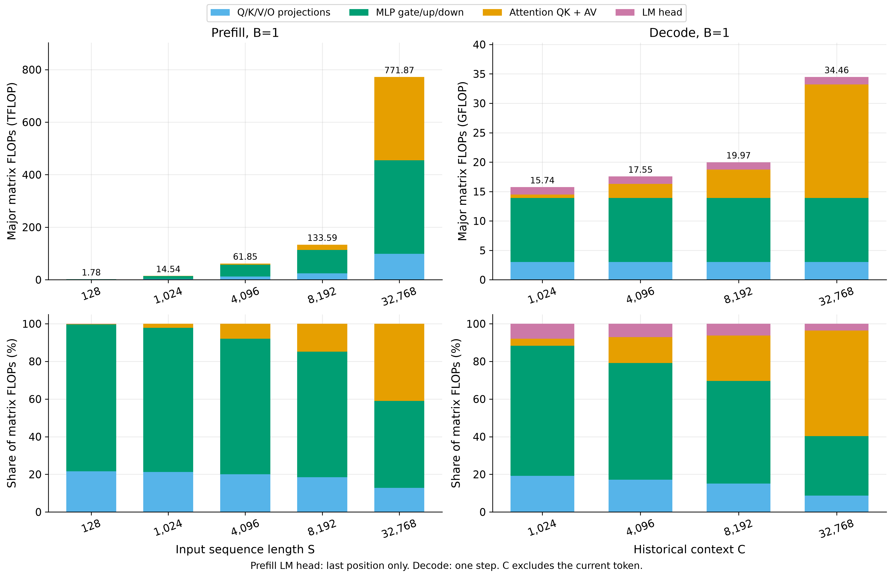
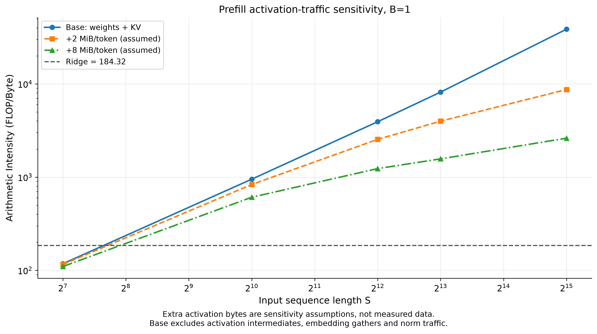
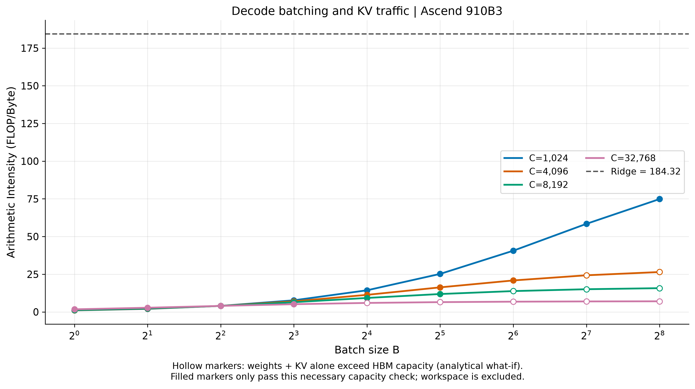
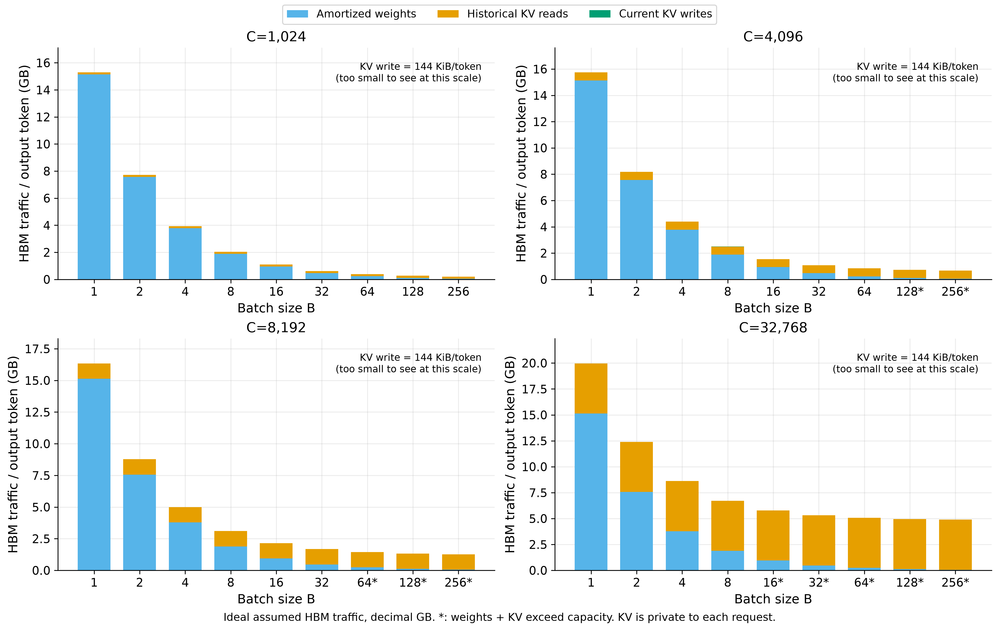

# Qwen3-8B 在 Ascend 910B3 上的理论 Roofline 分析

计算机系统结构课程讨论材料 · 2026-11-17 · 默认 BF16、单卡理论模型

## 摘要

在“每次调用矩阵权重从 HBM 读取一次”的基础流量假设下，Qwen3-8B 的 Prefill 能通过序列内权重复用迅速提高算术强度：S=128 时为 117.73 FLOP/Byte，仍在 910B3 脊点左侧；S=1024 时为 950.84 FLOP/Byte，整体模型转为计算受限。后者主要矩阵计算量为 14.535716 TFLOP，对应理论时间下界约 49.29 ms。

Decode 的情况不同。B=1、历史 C=1024 时，单步为 15.740764 GFLOP，却需要约 15.287337 GB 的假设 HBM 流量，算术强度仅 1.029660 FLOP/Byte，理论性能上限为 1.647457 TFLOP/s。Batching 可以摊销权重，但独立请求的 KV 不能同样共享；长上下文会限制这种收益，还可能先耗尽容量。

这些都是**给定 FLOPs 与流量假设下的上限或下界**，没有执行模型、调用 NPU 或采集 Profiling。不能把图中点解释为实际吞吐、实际带宽利用率或实测 MFU。

## 1. 分析目的、Roofline 与硬件口径

Roofline 将计算量 F 与片外数据流量 D 联系起来，帮助判断主要限制来自计算吞吐还是内存带宽。原始模型讨论的是与内存层级相关的 operational intensity；本报告将其具体定义为假设 HBM 流量下的算术强度。[Roofline 原始论文](https://doi.org/10.1145/1498765.1498785)，[Berkeley 作者版本](https://www2.eecs.berkeley.edu/Pubs/TechRpts/2008/EECS-2008-134.html)。

统一使用：

$$
I=F/D,\qquad P_{\mathrm{roof}}=\min(P_{\mathrm{peak}},I BW_{\mathrm{peak}}),
$$

$$
t_{\mathrm{roof}}=\max(F/P_{\mathrm{peak}},D/BW_{\mathrm{peak}}).
$$

F 为 FLOP，D 为 Byte，P 为 FLOP/s，BW 为 Byte/s，t 为秒。FMA（乘加）按 2 FLOPs 计算。图表中的 TFLOP/s、GB、TB/s 均使用十进制：1 TFLOP=10¹² FLOP，1 GB=10⁹ Byte，1 TB=10¹² Byte。容量和敏感性参数另用二进制：1 GiB=2³⁰ Byte，1 MiB=2²⁰ Byte，1 KiB=2¹⁰ Byte；1 TiB=2⁴⁰ Byte，不等于 1 TB。

| 项目 | 本报告采用值 | 来源与性质 |
|---|---:|---|
| 芯片 | Ascend 910B3 | 用户提供的 npu-smi 结果 |
| NPU ID / 工具版本 | 4 / 25.5.0 | 用户提供，脚本不查询设备 |
| HBM 容量 | 64 GiB | 按用户提供的 65536 MB 归一为本任务容量参考 |
| BF16/FP16 矩阵峰值 | 294.912 TFLOP/s | 20 × 1.8 GHz × 8192 FLOP/cycle 的参考推算 |
| HBM 峰值带宽 | 1.6 TB/s = 1600 GB/s | 公开技术资料的参考峰值，非持续带宽测量 |
| 脊点 | 184.32 FLOP/Byte | 294.912 / 1.6 |

华为 Cloud 官方仓库的 [Ascend MFU 方法资料](https://github.com/huaweicloud/huaweicloud-skills/blob/master/skills/ai/modelarts/huawei-cloud-ascend-op-mfu-calculator/references/mfu-calculation-methodology.md) 列出 910B3 约 294.91 TFLOP/s，支持这里的矩阵峰值口径；它是工具参考表，并非本服务器的实测结果。

为什么另有约 313 TFLOP/s？[CSET 的原始分析与附录](https://cset.georgetown.edu/publication/pushing-the-limits-huaweis-ai-chip-tests-u-s-export-controls/) 区分了矩阵与向量吞吐的统计变化，并按 8704 ops/cycle/core 推算综合性能：20 × 1.8 × 8704 / 1000 = 313.344 TFLOP/s。它还指出 910B3 的 1.8 GHz 是为解决公开资料矛盾所作的修正推断。因此，294.912 与约 313 的区别主要是运算单元统计口径；本报告不将综合吞吐当成纯矩阵峰值，也不把参考频率当成本机测量值。

同一 CSET 附注支持 910B3 的 1600 GB/s 带宽参考，其容量表写作“64 GB”。本任务的容量判断单独采用用户指定的 **64 GiB**，不将两个单位视为严格相等。[CSET 带宽与容量说明](https://cset.georgetown.edu/publication/pushing-the-limits-huaweis-ai-chip-tests-u-s-export-controls/)。

## 2. 模型结构与完整参数统计

分析对象是原始 **Qwen/Qwen3-8B**。官方配置为 L=36 层、隐藏维度 d=4096、MLP 中间维度 d_ff=12288、Query heads H_q=32、KV heads H_kv=8、head_dim d_h=128、词表 V=151936，BF16，输入 Embedding 与 LM Head 不共享权重。配置未启用 sliding window；默认示例最大长度 32768 小于配置中的 max_position_embeddings=40960。[官方 config.json](https://huggingface.co/Qwen/Qwen3-8B/blob/main/config.json)。

GQA 让 4 个 Query heads 共享一组 KV，减少 K/V 投影参数与 KV Cache 容量，但仍有 32 个 Query heads 产生注意力结果。门控 MLP 的主计算为 `down(SiLU(gate(x)) * up(x))`。Qwen3 还包含 Q/K 的逐 head RMSNorm、每层两个 hidden RMSNorm 和末端 RMSNorm；线性层无 bias。[Transformers v4.51.3 Qwen3 实现](https://github.com/huggingface/transformers/blob/v4.51.3/src/transformers/models/qwen3/modeling_qwen3.py)。

以下每个单层参数量由矩阵输入、输出维度相乘得到：

$$
N_Q=d(H_qd_h),\quad N_K=N_V=d(H_{kv}d_h),\quad N_O=(H_qd_h)d,
$$

$$
N_{\mathrm{MLP}}=3dd_{\mathrm{ff}},\quad
N_{\mathrm{linear}}=L(N_Q+N_K+N_V+N_O+N_{\mathrm{MLP}}),\quad N_{\mathrm{head}}=dV.
$$

| 模块 | 单层参数量 | 全模型参数量 | 全层累计 GFLOP/Token |
|---|---:|---:|---:|
| Q Projection | 16,777,216 | 603,979,776 | 1.207960 |
| K Projection | 4,194,304 | 150,994,944 | 0.301990 |
| V Projection | 4,194,304 | 150,994,944 | 0.301990 |
| O Projection | 16,777,216 | 603,979,776 | 1.207960 |
| MLP Gate | 50,331,648 | 1,811,939,328 | 3.623879 |
| MLP Up | 50,331,648 | 1,811,939,328 | 3.623879 |
| MLP Down | 50,331,648 | 1,811,939,328 | 3.623879 |
| Transformer 主要线性合计 | 192,937,984 | 6,945,767,424 | **13.891535** |
| LM Head | 不适用 | 622,329,856 | **1.244660 / 输出位置** |
| Input Embedding | 不适用 | 622,329,856 | 0 稠密矩阵 FLOPs，执行查表 |

主要线性部分与单位置 LM Head 合计为 **15.136194560 GFLOP**。Embedding 查表只读取所选 token 对应的行，不能将全部 Embedding 参数乘 2 计作每 Token 浮点计算。

参数统计还包括 `(2L+1)d=299008` 个 hidden RMSNorm scale，以及 `2Ld_h=9216` 个 Q/K Norm scale。后者按 head_dim 共享参数，不能再乘 heads。总参数量为 **8,190,735,360**，全部 BF16 参数驻留占 **16.381471 GB = 15.256433 GiB**。这解释了为什么用 `2 × 8.2B` 近似所有 Token 计算会混入 Embedding，并漏掉长度相关 Attention。

## 3. Prefill 与 Decode 的 FLOPs 推导

### 3.1 Prefill：线性部分与因果 Attention

对 B=1、长度 S 的输入，线性部分为 `2N_linear S`。理想因果 Attention 中，第 i 个位置只关注前 i 个位置，共有 `S(S+1)/2` 对有效位置。QKᵀ 与 AV 各执行 `2LH_qd_h × 有效位置对数`，因此：

$$
F_{\mathrm{attn,prefill}}=4LH_qd_h\frac{S(S+1)}{2},
$$

$$
F_{\mathrm{prefill}}=2N_{\mathrm{linear}}S+F_{\mathrm{attn,prefill}}+2N_{\mathrm{head}}.
$$

最后一项默认只为**每条序列最后一个位置**计算完整词表 logits：生成首个后续 Token 只需要这个分布，前面所有位置仍参与 Transformer 和 KV 构建。实际框架可能计算整段 logits，不能默认它一定做了裁剪。官方实现提供 logits_to_keep；其默认值 0 表示所有位置。[Qwen3 实现的 logits 处理](https://github.com/huggingface/transformers/blob/v4.51.3/src/transformers/models/qwen3/modeling_qwen3.py)。

若整个序列都执行 LM Head，公式应改为：

$$
F_{\mathrm{prefill,all}}=2N_{\mathrm{linear}}S+F_{\mathrm{attn,prefill}}+2N_{\mathrm{head}}S.
$$

脚本支持 `--lm-head-mode all`。S=1024 时，主要矩阵 FLOPs 从 **14.535716 TFLOP** 增至 **15.809003 TFLOP**。通用 B 下，三个计算项均乘 B。

### 3.2 Decode：整个 Batch 单步

设 C 为执行当前步骤之前的历史上下文长度，当前 Token 也参与注意力，所以键值长度为 C+1。每条序列都要进行 QK 与 AV：

$$
F_{\mathrm{decode}}=B\left(2N_{\mathrm{linear}}+2N_{\mathrm{head}}+4LH_qd_h(C+1)\right).
$$

这里使用 **Query heads=32**；存储 KV 时才使用 KV heads=8。B=1、C=1024 时，线性与 LM Head 为 15.136195 GFLOP，QK、AV 各为 0.302285 GFLOP，总计 **15.740764 GFLOP/步**。Batch 增大将整个 Batch 的 FLOPs 按 B 放大，不能把它误写成每输出 Token 的 FLOPs。

## 4. 基础 HBM 流量及驻留容量

### 4.1 一次调用只读一次矩阵权重

BF16 每元素 s=2 Byte，基础模型中：

$$
D_{\mathrm{weights}}=s(N_{\mathrm{linear}}+N_{\mathrm{head}})
=15{,}136{,}194{,}560\ {\mathrm{Byte}}
=15.136195\ {\mathrm{GB}}=14.096680\ {\mathrm{GiB}}.
$$

一次 Prefill 或一个 Decode Batch 步骤读取上述权重一次，不随该次调用的 B 或 S 重复读取。这是理想权重复用假设；实际分块、缓存与调度可能造成不同流量。基础流量不含 Embedding 行读取、norm scale、logits 写回及激活中间张量，不是所有 HBM 事务的精确求和。

### 4.2 KV Cache

每 Token 的缓存包含所有层的 K 与 V：

$$
D_{\mathrm{KV/token}}=2LH_{kv}d_hs
=2\times36\times8\times128\times2
=147456\ {\mathrm{Byte}}=144\ {\mathrm{KiB}}.
$$

基础 Prefill 只计 KV 写入：

$$
D_{\mathrm{prefill}}=D_{\mathrm{weights}}+BS D_{\mathrm{KV/token}}.
$$

这进一步理想化了 Attention 的片上数据复用，没有显式计入 Prefill Attention 的分块重读或分数矩阵写回。基础 Decode 读取 C 个历史位置的缓存并写入当前缓存：

$$
D_{\mathrm{decode}}=D_{\mathrm{weights}}+BCD_{\mathrm{KV/token}}+BD_{\mathrm{KV/token}}.
$$

当前 K/V 假设可直接供当前 Attention 使用，不额外计一次 HBM 回读。Cache 采用 BF16，未考虑量化、分页碎片、共享前缀与多卡通信。

### 4.3 Activation Traffic 敏感性与容量的区别

可选扩展为：

$$
D_{\mathrm{prefill,extended}}=D_{\mathrm{prefill}}+BS D_{\mathrm{extra/token}}.
$$

取 0、2 MiB/Token、8 MiB/Token，是对**整个模型每个输入 Token 的额外累计流量**作敏感性分析，不是每层流量，更不是测量值。FlashAttention 的 IO-aware tiling 可以减少 HBM 与片上 SRAM 之间的访问，融合算子也可能避免中间张量完整落地；不同内核的实际流量仍会不同。[FlashAttention 原始论文](https://arxiv.org/abs/2205.14135)。

流量是调用期间累计搬运的 Byte；容量是同时驻留的 Byte，两者不能互换。脚本额外检查：

$$
M_{\mathrm{resident,lower}}=sN_{\mathrm{total}}+BD_{\mathrm{KV/token}}(C+1)
$$

（Prefill 用 BS 替代 B(C+1)）。这仅是权重与最终 KV 的容量下限，尚未加入激活、工作区、框架预留。64 GiB 下，C=1024、4096、8192、32768 的 Batch 容量必要上界分别为 **346、86、43、10**。超出者不能据此声称单卡可运行；未超出也不是可部署保证。

## 5. 逐模块算术强度：单独的操作数模型

为进一步展示“哪个算子可能受限”，`results/module_roofline_results.csv` 给出各场景每个模块的 FLOPs、估计流量、AI、Roofline 上限与时间下界。此处采用**与基础总流量分开的未融合模型**：对每个 GEMM，权重与输入各读一次，输出写一次，所有存储按 BF16。

单层 `X[m,k] W[k,n]` 的公式为：

$$
F=2mkn,\qquad D_{\mathrm{local}}=s(mk+kn+mn).
$$

Transformer 中 m=BS（Prefill）或 B（Decode），D 和 F 乘 L；LM Head 没有 L，并按 last/all 决定 m。Embedding 只计所选行读取和输出写入 `2smd`，其矩阵 AI 和矩阵性能上限不适用，在 CSV 留空。

Attention 额外假设有效分数张量被物化。Prefill 的单个 QK 或 AV 模块：

$$
D_{\mathrm{local,attn}}=sBL\left[S(H_q+H_{kv})d_h+H_q\frac{S(S+1)}{2}\right].
$$

Decode 的单个 QK 或 AV 模块：

$$
D_{\mathrm{local,attn}}=sBL\left[H_qd_h+(C+1)H_{kv}d_h+H_q(C+1)\right].
$$

该模型仍假设 GQA 共享 K/V 读取可理想复用，只物化有效因果分数，未计 Softmax 自身流量，不能代表具体未融合内核的全部事务。实际分数和 logits 也可能以 FP32 保存；融合 Attention 通常能移除分数张量的这些 HBM 事务。

以下为 **B=1、Prefill S=1024 / Decode C=1024**。D 采用十进制 GB；P 是 TFLOP/s 的理论上限；全部 Transformer 层累计。相同数值的模块合并展示，每一行“各”指每个模块分别取此值。

| 模块 | Prefill D (GB) | Prefill AI | Prefill P | Decode D (GB) | Decode AI | Decode P |
|---|---:|---:|---:|---:|---:|---:|
| Q / O，各 | 1.811939 | 682.667 | 294.912 | 1.208549 | 0.999512 | 1.599 |
| K / V，各 | 0.679477 | 455.111 | 294.912 | 0.302359 | 0.998781 | 1.598 |
| Gate / Up / Down，各 | 4.831838 | 768.000 | 294.912 | 3.625058 | 0.999675 | 1.599 |
| QK / AV，各 | 1.586627 | 97.546 | 156.074 | 0.078228 | 3.864 | 6.183 |
| LM Head | 1.244972 | 0.999749 | 1.600 | 1.244972 | 0.999749 | 1.600 |

这说明即使整体 Prefill 位于脊点右侧，最后位置 LM Head 仍是接近矩阵向量乘的低 AI 算子。**局部表的流量不能再加到基础流量，也不要求与基础模型求和一致**：局部表显式物化了基础模型省略的中间数据。五张主图始终使用第 4 节的基础/敏感性流量口径。

## 6. Prefill 的理论性能与计算组成

### 图 1：Roofline 上的理论场景

[SVG 矢量版](../../figures/01_roofline.svg)。蓝色圆点为 Prefill，橙色方点为 C=1024 的 Decode。所有点都按 `min(294.912,1.6I)` 放在理论边界上，未编码任何测量数据。脊点左侧为带宽受限，右侧为计算受限；这只是在所选整体模型中的分类。

| S（B=1） | 总计算 (TFLOP) | 基础流量 (GB) | AI (FLOP/Byte) | 上限 (TFLOP/s) | 时间下界 (ms) |
|---:|---:|---:|---:|---:|---:|
| 128 | 1.784231 | 15.155069 | 117.732 | 188.371 | 9.472 |
| 1024 | 14.535716 | 15.287190 | 950.843 | 294.912 | 49.288 |
| 4096 | 61.849982 | 15.740174 | 3929.434 | 294.912 | 209.724 |
| 8192 | 133.594323 | 16.344154 | 8173.829 | 294.912 | 452.997 |
| 32768 | 771.868071 | 19.968033 | 38655.189 | 294.912 | 2617.283 |

序列内大量 Token 复用同一组权重，线性计算随 S 增长，权重流量保持一次，所以 AI 提升。Attention 为二次增长；长序列下时间下界显著增大，不能把“高 AI”理解为“绝对延迟更短”。

### 图 2：计算组成

[SVG 矢量版](../../figures/02_compute_mix.svg)。上排显示总计算，Prefill 用 TFLOP，Decode 用 GFLOP，避免混用量级；下排显示组成比例，让短序列的小柱也能被比较。默认 Prefill 每条序列仅一次 LM Head，Decode 是 B=1 单步。

MLP 贡献约 10.871636 GFLOP/Token，投影为 3.019899 GFLOP/Token。Prefill S=1024 时 Attention 只占主要矩阵计算的约 2.13%，S=32768 时升至约 41.03%。Decode 的投影、MLP、LM Head 每 Token 不随 C 增长，Attention 随 C+1 线性增长。

### 图 5：Prefill 对额外激活流量的敏感性

[SVG 矢量版](../../figures/05_prefill_sensitivity.svg)。0、2、8 MiB/Token 三条曲线都使用相同 FLOPs，只改变分母。**2/8 MiB 是人为敏感性参数，不是实验数据**。

S=1024 时三种 AI 分别为 950.843、833.725、608.772；S=32768 时分别为 38655.189、8703.233、2617.869。默认这些长序列仍在脊点右侧，但 AI 的数量级已明显改变。不能因性能屋顶暂时仍为 294.912 就认为激活流量在实际内核中没有代价。

## 7. Decode：Batching、上下文与流量

### 图 3：Decode 算术强度随 Batch 变化

[SVG 矢量版](../../figures/03_decode_batch_ai.svg)。横轴为对数 Batch，虚线为 184.32 FLOP/Byte 的脊点。空心点表示权重加 KV 已超过容量，曲线仍保留作理论外推；实心点只是通过容量必要条件。

将整个 Batch 的计算与流量同时除以 B，可以直接看出 Batch 的作用：

$$
I(B,C)=\frac{2N_{\mathrm{linear}}+2N_{\mathrm{head}}+4LH_qd_h(C+1)}
{D_{\mathrm{weights}}/B+D_{\mathrm{KV/token}}(C+1)}.
$$

权重占主要流量时，分母随 B 增大而下降，AI 接近按 B 增长。B 很大时，每个输出 Token 的 KV 流量不会消失，AI 趋于有限值。C=1024、4096、8192、32768 时，忽略容量的 B→∞ 极限分别约为 **104.15、29.05、16.53、7.13 FLOP/Byte**，均低于 910B3 脊点。因此，对这四种 C，在此基础模型下单纯无限增加 B 也不会进入整体计算受限区。

长上下文时曲线更早变平。不过，小 B 下更长 C 也增加 Attention FLOPs，AI 不保证一开始就更低；图中曲线交叉来自这一点，不能只看 KV 分母而忽略分子。

| C | B | 整个 Batch 计算 (GFLOP) | 基础流量 (GB) | AI | 上限 (TFLOP/s) | 单步时间下界 (ms) |
|---:|---:|---:|---:|---:|---:|---:|
| 1024 | 1 | 15.741 | 15.287 | 1.030 | 1.647 | 9.555 |
| 1024 | 8 | 125.926 | 16.345 | 7.704 | 12.327 | 10.216 |
| 1024 | 32 | 503.704 | 19.973 | 25.220 | 40.351 | 12.483 |
| 1024 | 64 | 1007.409 | 24.809 | 40.606 | 64.970 | 15.506 |
| 1024 | 256 | 4029.636 | 53.829 | 74.860 | 119.777 | 33.643 |
| 32768 | 1 | 34.464 | 19.968 | 1.726 | 2.762 | 12.480 |
| 32768 | 8 | 275.713 | 53.792 | 5.126 | 8.201 | 33.620 |

Batching 提升的是权重复用与潜在总吞吐，不保证每条请求的步骤延迟更低。上表中的时间对应整个 Batch 的同一 Decode 步，不是把该时间除 B 后当作单请求延迟。

### 图 4：每个输出 Token 的 HBM 流量

[SVG 矢量版](../../figures/04_decode_traffic.svg)。四个子图分别对应不同 C，纵轴都是十进制 GB/输出 Token。蓝色权重项按 B 摊销；橙色历史 KV 读取不随 B 摊销；绿色当前 KV 写入恒为 144 KiB/输出 Token，在 GB 量级下很薄，图中标出精确值。带星号的 Batch 超过容量必要上界。

$$
\frac{D_{\mathrm{decode}}}{B}=\frac{D_{\mathrm{weights}}}{B}+C D_{\mathrm{KV/token}}+D_{\mathrm{KV/token}}.
$$

C=1024 时，每 Token 总流量从 B=1 的 **15.287337 GB** 降至 B=64 的 **0.387645 GB**；其中历史 KV 固定为 0.150995 GB。C=32768 时，历史 KV 已达 **4.831838 GB/Token**，即使 B=8，整体仍为 6.724010 GB/Token。独立请求的 KV 属于不同序列，通常不能像共享模型权重那样跨请求直接复用；共享前缀是需要另建模型的特殊情况。

## 8. 非矩阵操作不能直接等同于零开销

本报告采用两层计算口径：基础层精确计算主要矩阵 FLOPs；扩展层描述非矩阵操作的规模及执行特征，不编造特殊函数的精确 FLOPs。

| 操作 | 规模与执行特点 | 可能影响 |
|---|---|---|
| Hidden RMSNorm | 约 O(LBSd)，Decode 将 S 换成 1；含平方、归约、倒平方根、缩放 | 归约与访存，融合及向量吞吐影响延迟 |
| QK Norm | 约 O(LBS(H_q+H_kv)d_h)，确实存在于 Qwen3 | 参数少，但处理全部 Q/K 元素 |
| RoPE | 约 O(LBS(H_q+H_kv)d_h)；旋转涉及乘加与位置因子 | 位置表、类型转换、融合方式影响流量 |
| Softmax | Prefill 约 O(LBH_qS²) 有效元素，Decode 约 O(LBH_q(C+1)) | 指数、归约与除法；特殊函数吞吐不能用 Cube 峰值代替 |
| SiLU 与门控逐元素乘 | 约 O(LBSd_ff) | 包含 sigmoid 等特殊函数，可能与矩阵算子融合 |
| 残差相加 | 每层约两个 hidden 向量加法，O(LBSd) | FLOPs 较少仍可能产生额外读写 |

虽然许多操作比大型 GEMM 的 FLOPs 少，但它们可能由向量单元执行，存在归约、同步、内核启动和转换成本。把这些操作简单加到矩阵 FLOPs，再统一除以 294.912 TFLOP/s，无法得到可信的扩展延迟。更严格的做法需要向量/特殊函数吞吐上界和内核调度信息；本任务不作这种未经验证的精确预测。

## 9. 与原假设硬件相比，结论为何变化

原假设硬件为 100 TFLOP/s、2.0 TB/s，脊点 **50 FLOP/Byte**。910B3 的矩阵峰值为其 2.94912 倍，但带宽只有其 0.8 倍，脊点提高到 184.32，约为原来的 3.6864 倍。同一 F、D 的 AI 与硬件无关，改变的是屋顶、时间下界和受限区域。

| 相同场景 | 假设硬件上限 (TFLOP/s) | 910B3 上限 (TFLOP/s) | 假设硬件时间下界 (ms) | 910B3 时间下界 (ms) |
|---|---:|---:|---:|---:|
| Prefill B=1，S=128 | 100.000 | 188.371 | 17.842 | 9.472 |
| Prefill B=1，S=1024 | 100.000 | 294.912 | 145.357 | 49.288 |
| Decode B=1，C=1024 | 2.059 | 1.647 | 7.644 | 9.555 |

S=128 在原假设中计算受限，在 910B3 模型中带宽受限；S=1024 两者都计算受限，受益于更高矩阵峰值。低 Batch Decode 主要依赖带宽，所以更高算力不能抵消较低带宽，此例的时间下界反而增加 25%。这些是两套参考参数的理论比较，不是两台真实设备的跑分。

## 10. 模型局限与未来 Profiling 的连接方式

基础模型对权重及中间数据复用十分理想化，忽略大部分激活流量；因果 Attention 采用理想三角 FLOPs，真实分块内核可能处理部分 masked 区域、做 padding 或重算。局部未融合模型则显式物化中间数据；两种口径必须独立解读。不同精度、量化、Cache 命中与内核布局都可能改变 F 或 D。

全模型使用 `max(ΣF/P,ΣD/BW)` 是乐观的整体资源下界。不同模块按依赖顺序执行，其中某些模块计算受限、另一些带宽受限，逐模块的 `Σmax(F_i/P,D_i/BW)` 往往更大；再加上非矩阵算子、启动、同步及不完美重叠，实际延迟可能进一步增加。因此不能声称“整体落在计算屋顶”等于每个算子都能接近矩阵峰值。逐模块相加也需要统一、无重复的流量口径，不能直接拿第 5 节局部表与第 4 节混算。

HBM 带宽与矩阵峰值都是参考峰值，并非本机可持续值。64 GiB 检查没有覆盖真实内存峰值。全部性能与时间结论只在所声明模型内成立，不能充当实际延迟保证，也没有真实带宽利用率或实测 MFU。

未来如需验证，可在确定的推理框架中固定 BF16、Batch、上下文与 logits 裁剪方式，分别采集 Prefill 和 Decode 的同步计时、算子形状、HBM 读写与设备内存峰值。随后对齐 FMA、causal FLOPs 和时间单位，把本报告中的假设流量替换为对应层级的计数，并为向量算子建立独立分析。只有取得实际时间后才能计算 achieved FLOP/s；MFU 还必须说明分子统计范围与峰值口径。华为 Cloud 工具说明强调了算子时长与 FLOPs 的对应关系，本报告仅将其用作参考，不执行该工具。[MFU 方法说明](https://github.com/huaweicloud/huaweicloud-skills/blob/master/skills/ai/modelarts/huawei-cloud-ascend-op-mfu-calculator/references/mfu-calculation-methodology.md)。

## 11. 复算、验证与参考资料

在项目目录 `qwen3_roofline/` 执行 `python roofline_qwen3.py` 一次生成全部图表、CSV 和配置；执行 `python -m unittest discover -s tests -v` 验证公式。所有表的未舍入值在 `results/`，运行方法与字段说明见 [README](../../README.md)，本次检查记录见 [VALIDATION](../development/VALIDATION.md)。本报告绑定默认参数，CLI 自定义后应以新输出的 JSON/CSV 为准。

| 用户要求核对项 | 脚本结果 | 参考值比较 |
|---|---:|---|
| 脊点 | 184.32 FLOP/Byte | 一致 |
| KV / Token | 144 KiB | 一致 |
| Transformer 主要线性 | 13.891534848 GFLOP/Token | ≈13.892 |
| 单位置 LM Head | 1.244659712 GFLOP | ≈1.245 |
| Prefill B=1，S=1024 | 14.535715979264 TFLOP | ≈14.536 |
| Decode B=1，C=1024 | 15.740764160 GFLOP | ≈15.741 |
| 同一 Decode 的 AI | 1.029660313 FLOP/Byte | ≈1.03 |
| Roofline 双上界 | 不超过 peak 与 BW×AI | 全测试网格满足 |

所有参考值差异仅来自四舍五入。自动测试使用容差比较，并检查 GQA、C+1、Batch 摊销、logits all 模式、容量与流量分离、Embedding 查表、局部算子模型和无效输入。

参考资料（核实日期 2026-11-17）：

1. Qwen 团队，[Qwen3-8B 官方配置](https://huggingface.co/Qwen/Qwen3-8B/blob/main/config.json)：模型结构与 BF16。配置常量已写入脚本，离线运行不请求网页。
2. Hugging Face，[Transformers v4.51.3 的 Qwen3 实现](https://github.com/huggingface/transformers/blob/v4.51.3/src/transformers/models/qwen3/modeling_qwen3.py)：QK Norm、MLP、无 bias 线性层及 logits 选择；这里只读取源码，不安装或运行 Transformers。
3. Williams, Waterman, Patterson，2009，[Roofline: An Insightful Visual Performance Model for Multicore Architectures](https://doi.org/10.1145/1498765.1498785)，CACM 52(4):65–76；[Berkeley 技术报告](https://www2.eecs.berkeley.edu/Pubs/TechRpts/2008/EECS-2008-134.html) 可公开访问，DOI 页面在本次访问中返回 403。
4. Feldgoise & Dohmen，CSET，2024-06-17，[Pushing the Limits: Huawei’s AI Chip Tests U.S. Export Controls](https://cset.georgetown.edu/publication/pushing-the-limits-huaweis-ai-chip-tests-u-s-export-controls/)：第三方对技术资料的分析，重点参看附录第二张表、脚注 8、10、15；不是本机参数证明。
5. Huawei Cloud，[huaweicloud-skills 的 MFU calculation methodology](https://github.com/huaweicloud/huaweicloud-skills/blob/master/skills/ai/modelarts/huawei-cloud-ascend-op-mfu-calculator/references/mfu-calculation-methodology.md)：官方维护工具中的参考峰值表和 GEMM/Attention FLOPs 方法；不表示已测量本模型 MFU。
6. Dao 等，2022，[FlashAttention: Fast and Memory-Efficient Exact Attention with IO-Awareness](https://arxiv.org/abs/2205.14135)：分块与 HBM 访问减少的原始研究，不据此假定 910B3 某内核的实际性能。

除上述公开配置和参考规格外，“权重每次读一次”、理想因果有效计算、BF16 KV、最后位置 logits、额外 2/8 MiB 流量以及局部操作数模型均为本报告明确选择的分析假设。
