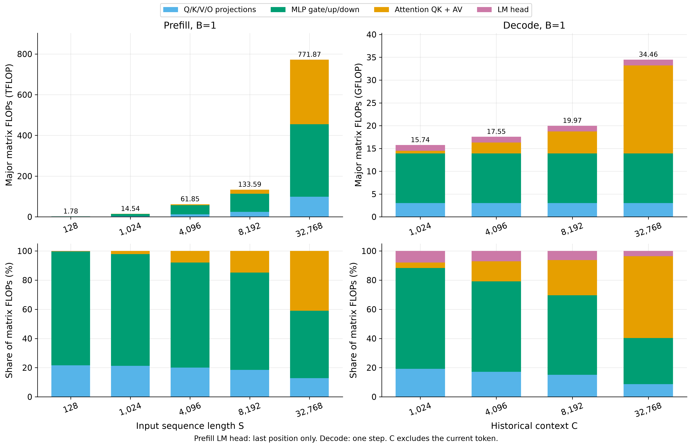
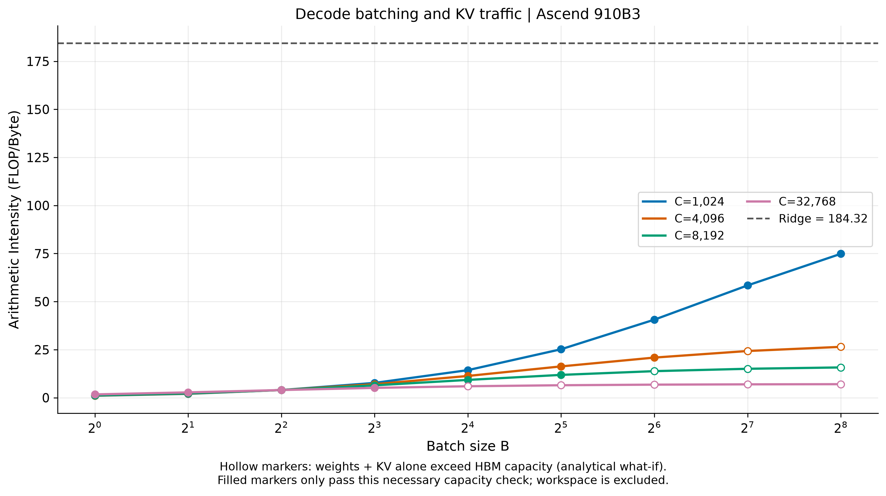
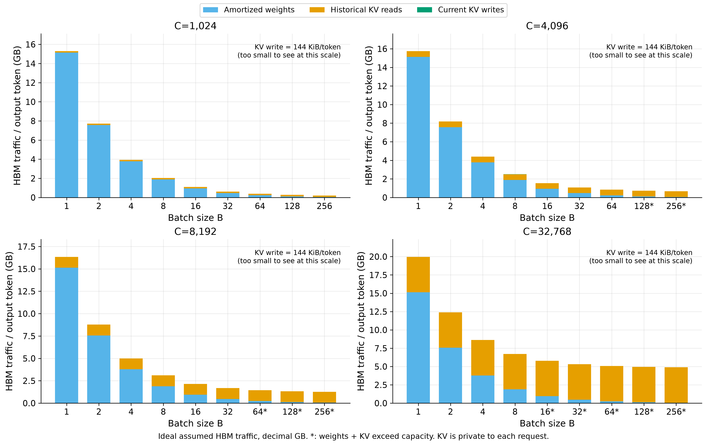
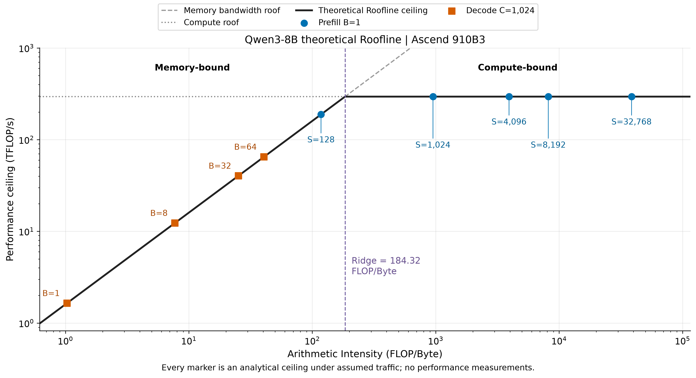

# Qwen3-8B 在 Ascend 910B3 上的理论 Roofline 分析

## 1. Roofline & Hardware Config

### 1.1 Roofline

$$
I=F/D,\qquad P_{\mathrm{roof}}=\min(P_{\mathrm{peak}},I BW_{\mathrm{peak}}),
$$

$$
t_{\mathrm{roof}}=\max(F/P_{\mathrm{peak}},D/BW_{\mathrm{peak}}).
$$

F: FLOP, D: Byte, P: FLOP/s, BW: Byte/s, t: s

FMA（乘加）按 2 FLOPs 计算。图表中的 TFLOP/s、GB、TB/s 均使用十进制：1 TFLOP=10¹² FLOP，1 GB=10⁹ Byte，1 TB=10¹² Byte。
容量和敏感性参数另用二进制：1 GiB=2³⁰ Byte，1 MiB=2²⁰ Byte，1 KiB=2¹⁰ Byte

### 1.2 Hardware

| 项目 | 本报告采用值 | 来源与性质 |
|---|---:|---|
| 芯片 | Ascend 910B3 | 用户提供的 npu-smi 结果 |
| NPU ID / 工具版本 | 4 / 25.5.0 | 用户提供，脚本不查询设备 |
| HBM 容量 | 64 GiB | 按用户提供的 65536 MB 归一为本任务容量参考 |
| BF16/FP16 矩阵峰值 | 294.912 TFLOP/s | 20 × 1.8 GHz × 8192 FLOP/cycle 的参考推算 |
| HBM 峰值带宽 | 1.6 TB/s = 1600 GB/s | 公开技术资料的参考峰值，非持续带宽测量 |
| 脊点 | 184.32 FLOP/Byte | 294.912 / 1.6 |

## 2. Model Configuration

分析对象是原始 **Qwen/Qwen3-8B**，以下数据根据官方配置文档得出。[官方 config.json](https://huggingface.co/Qwen/Qwen3-8B/blob/main/config.json)

$$
N_Q=d(H_qd_h),\quad N_K=N_V=d(H_{kv}d_h),\quad N_O=(H_qd_h)d,
$$

$$
N_{\mathrm{MLP}}=3dd_{\mathrm{ff}},\quad
N_{\mathrm{linear}}=L(N_Q+N_K+N_V+N_O+N_{\mathrm{MLP}}),\quad N_{\mathrm{head}}=dV.
$$

| 模块 | 单层参数量 | 全模型参数量 | 全层累计 GFLOP/Token |
|---|---:|---:|---:|
| Q Projection | 16,777,216 | 603,979,776 | 1.207960 |
| K Projection | 4,194,304 | 150,994,944 | 0.301990 |
| V Projection | 4,194,304 | 150,994,944 | 0.301990 |
| O Projection | 16,777,216 | 603,979,776 | 1.207960 |
| MLP Gate | 50,331,648 | 1,811,939,328 | 3.623879 |
| MLP Up | 50,331,648 | 1,811,939,328 | 3.623879 |
| MLP Down | 50,331,648 | 1,811,939,328 | 3.623879 |
| Transformer 主要线性合计 | 192,937,984 | 6,945,767,424 | **13.891535** |
| LM Head | 不适用 | 622,329,856 | **1.244660 / 输出位置** |
| Input Embedding | 不适用 | 622,329,856 | 0 稠密矩阵 FLOPs，执行查表 |

主要线性部分与单位置 LM Head 合计为 **15.136194560 GFLOP**。总参数量为 **8,190,735,360**，全部 BF16 参数驻留占 **16.381471 GB = 15.256433 GiB**。

## 3. Prefill 与 Decode 的 FLOPs 推导

### 3.1 Prefill：线性部分与因果 Attention

对 B=1、长度 S 的输入，线性部分为 `2N_linear S`。理想因果 Attention 中，第 i 个位置只关注前 i 个位置，共有 `S(S+1)/2` 对有效位置。QKᵀ 与 AV 各执行 `2LH_qd_h × 有效位置对数`，因此：

$$
F_{\mathrm{attn,prefill}}=4LH_qd_h\frac{S(S+1)}{2},
$$

$$
F_{\mathrm{prefill}}=2N_{\mathrm{linear}}S+F_{\mathrm{attn,prefill}}+2N_{\mathrm{head}}.
$$

### 3.2 Decode：整个 Batch 单步

设 C 为执行当前步骤之前的历史上下文长度，当前 Token 也参与注意力，所以键值长度为 C+1。每条序列都要进行 QK 与 AV：

$$
F_{\mathrm{decode}}=B\left(2N_{\mathrm{linear}}+2N_{\mathrm{head}}+4LH_qd_h(C+1)\right).
$$

这里使用 **Query heads=32**；存储 KV 时才使用 KV heads=8。B=1、C=1024 时，线性与 LM Head 为 15.136195 GFLOP，QK、AV 各为 0.302285 GFLOP，总计 **15.740764 GFLOP/步**。

## 4. 基础 HBM 流量及驻留容量

### 4.1 一次调用只读一次矩阵权重

BF16 每元素 s=2 Byte，基础模型中：

$$
D_{\mathrm{weights}}=s(N_{\mathrm{linear}}+N_{\mathrm{head}})
=15{,}136{,}194{,}560\ {\mathrm{Byte}}
=15.136195\ {\mathrm{GB}}=14.096680\ {\mathrm{GiB}}.
$$

一次 Prefill 或一个 Decode Batch 步骤读取上述权重一次，不随该次调用的 B 或 S 重复读取。

### 4.2 KV Cache

每 Token 的缓存包含所有层的 K 与 V：

$$
D_{\mathrm{KV/token}}=2LH_{kv}d_hs
=2\times36\times8\times128\times2
=147456\ {\mathrm{Byte}}=144\ {\mathrm{KiB}}.
$$

基础 Prefill 只计 KV 写入：

$$
D_{\mathrm{prefill}}=D_{\mathrm{weights}}+BS D_{\mathrm{KV/token}}.
$$

基础 Decode 读取 C 个历史位置的缓存并写入当前缓存：

$$
D_{\mathrm{decode}}=D_{\mathrm{weights}}+BCD_{\mathrm{KV/token}}+BD_{\mathrm{KV/token}}.
$$

## 5. 图示分析

### 5.1 Prefill & Decode 计算组成分析

上排显示总计算，Prefill 用 TFLOP，Decode 用 GFLOP，避免混用量级；下排显示组成比例，让短序列的小柱也能被比较。默认 Prefill 每条序列仅一次 LM Head，Decode 是 B=1 单步。

### 5.2 Batch Size 对 Decode 的影响

横轴为对数 Batch，虚线为 184.32 FLOP/Byte 的脊点。空心点表示权重加 KV 已超过容量，曲线仍保留作理论外推；实心点只是通过容量必要条件。

将整个 Batch 的计算与流量同时除以 B，可以直接看出 Batch 的作用：

$$
I(B,C)=\frac{2N_{\mathrm{linear}}+2N_{\mathrm{head}}+4LH_qd_h(C+1)}
{D_{\mathrm{weights}}/B+D_{\mathrm{KV/token}}(C+1)}.
$$

权重占主要流量时，分母随 B 增大而下降，AI 接近按 B 增长。B 很大时，每个输出 Token 的 KV 流量不会消失，AI 趋于有限值。C=1024、4096、8192、32768 时，忽略容量的 B→∞ 极限分别约为 **104.15、29.05、16.53、7.13 FLOP/Byte**，均低于 910B3 脊点。因此，对这四种 C，在此基础模型下单纯无限增加 B 也不会进入整体计算受限区。

### 5.3 每个输出 Token 的 HBM 流量

[SVG 矢量版](../../figures/04_decode_traffic.svg)。四个子图分别对应不同 C，纵轴都是十进制 GB/输出 Token。蓝色权重项按 B 摊销；橙色历史 KV 读取不随 B 摊销；绿色当前 KV 写入恒为 144 KiB/输出 Token，在 GB 量级下很薄，图中标出精确值。带星号的 Batch 超过容量必要上界。

$$
\frac{D_{\mathrm{decode}}}{B}=\frac{D_{\mathrm{weights}}}{B}+C D_{\mathrm{KV/token}}+D_{\mathrm{KV/token}}.
$$

C=1024 时，每 Token 总流量从 B=1 的 **15.287337 GB** 降至 B=64 的 **0.387645 GB**；其中历史 KV 固定为 0.150995 GB。C=32768 时，历史 KV 已达 **4.831838 GB/Token**，即使 B=8，整体仍为 6.724010 GB/Token。独立请求的 KV 属于不同序列，通常不能像共享模型权重那样跨请求直接复用；共享前缀是需要另建模型的特殊情况。

## 6. Roofline 上的理论场景

蓝色圆点为 Prefill，橙色方点为 C=1024 的 Decode。

| S（B=1） | 总计算 (TFLOP) | 基础流量 (GB) | AI (FLOP/Byte) | 上限 (TFLOP/s) | 时间下界 (ms) |
|---:|---:|---:|---:|---:|---:|
| 128 | 1.784231 | 15.155069 | 117.732 | 188.371 | 9.472 |
| 1024 | 14.535716 | 15.287190 | 950.843 | 294.912 | 49.288 |
| 4096 | 61.849982 | 15.740174 | 3929.434 | 294.912 | 209.724 |
| 8192 | 133.594323 | 16.344154 | 8173.829 | 294.912 | 452.997 |
| 32768 | 771.868071 | 19.968033 | 38655.189 | 294.912 | 2617.283 |

序列内大量 Token 复用同一组权重，线性计算随 S 增长，权重流量保持一次，所以 AI 提升。Attention 为二次增长；长序列下时间下界显著增大，不能把“高 AI”理解为“绝对延迟更短”。
