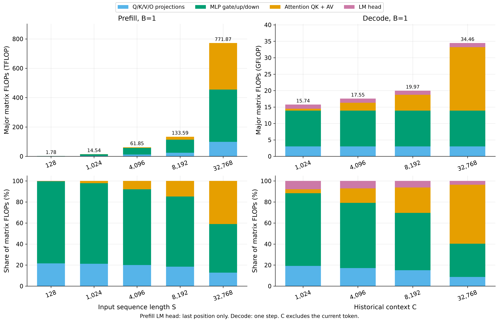
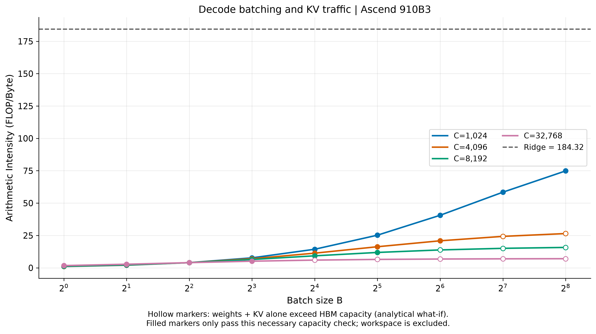
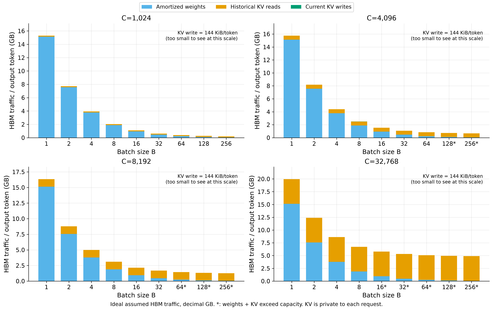
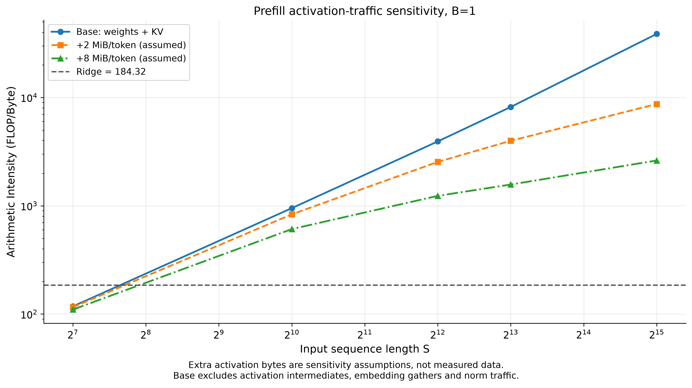
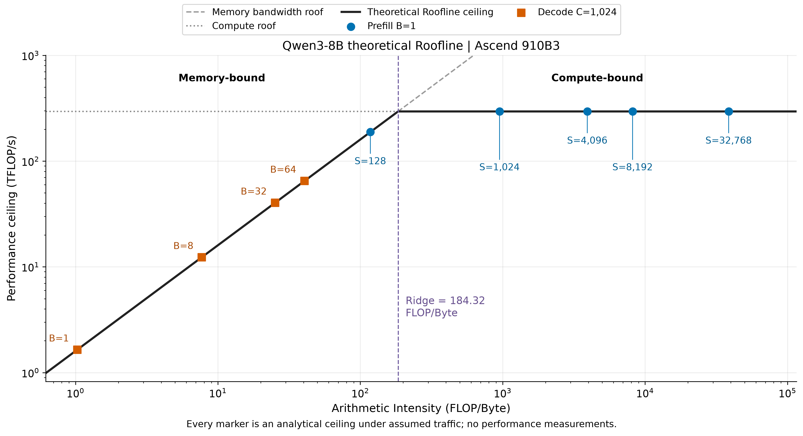

# Qwen3-8B 在 Ascend 910B3 上的理论 Roofline 分析

本文根据模型结构估算 Prefill 与 Decode 的主要矩阵计算量和高带宽内存（HBM）流量，再计算算术强度、性能上限与时间下界。

## 1. Roofline 与硬件配置

### 1.1 Roofline 模型

Roofline 用计算吞吐和内存带宽两个约束，分析一次计算的理论性能上限。本文使用以下符号：

| 符号 | 含义 | 单位 |
|---|---|---|
| `F` | 一次 Prefill 调用或一个 Decode Batch 步骤的主要矩阵计算量 | FLOP |
| `D` | 对应调用或步骤中估算的 HBM 数据流量 | Byte |
| `I` | 算术强度，即每搬运一字节所完成的浮点运算数 | FLOP/Byte |
| `P_peak`、`P_roof` | 硬件矩阵计算峰值、Roofline 性能上限 | FLOP/s |
| `BW_peak` | HBM 峰值带宽 | Byte/s |
| `t_roof` | 给定计算量与流量假设下的时间下界 | s |

算术强度由计算量除以访存量得到：

$$
I=\frac{F}{D}.
$$

一次计算同时受矩阵计算峰值和带宽约束，因此其性能上限取两者的较小值：

$$
P_{\mathrm{roof}}=\min\left(P_{\mathrm{peak}},I\,BW_{\mathrm{peak}}\right).
$$

同理，计算和搬运数据各需要一定时间，整个过程不可能快于其中较慢的一项：

$$
t_{\mathrm{roof}}=\max\left(\frac{F}{P_{\mathrm{peak}}},\frac{D}{BW_{\mathrm{peak}}}\right).
$$

[Roofline 原始论文](https://doi.org/10.1145/1498765.1498785)

### 1.2 Ascend 910B3 参数与单位

| 项目 | 采用值 |
|---|---|
| 芯片 | Ascend 910B3 |
| NPU ID / npu-smi 版本 | 4 / 25.5.0 |
| HBM 容量 | 64 GiB |
| BF16/FP16 矩阵峰值 `P_peak` | 294.912 TFLOP/s |
| HBM 带宽 `BW_peak` | 1.6 TB/s |

[华为 Cloud MFU 资料](https://github.com/huaweicloud/huaweicloud-skills/blob/master/skills/ai/modelarts/huawei-cloud-ascend-op-mfu-calculator/references/mfu-calculation-methodology.md)

记脊点为 `I*`，即计算上限与带宽上限相等时的算术强度：

$$
I^*=\frac{P_{\mathrm{peak}}}{BW_{\mathrm{peak}}}
=\frac{294.912\times10^{12}}{1.6\times10^{12}}
=184.32\ \mathrm{FLOP/Byte}.
$$

`I<I*` 时整体模型受带宽限制；`I>I*` 时受矩阵计算峰值限制。本文按乘加一次计 2 FLOPs；速率和流量使用十进制：1 GFLOP=10⁹ FLOP、1 TFLOP=10¹² FLOP、1 GB=10⁹ Byte、1 TB=10¹² Byte。容量单位使用二进制：1 GiB=2³⁰ Byte、1 MiB=2²⁰ Byte、1 KiB=2¹⁰ Byte。

## 2. Qwen3-8B 模型配置

### 2.1 结构与符号

分析对象是原始 Qwen/Qwen3-8B，[官方配置](https://huggingface.co/Qwen/Qwen3-8B/blob/main/config.json)

| 符号 | 含义 | 数值 |
|---|---|---:|
| `L` | Transformer 层数 | 36 |
| `d` | 隐藏向量维度 | 4096 |
| `d_ff` | 门控 MLP 的中间维度 | 12288 |
| `H_q` | Query heads 数量 | 32 |
| `H_kv` | Key/Value heads 数量 | 8 |
| `d_h` | 每个注意力头的维度 | 128 |
| `V` | 词表大小 | 151936 |
| `s` | 一个 BF16 元素的存储字节数 | 2 Byte |

Q、K、V 分别表示查询、键和值张量，O Projection 将注意力输出映射回隐藏维度。Qwen3-8B 采用分组查询注意力（GQA）：每 4 个 Query heads 共享一组 K/V，但仍有 32 个 Query heads 参与注意力计算。因此，**注意力 FLOPs 使用 `H_q`，KV 存储使用 `H_kv`**。

### 2.2 参数量与每 Token 的线性计算

记单层 Q、K、V、O 投影的权重参数量分别为 `N_Q`、`N_K`、`N_V`、`N_O`。参数量等于矩阵的输入维度与输出维度之积：

$$
N_Q=d(H_qd_h),\qquad N_K=N_V=d(H_{kv}d_h),\qquad N_O=(H_qd_h)d.
$$

门控 MLP 包含 Gate、Up、Down 三个线性层，每个均有 `d × d_ff` 个参数，故单层 MLP 总参数量 `N_MLP` 为三者之和。记全部 Transformer 层的主要线性参数量为 `N_linear`，独立 LM Head 的参数量为 `N_head`，则：

$$
N_{\mathrm{MLP}}=3dd_{\mathrm{ff}},\qquad
N_{\mathrm{linear}}=L\left(N_Q+N_K+N_V+N_O+N_{\mathrm{MLP}}\right).
$$

LM Head 将一个 d 维隐藏向量映射为 V 个词表分数，因此：

$$
N_{\mathrm{head}}=dV.
$$

一个 Token 经过某个线性层时，每个权重参与一次乘加，所以计算量为其参数量的 2 倍。下表中的 Transformer 计算量均已累计全部 36 层。

| 模块 | 单层参数量 | 全模型参数量 | 每 Token / 每位置的计算量（GFLOP） |
|---|---:|---:|---:|
| Q Projection | 16,777,216 | 603,979,776 | 1.207960 |
| K Projection | 4,194,304 | 150,994,944 | 0.301990 |
| V Projection | 4,194,304 | 150,994,944 | 0.301990 |
| O Projection | 16,777,216 | 603,979,776 | 1.207960 |
| MLP Gate | 50,331,648 | 1,811,939,328 | 3.623879 |
| MLP Up | 50,331,648 | 1,811,939,328 | 3.623879 |
| MLP Down | 50,331,648 | 1,811,939,328 | 3.623879 |
| Transformer 主要线性合计 | 192,937,984 | 6,945,767,424 | **13.891535** |
| LM Head | — | 622,329,856 | **1.244660 / 输出位置** |
| Input Embedding | — | 622,329,856 | 查表，不按稠密矩阵计算 |

输入 Embedding 与 LM Head 不共享权重。Embedding 仅查询所需 Token 对应的行，不能将整个 Embedding 矩阵计入每 Token 的乘法。再计入 hidden RMSNorm 的 299,008 个参数和 QK Norm 的 9,216 个参数，模型总参数量 `N_total` 为 **8,190,735,360**，BF16 参数驻留约为 **15.256433 GiB**。

以下 FLOPs 只统计主要矩阵运算。RoPE、RMSNorm、QK Norm、Softmax、SiLU 和残差相加确实存在，但涉及向量运算、归约或特殊函数，本文不为其编造精确 FLOPs，也不将这些运算统一套用 Cube 峰值。[Qwen3 实现](https://github.com/huggingface/transformers/blob/v4.51.3/src/transformers/models/qwen3/modeling_qwen3.py)

## 3. Prefill：从模型结构到图表数据

Prefill 处理输入序列并建立 KV Cache。记 `B` 为同时处理的请求数（Batch Size），`S` 为每条请求的输入 Token 数；本报告的 Prefill 配图均取 **B=1**。

### 3.1 计算量：逐 Token 线性计算与因果注意力

全部 B×S 个 Token 都需要经过 Transformer 线性层，因此线性计算量为 `2BSN_linear`。

注意力包含两次矩阵运算：QKᵀ 计算查询与键的相关分数，AV 根据注意力权重对值向量加权求和，其中 A 表示经过 Softmax 的注意力权重。理想因果注意力中，位置 i 只能关注第 1 到第 i 个位置，故有效位置对共有 `1+2+…+S=S(S+1)/2` 个。QKᵀ 与 AV 对每个位置对、每个 Query head 分别需要 `2d_h` FLOPs，因此两项各为：

$$
F_{\mathrm{QK,prefill}}=F_{\mathrm{AV,prefill}}
=2BLH_qd_h\frac{S(S+1)}{2}.
$$

这里的 `F_QK,prefill`、`F_AV,prefill` 分别表示整个 Prefill 调用的 QKᵀ 和 AV 计算量。它们随 S 近似二次增长，线性层则只随 S 一次增长。

记 Prefill 总主要矩阵计算量为 `F_prefill`。默认每条序列仅对最后一个位置执行 LM Head，故总量为：

$$
F_{\mathrm{prefill}}
=2BSN_{\mathrm{linear}}
+4BLH_qd_h\frac{S(S+1)}{2}
+2BN_{\mathrm{head}}.
$$

三项依次对应 Transformer 线性层、QKᵀ 与 AV、LM Head。最后位置的词表分数足以生成首个后续 Token；前面的所有位置仍需完成 Transformer 计算。如果框架对整段序列计算词表分数，最后一项应改为 `2BSN_head`。

以 **B=1、S=1024** 为例，图 5.1 中 Prefill 柱的分项来自下表。

| 计算组成 | 计算依据 | 计算量（GFLOP） |
|---|---|---:|
| Q/K/V/O Projection | 第 2.2 节投影 FLOPs/Token × 1024 | 3092.376453 |
| MLP Gate/Up/Down | 第 2.2 节 MLP FLOPs/Token × 1024 | 11132.555231 |
| Attention QKᵀ | 代入因果位置对数及 32 个 Query heads | 154.769818 |
| Attention AV | 与 QKᵀ 的主要矩阵 FLOPs 相同 | 154.769818 |
| LM Head | 只计算最后一个位置 | 1.244660 |
| **合计** | 各项相加 | **14535.715979** |

合计即 **14.535716 TFLOP**。图 5.1 将 QKᵀ 和 AV 合为 Attention，将上表的 GFLOP 除以 1000 后画成 Prefill 的 TFLOP 柱；组成比例则由各项除以总量得到。

### 3.2 访存量：一次权重读取与 KV 写入

记 `D_weights` 为一次调用读取矩阵权重的流量。基础模型假设 Transformer 主要线性权重和 LM Head 权重各从 HBM 读取一次：

$$
D_{\mathrm{weights}}=s\left(N_{\mathrm{linear}}+N_{\mathrm{head}}\right)
=15.136195\ \mathrm{GB}.
$$

该流量不随本次调用中的 Token 数重复计数，体现了理想权重复用。记 `D_KV/token` 为一个 Token 在全部层中保存 K 与 V 所需的缓存大小：

$$
D_{\mathrm{KV/token}}=2LH_{kv}d_hs
=147456\ \mathrm{Byte}=144\ \mathrm{KiB}.
$$

系数 2 对应 K、V 两份缓存，其余因素分别对应层数、KV heads、每头维度及每元素字节数。

Prefill 需要为全部 B×S 个输入 Token 写入缓存。记其基础流量为 `D_prefill`，则：

$$
D_{\mathrm{prefill}}=D_{\mathrm{weights}}+BS D_{\mathrm{KV/token}}.
$$

两项分别是权重读取和 KV 写入。B=1、S=1024 时，KV 写入为 0.150995 GB，总流量为 **15.287190 GB**。此基础模型没有单列 Attention 分块重读、Embedding 行读取、logits 写回和激活中间张量，属于理想化流量估计。

### 3.3 算术强度与 Roofline 点

将同一次 Prefill 的计算量与流量相除，就得到图中的横坐标。S=1024 时：

$$
I_{\mathrm{prefill}}=\frac{F_{\mathrm{prefill}}}{D_{\mathrm{prefill}}}
=\frac{14.535715979264\times10^{12}}{15.287189504\times10^9}
=950.842925\ \mathrm{FLOP/Byte}.
$$

这里 `I_prefill` 表示 Prefill 算术强度。它高于脊点 184.32，因此理论性能上限取 294.912 TFLOP/s，时间下界约为 49.288 ms。其他 S 的结果使用完全相同的计算过程，完整场景表见第 6 节。

### 3.4 额外激活流量的敏感性

为了分析基础模型对中间数据流量的敏感程度，记 `e` 为**整个模型每个输入 Token 的额外 HBM 流量**，`D_prefill,ext` 为扩展后的流量：

$$
D_{\mathrm{prefill,ext}}=D_{\mathrm{prefill}}+BS e.
$$

图 5.4 分别取 e=0、2 MiB/Token、8 MiB/Token，保持计算量不变，再计算 `F_prefill / D_prefill,ext`。例如 S=1024 时，三种算术强度依次为 **950.843、833.725、608.772 FLOP/Byte**。

2 MiB、8 MiB 是敏感性假设，不是 Profiling 数据，也不是每层的额外流量。[FlashAttention](https://arxiv.org/abs/2205.14135) 和融合算子可以减少中间张量写回，但具体内核的实际 HBM 流量仍需测量。

## 4. Decode：从单步计算到 Batch 与上下文影响

Decode 每步为每条请求处理一个新 Token。沿用第 3 节的 Batch Size `B`，记 `C` 为**执行当前 Decode 步之前**每条请求已有的历史 Token 数；计入当前 Token 后，注意力长度为 C+1。下面的 F、D 默认对应整个 Batch 的一次步骤。

### 4.1 计算量：固定线性计算与长度相关注意力

每条请求每步只处理一个新 Token，所以 Transformer 线性层和 LM Head 的计算量分别为 `2N_linear` 与 `2N_head`。QKᵀ、AV 各需对 C+1 个位置计算，每项为 `2LH_qd_h(C+1)`。

记整个 Batch 的主要矩阵计算量为 `F_decode`，则：

$$
F_{\mathrm{decode}}
=B\left[2N_{\mathrm{linear}}+2N_{\mathrm{head}}+4LH_qd_h(C+1)\right].
$$

括号内是**每个输出 Token**的计算量，外乘 B 才得到整个 Batch 的单步计算量。注意力仍使用 32 个 Query heads，而非 8 个 KV heads。

以 **B=1、C=1024** 为例，图 5.1 中 Decode 柱的分项如下。

| 计算组成 | 计算依据 | 计算量（GFLOP） |
|---|---|---:|
| Q/K/V/O Projection | 第 2.2 节投影 FLOPs/Token | 3.019899 |
| MLP Gate/Up/Down | 第 2.2 节 MLP FLOPs/Token | 10.871636 |
| Attention QKᵀ | 对每个 Query head 计算 1025 个位置 | 0.302285 |
| Attention AV | 与 QKᵀ 的主要矩阵 FLOPs 相同 | 0.302285 |
| LM Head | 当前 Token 的一个词表分布 | 1.244660 |
| **合计** | 各项相加 | **15.740764** |

固定 B 时，只有 Attention 部分随 C 增长；固定 C 时，整个 Batch 的各项 FLOPs 均随 B 成正比。表中各项由未舍入值求和，因此显示值相加可能有末位差异。

### 4.2 访存量：共享权重与独立 KV

Decode 沿用第 3.2 节的权重流量与每 Token KV 大小。记其基础总流量为 `D_decode`：

$$
D_{\mathrm{decode}}=D_{\mathrm{weights}}
+BC D_{\mathrm{KV/token}}+B D_{\mathrm{KV/token}}.
$$

三项依次对应一次权重读取、B 条请求各自读取 C 个历史位置的 KV、写入 B 个当前 Token 的 KV。当前 K/V 假设可以直接供本步注意力使用，不额外计一次 HBM 回读。

B=1、C=1024 时，三项为 **15.136195、0.150995、0.000147 GB**，总量为 **15.287337 GB**。不同请求共享相同模型权重，但历史 KV 通常属于各自的序列，不能按同样方式跨请求复用。

### 4.3 每输出 Token 的流量与算术强度

一个 Decode Batch 步骤产生 B 个输出 Token。将流量除以 B，可直接得到图 5.3 中堆叠柱的三项：

$$
\frac{D_{\mathrm{decode}}}{B}
=\frac{D_{\mathrm{weights}}}{B}+C D_{\mathrm{KV/token}}+D_{\mathrm{KV/token}}.
$$

只有权重项被 B 摊销；历史 KV 读取随 C 增长，当前 KV 写入恒为 144 KiB/输出 Token。再用每输出 Token 的计算量除以这个流量，可得图 5.2 的算术强度：

$$
I_{\mathrm{decode}}(B,C)
=\frac{2N_{\mathrm{linear}}+2N_{\mathrm{head}}+4LH_qd_h(C+1)}
{D_{\mathrm{weights}}/B+(C+1)D_{\mathrm{KV/token}}}.
$$

`I_decode(B,C)` 表示给定 B、C 时的 Decode 算术强度。此式与“整个 Batch 的 F 除以整个 Batch 的 D”等价，避免混用 Batch 总量和每 Token 平均量。

以 C=1024 为例，第 5.2、5.3 节的相应数据为：

| B | 平均权重读取（GB/Token） | 历史 KV 读取（GB/Token） | 当前 KV 写入（GB/Token） | 总流量（GB/Token） | 算术强度（FLOP/Byte） |
|---:|---:|---:|---:|---:|---:|
| 1 | 15.136195 | 0.150995 | 0.000147 | 15.287337 | 1.029660 |
| 8 | 1.892024 | 0.150995 | 0.000147 | 2.043167 | 7.704102 |
| 32 | 0.473006 | 0.150995 | 0.000147 | 0.624148 | 25.219583 |
| 64 | 0.236503 | 0.150995 | 0.000147 | 0.387645 | 40.606086 |

例如 B=1 时，15.740764 GFLOP 除以 15.287337 GB 得到 1.029660 FLOP/Byte。相应理论性能上限为 **1.647457 TFLOP/s**，整个步骤的时间下界为 **9.555 ms**。

### 4.4 上下文增长为何限制 Batch 收益

当 B 持续增大，平均权重流量趋近于零，但每条请求的 KV 流量仍然存在。因此算术强度趋于有限值：

$$
\lim_{B\to\infty}I_{\mathrm{decode}}(B,C)
=\frac{2N_{\mathrm{linear}}+2N_{\mathrm{head}}+4LH_qd_h(C+1)}
{(C+1)D_{\mathrm{KV/token}}}.
$$

此外，容量是同时驻留的数据量，不能与一次步骤的累计流量混为一谈。记权重加最终 KV 的驻留容量下限为 `M_lower`，则必须满足：

$$
M_{\mathrm{lower}}=sN_{\mathrm{total}}+B(C+1)D_{\mathrm{KV/token}}
\leq64\times2^{30}\ \mathrm{Byte}.
$$

第一项包含全部 BF16 参数，第二项是当前步骤结束后的 KV Cache。该条件尚未计入激活、临时工作区和运行时预留，因此仅是必要条件。

| 历史长度 C | 历史 KV 读取（GB/输出 Token） | B→∞ 时的算术强度（FLOP/Byte） | 仅按权重+KV 算出的 Batch 容量上界 |
|---:|---:|---:|---:|
| 1024 | 0.150995 | 104.15 | 346 |
| 4096 | 0.603980 | 29.05 | 86 |
| 8192 | 1.207960 | 16.53 | 43 |
| 32768 | 4.831838 | 7.13 | 10 |

此表解释图 5.2 中曲线的饱和趋势，以及图 5.2、5.3 的容量超限标记。四种上下文对应的理论极限均低于脊点 184.32，因此在此模型内，仅增加 Batch 不能使它们进入整体计算受限区；容量还会限制实际可选择的 Batch。

## 5. 图示分析

### 5.1 Prefill 与 Decode 的计算组成

[SVG 矢量版](../figures/02_compute_mix.svg)

**数据来源：第 3.1、4.1 节的计算分项。** 上排柱高是各模块 FLOPs，下排是各模块占总 FLOPs 的比例。Prefill 用 TFLOP，Decode 用 GFLOP，两侧都取 B=1；Prefill 的 LM Head 仅计算最后位置。

短输入下，MLP 占主要计算量；随着 S 增大，Prefill Attention 的二次项逐渐显著，其占比由 S=1024 时的 **2.13%** 增至 S=32768 时的 **41.03%**。Decode 的线性部分保持不变，Attention 则随 C+1 增长。

### 5.2 Batch Size 对 Decode 算术强度的影响

[SVG 矢量版](../figures/03_decode_batch_ai.svg)

**数据来源：第 4.3 节的 `I_decode(B,C)`，容量标记来自第 4.4 节。** 对每个固定 C，将 B=1、2、4、8、16、32、64、128、256 依次代入公式，得到一条曲线。水平虚线是硬件脊点；空心点表示权重加 KV 已超过 64 GiB，保留这些点仅作理论外推。

短上下文下，权重摊销能明显提高算术强度；长上下文下，KV 占比增加，曲线更早趋平。小 Batch 时，更长上下文也增加了 Attention 计算，算术强度不一定更低，因此曲线可能交叉。所有曲线仍低于本硬件的脊点。

### 5.3 每个输出 Token 的 HBM 流量

[SVG 矢量版](../figures/04_decode_traffic.svg)

**数据来源：第 4.3 节每输出 Token 流量的三个加项。** 蓝色是 `D_weights/B`，橙色是 `C × D_KV/token`，绿色是 `D_KV/token`。绿色恒为 144 KiB，在 GB 尺度下很薄；星号表示容量必要条件不满足。

例如 C=1024 时，B 从 1 增至 64，平均总流量从 **15.287337 GB** 降为 **0.387645 GB**，原因是权重读取被摊销；历史 KV 仍为 0.150995 GB/Token。C=32768 时，仅历史 KV 就达到 **4.831838 GB/Token**，因而 Batch 增大的收益明显受限。

### 5.4 Prefill 对额外激活流量的敏感性

[SVG 矢量版](../figures/05_prefill_sensitivity.svg)

**数据来源：第 3.4 节的扩展流量，分子仍使用第 3.1 节的 Prefill FLOPs。** 额外流量越大，算术强度越低；2 MiB、8 MiB 均是人为设置的敏感性参数。图中较长序列在三种假设下仍位于脊点上方，只能说明该整体模型仍判为计算受限，不能推断实际内核没有访存代价。

## 6. Roofline 上的理论场景

[SVG 矢量版](../figures/01_roofline.svg)

图中横坐标由第 3、4 节计算的 `I=F/D` 得到，纵坐标由第 1.1 节的 `P_roof` 得到。蓝色圆点是 Prefill，橙色方点是 C=1024 的 Decode。**数据点表示相应算术强度下的理论性能上限，图中没有实测性能点。**

| Prefill 输入长度 S（B=1） | 计算量（TFLOP） | 基础流量（GB） | 算术强度（FLOP/Byte） | 性能上限（TFLOP/s） | 时间下界（ms） |
|---:|---:|---:|---:|---:|---:|
| 128 | 1.784231 | 15.155069 | 117.732 | 188.371 | 9.472 |
| 1024 | 14.535716 | 15.287190 | 950.843 | 294.912 | 49.288 |
| 4096 | 61.849982 | 15.740174 | 3929.434 | 294.912 | 209.724 |
| 8192 | 133.594323 | 16.344154 | 8173.829 | 294.912 | 452.997 |
| 32768 | 771.868071 | 19.968033 | 38655.189 | 294.912 | 2617.283 |

| Decode Batch B（C=1024） | 单步计算量（GFLOP） | 单步总流量（GB） | 算术强度（FLOP/Byte） | 性能上限（TFLOP/s） | 单步时间下界（ms） |
|---:|---:|---:|---:|---:|---:|
| 1 | 15.741 | 15.287 | 1.030 | 1.647 | 9.555 |
| 8 | 125.926 | 16.345 | 7.704 | 12.327 | 10.216 |
| 32 | 503.704 | 19.973 | 25.220 | 40.351 | 12.483 |
| 64 | 1007.409 | 24.809 | 40.606 | 64.970 | 15.506 |

Prefill 通过序列内权重复用提高算术强度，S=128 时仍受带宽限制，S≥1024 的这些场景则受计算峰值限制。高算术强度不代表延迟更短：长输入的总计算量也更大。

Decode 的较小 Batch 受到权重流量限制；Batch 增大后，KV 流量逐步成为主要约束。Batching 提高潜在总吞吐，但不保证单请求延迟降低：表中的时间对应整个 Batch 的同一步骤，不能除以 B 后当作每条请求的步骤延迟。

以上结论依赖理想权重复用、BF16 KV 和简化激活流量。整体 Roofline 下界没有逐项累加串行算子及非矩阵操作的耗时，也没有覆盖真实内存峰值。完整数值见 [Prefill CSV](../results/prefill_results.csv) 与 [Decode CSV](../results/decode_results.csv)；复算方法见 [README](../README.md)。

### 参考资料

1. [Qwen3-8B 官方配置](https://huggingface.co/Qwen/Qwen3-8B/blob/main/config.json)：模型维度、GQA 与权重配置。
2. [Transformers v4.51.3 Qwen3 实现](https://github.com/huggingface/transformers/blob/v4.51.3/src/transformers/models/qwen3/modeling_qwen3.py)：QK Norm、门控 MLP 与 logits 选择。
3. [Roofline 原始论文](https://doi.org/10.1145/1498765.1498785)：性能模型；[Berkeley 作者版本](https://www2.eecs.berkeley.edu/Pubs/TechRpts/2008/EECS-2008-134.html) 可公开访问。
4. [CSET 对 Ascend 910B 系列的分析](https://cset.georgetown.edu/publication/pushing-the-limits-huaweis-ai-chip-tests-u-s-export-controls/)：带宽、综合吞吐口径与频率推算。
5. [Huawei Cloud MFU 方法资料](https://github.com/huaweicloud/huaweicloud-skills/blob/master/skills/ai/modelarts/huawei-cloud-ascend-op-mfu-calculator/references/mfu-calculation-methodology.md)：矩阵峰值参考与 FLOPs 计算方法。
6. [FlashAttention 原始论文](https://arxiv.org/abs/2205.14135)：通过分块减少 Attention 的 HBM 访问。
